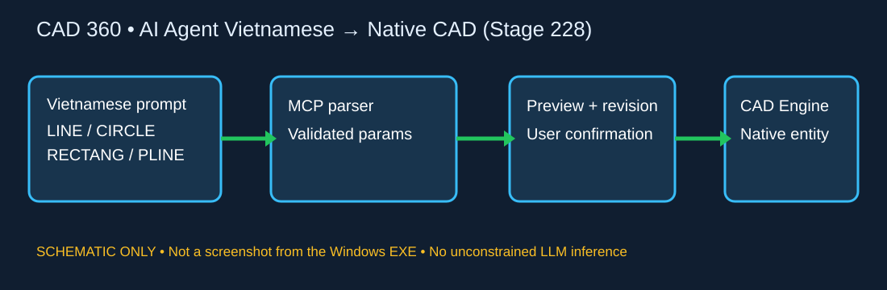
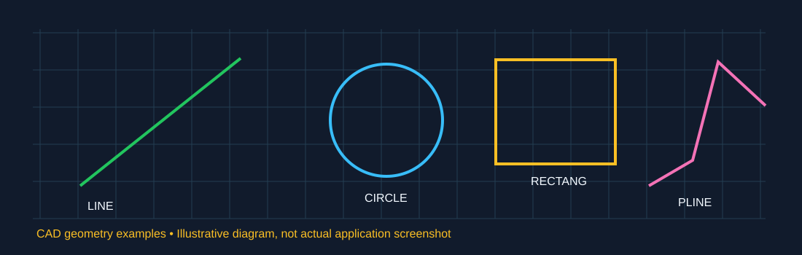
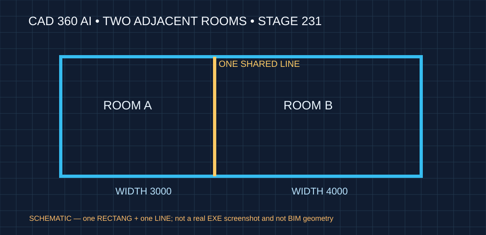
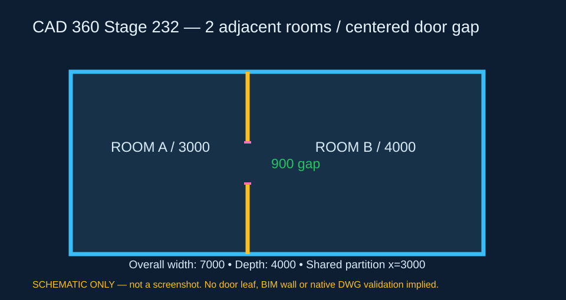

# CAD 360 VIỆT NAM — TBT V1.025
## Giáo trình tổng hợp từ cài đặt đến các tính năng CAD, QTO, BIM và AI — Đợt 178

**Ngày:** 05/11/2026. **Đơn vị:** Công ty CP Công nghệ TBT Việt Nam.  
**Tình trạng:** tài liệu đối chiếu mã nguồn; Windows CI PASS, EXE hiện hành và ảnh chụp giao diện thật vẫn phải kiểm chứng. Không mô tả tính năng thử nghiệm như đã nghiệm thu.

**Tài liệu Word học viên:** Bản phát hành Windows tạo `CADTBT360_V1.025_GIAO_TRINH_TONG_HOP.docx` từ chính Markdown này và cài với tên `GIAO_TRINH_TONG_HOP_CAD360.docx`; bản trao đổi đợt 180 có tên `CADTBT360_V1.025_GiaoTrinh_TOAN_BO_TINH_NANG_Dot180.docx` (32 trang, 21 bài thực hành). Tài liệu AI chỉ là hướng dẫn chuyên đề, không thay thế giáo trình toàn phần mềm.

### 15 chương của giáo trình

| Chương | Các nội dung chính | Bài kiểm tra |
|---|---|---|
| 1. Bắt đầu | Cài Setup/Portable, 5 tab, NEW/OPEN/SAVEAS, lưu file | Tạo DXF và mở lại |
| 2. Môi trường CAD | Tọa độ, mm/m, ZOOM/PAN, chọn window/crossing, OSNAP/ORTHO | Vẽ và đo đoạn 5000 mm |
| 3. Vẽ 2D | LINE/PLINE, RECTANG/POLYGON, CIRCLE/ARC/ELLIPSE, HATCH, SPLINE, XLINE | Mặt bằng hình học |
| 4. Sửa CAD | MOVE/COPY/ROTATE, OFFSET/TRIM/EXTEND, FILLET/CHAMFER, SCALE/MIRROR/ARRAY, UNDO/REDO | So sánh trước/sau |
| 5. Tổ chức hồ sơ | Layer, Block/INSERT/Attributes, Xref, IMAGEATTACH/IMAGECLIP, DXF/DWG | Bản vẽ nhiều lớp |
| 6. Chữ và in | TEXT/MTEXT/STYLE, Dimension/DIMSTYLE, Model/Layout, PDF/PNG/SVG | Bản in A3 |
| 7. QTO cơ bản | Length/Area/Perimeter/Count, vùng chọn, mã công tác, review/confirm, nested Block/Array | Bảng đo có nguồn |
| 8. QTO chuyên sâu | Mặt bằng × mặt cắt, bóc đào/đắp theo cọc, Average End Area | A×H; V=(A1+A2)×L/2 |
| 9. QTO báo cáo | Chọn 12 cột, phân nhóm, đơn vị, Excel XLSX, CSV, truy nguyên handle | Báo cáo Excel in được |
| 10. IFC/3D | Đọc IFC STEP, entity counts, mesh runtime, orbit/wireframe, GlobalId | Mở IFC mẫu |
| 11. BIM cộng tác | Workspace, tầng/bộ môn, Issue/RFI/BCF, clash sơ bộ, ChangeSet, sync mô phỏng, viewport | Tạo issue thử |
| 12. AI ảnh → CAD | PNG/JPEG, hiệu chỉnh tỷ lệ, Preview, LINE chỉnh sửa được, Undo và epoch | PNG → LINE → DXF |
| 13. CLI/MCP | commands/info/convert/run/sample, MCP stdio, Headless vs Remote, Agent tool | CLI chuyển DXF/DWG |
| 14. Phục hồi | Tự lưu CAD+BIM, phục hồi, xử lý lỗi, kiểm tra CI, mã commit | Kiểm tra file backup |
| 15. Dự án tổng hợp | Mặt bằng phòng 6000×4000 mm, Layer, Block, kích thước, QTO, BIM, xuất báo cáo | Bộ hồ sơ thực hành |

### Hướng dẫn bắt đầu từ số không

**Bước 1 — Cài đặt.** Sau khi tải bộ phát hành **đã xác nhận Success**, chạy `CADTBT360.exe`; xem `BUILD_INFO.txt` để đối chiếu `SourceCommit`.
**Bước 2 — Tạo bản vẽ.** Chọn tab **CAD**, dùng **NEW**, xác định đơn vị bản vẽ và vẽ `LINE` từ `0,0` đến `5000,0`. Kiểm tra bằng `DIST`.
**Bước 3 — Lưu và mở lại.** Lưu thành `BT01.dxf`, đóng rồi mở lại. Không ghi đè bản vẽ người dùng.
4. Vào tab **ĐO BÓC** để thử đo chiều dài; chọn đúng phạm vi cửa sổ và quy đổi mm → m.
5. Thực hành tiếp từng chương theo bảng; chỉ xác nhận QTO sau khi kiểm tra nguồn và đơn vị.

### Các ví dụ định lượng không được làm sai

- Phòng 5×4 m có diện tích **20 m²**, cao 3 m → thể tích **60 m³** khi mặt bằng và mặt cắt có cùng hệ quy đổi.
- Đất đào giữa hai cọc cách 20 m, diện tích mặt cắt 8 m² và 12 m² → theo AEA: **200 m³**.
- Một nét ảnh dài 80 pixel với tỷ lệ 10 mm/pixel → chiều dài CAD **xấp xỉ 800 mm** (đo lại trên LINE).
- Nếu bản vẽ dùng mm, không được coi 1 CAD unit là 1 m khi xuất báo cáo.

### Phân biệt chức năng thật với phần đang hoàn thiện

- **Tab PDF / BẢN VẼ:** GUI ghi rõ đây là khu vực đang được tích hợp. Không coi là PDF editor đầy đủ.
- **IFC/3D:** đọc IFC và có thành phần hiển thị; mesh đầy đủ có thể cần **IfcConvert runtime** riêng.
- **BIM cộng tác:** có workspace offline, metadata và Issue; các tính năng đăng nhập/đồng bộ server có thể đang **mô phỏng**.
- **Clash BIM:** nguồn hiện mô tả lọc ứng viên bằng **bounding box 2D**, không được gọi là clash 3D chính thức.
- **AI từ ảnh:** hiện chủ yếu vector hóa nét pixel thành LINE, chưa tự hiểu tường, cửa, cột, kích thước thiết kế.
- **DWG:** phải kiểm chứng đọc/chỉnh sửa/lưu hai chiều bằng AutoCAD độc lập trước khi tuyên bố đạt tương thích.
- **Ảnh hướng dẫn:** chỉ dùng ảnh chụp thật từ GUI Windows đã được kiểm chứng; không thay bằng ảnh dựng rồi ghi như ảnh phần mềm.

### Mẫu kiểm tra một bài học

Ghi **tên bài → phiên bản/commit → file nguồn → bước thao tác → kết quả đo được → ảnh chụp thực tế → lỗi phát sinh → kết luận Đạt/Không đạt/Chưa kiểm chứng**. Bài chưa xác nhận trên EXE vẫn được phép dùng để học cấu trúc lệnh, nhưng không đánh dấu đã nghiệm thu.

### Bàn giao sau mỗi đợt

Lượt phát hành Windows đạt yêu cầu phải có **Full_Source.zip + Setup.exe + Portable.zip + hướng dẫn Word + SHA256SUMS + BUILD_INFO** cùng mã nguồn. File Word tổng hợp sẽ tiếp tục được cập nhật các bài học mới; không chỉ bổ sung riêng chương AI và không tạo nhiều bài lặp lại.

### Nguồn mã đã đối chiếu

- `CADTBT360_V1.000/apps/cadcraft/src/main.rs` — 5 tab và luồng giao diện.
- `CADTBT360_V1.000/crates/ui-egui/src/menus.rs` — menu File/Edit/View/Insert/Format/Tools/Draw/Dimension/Modify/3D/Help.
- `CADTBT360_V1.000/apps/cadcraft/src/takeoff.rs` — QTO live, chọn nguồn, confirm/review, nested.
- `CADTBT360_V1.000/apps/cadcraft/src/takeoff_composite.rs` — diện tích × chiều cao mặt cắt.
- `CADTBT360_V1.000/apps/cadcraft/src/takeoff_road.rs` — khối lượng đào/đắp theo AEA.
- `CADTBT360_V1.000/apps/cadcraft/src/takeoff_report.rs` — báo cáo Excel 12 cột và nhóm.
- `CADTBT360_V1.000/apps/cadcraft/src/model3d.rs` — xem IFC/3D.
- `CADTBT360_V1.000/apps/cadcraft/src/bim_collab.rs` — cộng tác BIM.
- `CADTBT360_V1.000/apps/cadcraft/src/ai_raster_panel.rs` — AI ảnh → LINE.
- `CADTBT360_V1.000/apps/cadcraft-cli/src/main.rs` và `crates/mcp/src/tools.rs` — CLI/MCP.


## 16. Sổ tay thao tác chi tiết theo tính năng (bổ sung đợt 179)

Các bài thực hành sau dùng **bản vẽ thử** và chỉ dẫn bám theo lệnh/giao diện trong mã nguồn V1.025. Giữ bản vẽ gốc độc lập, lưu file mới sau mỗi bài. Đường dẫn menu có thể thay đổi theo cấu hình hiển thị; nếu không thấy bảng lệnh, bật **Window → Command Line** hoặc vào **Help → Command Reference**. Mỗi bài đều có kết quả cần tự kiểm tra.

### Bài 01 — Khởi động, lưu bản vẽ và mở lại (File)

**Mục tiêu:** Tạo dự án đầu tiên mà không ghi đè tệp người dùng.

1. Cài từ **Setup EXE** hoặc giải nén **Portable ZIP** đã qua kiểm thử; chạy `CADTBT360.exe`.
2. Nhìn phiên bản `CADTBT360_V1.025` trên giao diện; đối chiếu `BUILD_INFO.txt` khi có.
3. Chọn **File → New** hoặc gọi `NEW`; giữ Model space. Chọn đơn vị mm cho bài này.
4. Từ Command Line, gọi `LINE`, nhập điểm **0,0** và **5000,0**, kết thúc bằng Enter.
5. Gọi `ZOOM` → `E` nếu chưa nhìn thấy đoạn vừa vẽ.
6. Chọn **File → Save As**, nhập `BT01_CAD_CoBan.dxf` vào thư mục bài tập mới.
7. Đóng/mở lại bằng **File → Open**; chọn nét và dùng lệnh `DIST` để kiểm tra chiều dài **5000 CAD units**.
8. Nếu cần DWG, lưu bản sao `BT01_CAD_CoBan.dwg`. Không coi việc phần mềm tự đọc lại là đủ bằng chứng tương thích AutoCAD.

**Cần đạt:** File DXF tồn tại, mở lại được, chứa LINE chỉnh sửa và kích thước không thay đổi. Nếu phần mềm thiếu nút trên thanh công cụ, dùng cùng lệnh qua Command Line.

### Bài 02 — Tùy chỉnh giao diện và truy cập công cụ (Window / View)

1. Vào **Window → Command Line** để bật lại cửa sổ nhập lệnh khi bị ẩn.
2. Vào **Window → Layers Palette** hoặc **Layer Properties Manager** để mở quản lý Layer.
3. Vào **Window → Properties Inspector** để kiểm tra thông số của LINE đang chọn.
4. Thử **Window → Reset Panel Layout** khi mất bảng; ghi nhận bố cục trở về mặc định.
5. Vào **View → Interface Theme → Light/Dark** nếu muốn thay đổi chế độ sáng/tối.
6. Thử chuyển qua 5 tab: **CAD**, **ĐO BÓC**, **PDF / BẢN VẼ**, **3D / IFC**, **BIM CỘNG TÁC**. Không nhập liệu trên tab PDF vì giao diện nguồn hiện thông báo tính năng đang tích hợp.

**Cần đạt:** Người mới biết chỗ bật Command Line, Layers, Properties và xác định các tab chính; không nhầm tab PDF đang phát triển thành chức năng hoàn chỉnh.

### Bài 03 — Vẽ mặt bằng phòng 6 × 4 m bằng LINE và OFFSET

1. Tạo file `BT03_Phong_6000x4000.dxf`; đặt bản vẽ sử dụng mm.
2. Lệnh `LINE`: lần lượt nhập **0,0 → 6000,0 → 6000,4000 → 0,4000 → 0,0**; kết thúc.
3. Gọi `DIST` trên hai đầu cạnh đáy: kỳ vọng **6000**; cạnh đứng: **4000**.
4. Dùng `OFFSET` nhập **200**, chọn các cạnh bao tường và chọn phía trong phòng. Kiểm tra các đoạn sau OFFSET nằm đúng phía cần thiết.
5. Dùng `TRIM` để xử lý phần thừa tại giao nhau nếu có; không tự cho rằng OFFSET đã tạo bốn góc kín.
6. Vào **Window → Properties Inspector**, chọn từng đoạn; ghi lại chiều dài và tọa độ.
7. Lưu lại rồi đóng/mở. Dùng `UNDO` hoặc `REDO` trên bản nháp để hiểu thao tác hoàn tác trước khi tạo bản chính thức.

**Cần đạt:** Khung ngoài 6000 × 4000 mm, tường offset 200 mm theo phía đã chọn, không có nét rác hoặc trùng đối tượng gây sai đo bóc.

### Bài 04 — Layer theo nhóm công việc và kiểm soát hiện hành

1. Mở **Window → Layers Palette**. Tạo các Layer ví dụ `A-TUONG`, `A-CUA`, `A-KICH_THUOC`, `S-COT`, `M-DIEN`.
2. Chỉnh màu/linetype từng Layer; đặt `A-TUONG` là **Current Layer**.
3. Vẽ một LINE làm tường và kiểm tra Properties thể hiện đúng Layer.
4. Đổi sang `A-CUA`, vẽ đường tượng trưng vị trí cửa; bảo đảm không nằm lẫn trên Layer tường.
5. Tạm **Off/Freeze** Layer `A-CUA` và kiểm tra hình biến mất; bật lại để chắc chắn đối tượng chưa bị xóa.
6. Dùng **Lock** để bảo vệ Layer tường trước khi quét chọn phần khác; bỏ khóa khi chỉnh sửa.
7. Lưu và mở lại để kiểm tra trạng thái Layer và hình học.

**Cần đạt:** Có tối thiểu ba lớp riêng biệt, thao tác ẩn/khóa không làm mất đối tượng. Tránh đưa mọi cấu kiện lên Layer 0.

### Bài 05 — Block và tái sử dụng hình học

1. Trên bản vẽ mẫu, tạo hình tượng trưng cửa bằng LINE/ARC.
2. Dùng lệnh `BLOCK`, đặt tên `CUA_D1`, chọn điểm gốc và các nét thuộc cửa.
3. Dùng `INSERT`, chèn block `CUA_D1` tại hai vị trí khác nhau.
4. Chọn một block, mở Properties để kiểm tra tên/tham chiếu; kiểm tra các đối tượng bên trong không bị nhân đôi sai chủ ý.
5. Thực hành với `EXPLODE` chỉ trên một bản sao block; đối chiếu tác dụng trước/sau và **UNDO** để khôi phục.
6. Chuyển sang **ĐO BÓC**, dùng lựa chọn **Thêm QTO nested từ Block/Array đang chọn** nếu đang cần bóc thành phần lồng nhau.

**Cần đạt:** Có ít nhất hai tham chiếu Block dùng chung định nghĩa. Kiểm tra khác biệt giữa số lượng Insert và số đối tượng con.

### Bài 06 — Xref và ảnh tham chiếu

1. Chuẩn bị hai tệp DXF trong cùng thư mục: `mat-bang.dxf` và `ket-cau.dxf`; tạo một bản vẽ tổng `tong-hop.dxf`.
2. Trong bản vẽ tổng, sử dụng lệnh **XREF** để gắn `ket-cau.dxf` làm tham chiếu; chọn đường dẫn tương đối khi phù hợp.
3. Thử ẩn/xuất hiện tham chiếu; đối chiếu rằng nguồn `ket-cau.dxf` không bị chỉnh khi sửa bản vẽ tổng.
4. Thử mở bản vẽ tổng sau khi đổi tên/thay vị trí file nguồn trên bản **sao** để nhận biết lỗi đường dẫn Xref.
5. Với ảnh tham chiếu, dùng **IMAGEATTACH** chọn PNG/JPG và **IMAGECLIP** để giới hạn vùng nhìn. IMAGEATTACH chỉ gắn ảnh, không chuyển thành LINE.
6. Dùng công cụ AI từ ảnh thành CAD nếu muốn tạo nét chỉnh sửa; **Preview trước** rồi mới tạo LINE và kiểm tra tỷ lệ.

**Cần đạt:** Không nhầm Xref với Block, không nhầm hình ảnh tham chiếu với đối tượng LINE.

### Bài 07 — Ghi chữ, kích thước và kiểm tra tỷ lệ

1. Mở bản vẽ phòng 6000 × 4000; đặt Layer `A-KICH_THUOC` làm hiện hành.
2. Dùng `STYLE` để xem/chọn kiểu chữ; dùng `TEXT` hoặc `MTEXT` để ghi “PHÒNG 01”.
3. Dùng `DIMLINEAR` trên hai đầu cạnh ngang để đo **6000**; dùng `DIMALIGNED` khi cần kích thước theo phương xiên.
4. Dùng `DIMSTYLE` để kiểm tra chiều cao chữ, kích thước mũi tên và đơn vị.
5. Mở Properties trên đối tượng Dimension để kiểm tra nội dung giá trị. Nếu ghi kích thước thủ công không khớp hình học, phải sửa hình hoặc Dim; không dùng chữ ghi đè để che sai số.
6. Thử **PLOT** và xuất PDF ở bản vẽ thử; mở tệp PDF bằng trình đọc ngoài để xem đủ nét và không mất font.

**Cần đạt:** Kích thước hiển thị khớp số đo thực, font đọc được và PDF không bị mất nét.

### Bài 08 — Đo bóc chiều dài và diện tích có nguồn

1. Vào tab **ĐO BÓC**, giữ bản vẽ phòng đang mở ở cột CAD bên trái.
2. Trong giao diện QTO, xem phần **Phạm vi bóc**; quét một vùng cửa sổ trên canvas. Trái → phải là chọn đối tượng nằm trong; phải → trái là chọn đối tượng bị quét cắt qua.
3. Chọn một LINE hợp lệ rồi dùng **Thêm phép đo từ CAD đang chọn**; chọn phép đo **Length**.
4. Đặt **Nhóm công việc**, **Mã công tác**, **Diễn giải** và ghi chú rõ đối tượng nguồn.
5. Đối chiếu đơn vị bản vẽ: nếu LINE dài 6000 mm thì khối lượng dài theo m là **6,000 m**, không phải 6000 m.
6. Dùng trạng thái **Review → Đã xác nhận** sau khi kiểm tra nguồn; chỉ record xác nhận mới được tính vào tổng hợp theo cấu hình báo cáo.
7. Thử xóa/thay hình nguồn trên bản sao để kiểm tra cảnh báo nguồn đo bóc cũ hoặc cần rà soát.

**Cần đạt:** Bảng có mã công tác, trạng thái, đơn vị, khối lượng và nguồn CAD truy xuất được; không chỉ đếm số Entity.

### Bài 09 — Bóc thể tích qua hai vùng mặt bằng và mặt cắt

1. Vào tab **ĐO BÓC**; chuẩn bị mặt bằng có **một đường bao kín** diện tích 20 m² và mặt cắt có **một LINE thẳng đứng** cao 3 m.
2. Nhấn **1. LẤY DIỆN TÍCH MẶT BẰNG**, chọn vùng/đối tượng CAD làm diện tích nguồn.
3. Nhấn **2. LẤY CHIỀU CAO MẶT CẮT**, chọn LINE đứng biểu diễn chiều cao; phần mềm có kiểm tra hướng đứng của LINE, không tự suy từ kích thước chữ.
4. Nhập **Nhóm**, **Mã CT**, **Diễn giải**; xác nhận cả hai nguồn hình học.
5. Đối chiếu công thức **V = A × H = 20 × 3 = 60 m³** sau khi quy đổi đồng nhất từ CAD unit sang đơn vị m.
6. Thử thay đổi chiều cao trên bản thử; kiểm tra rằng bản ghi đã xác nhận phải được rà soát lại nếu nguồn hình học thay đổi.

**Cần đạt:** Bản ghi có **hai nguồn hình học riêng** (mặt bằng + mặt cắt). Không sử dụng phép đếm đối tượng để suy ra m³.

### Bài 10 — Đo bóc đất đào/đắp theo lý trình đường

1. Vào tab **ĐO BÓC**, tìm chức năng bóc giao thông theo **Lý trình**, **Tên cọc**, **Mã đào**, **Mã đắp**.
2. Tạo cọc A ở lý trình **0 m**, diện tích đào **8 m²**, cọc B ở **20 m**, diện tích đào **12 m²**. Chọn đúng các đối tượng vùng mặt cắt đã đo.
3. Chọn **Khoảng cọc cần bóc** từ A đến B, đảm bảo hai lý trình tăng dần và không bị trùng.
4. Kiểm tra thể tích đào theo phương pháp Average End Area: **V = (8+12) × 20 / 2 = 200 m³**.
5. Nếu có diện tích đắp, nhập bộ nguồn khác; không gộp đào và đắp thành một giá trị dương.
6. Xuất bảng theo cọc và kiểm tra số liệu từng khoảng trước khi cộng tổng.

**Cần đạt:** Khối lượng phụ thuộc dữ liệu diện tích mặt cắt và khoảng cách cọc thực, không dựa trên giả định từ bình đồ đơn thuần.

### Bài 11 — Tạo bảng QTO Excel được in trực tiếp

1. Sau khi có ít nhất ba bản ghi đo bóc, chọn chức năng xuất **Excel/XLSX** từ tab **ĐO BÓC**.
2. Nhập **Tên dự án**, **Chủ đầu tư**, **Số hiệu biểu mẫu**; chọn nhóm theo **Nhóm công việc**, **Mã công tác**, **Layer**, **Tầng** hoặc **Bộ môn**.
3. Chọn các cột muốn xuất trong 12 trường hiện có, ví dụ STT, Mã công tác, Nội dung đo bóc, Nhóm, Layer, Tầng, Loại phép đo, Khối lượng, Đơn vị.
4. Cấu hình **Đơn vị chiều dài** và **Số chữ số lẻ** (ví dụ 3); nếu chỉ xuất bản ghi đã xác nhận, bật lọc tương ứng.
5. Xuất XLSX và mở bằng Excel. Kiểm tra tiêu đề, nhóm, tổng cộng, số thập phân, độ rộng cột, ngắt trang và handle nguồn.
6. So sánh số liệu XLSX với bảng QTO trong CAD. Không sửa tay một con số Excel để che chênh lệch chưa giải quyết.

**Cần đạt:** Mở và in XLSX được, cột dữ liệu dễ đọc và tổng hợp đúng trạng thái bản ghi.

### Bài 12 — Xem và phân loại IFC/3D

1. Chuyển tab **3D / IFC**, chọn tệp `.ifc` chuẩn STEP (`ISO-10303-21`).
2. Kiểm tra bảng **Thống kê IFC Entities**; đối chiếu số lượng cấu kiện và tên file.
3. Khi có mesh hiển thị, kéo chuột xoay và cuộn để phóng to; có thể **Đặt lại góc nhìn**.
4. Sử dụng ô lọc **IFC GlobalId**, **Tầng**, **Bộ môn**; ghi lại số phần tử còn lại sau lọc.
5. Thử **Ẩn nhóm đã chọn**, **Cô lập nhóm đã chọn**, **Hiện tất cả** trên dữ liệu mẫu.
6. Nếu IFC chỉ hiển thị danh mục/điểm mà chưa có lưới 3D, kiểm tra yêu cầu **IfcConvert** hoặc tệp OBJ hỗ trợ. Không ghi lỗi “mất cấu kiện” khi chưa có runtime chuyển mesh.

**Cần đạt:** Xem đúng metadata và phạm vi mô hình; ghi rõ khác biệt giữa IFC xem sơ bộ và mesh 3D đầy đủ.

### Bài 13 — BIM cộng tác theo tầng, bộ môn và Issue

1. Chuyển tab **BIM CỘNG TÁC**, nhập **Mã dự án** và **Tên dự án**, chọn **Dùng profile offline** để thực hành.
2. Dùng **+ Thêm tầng** tạo TẦNG 1, TẦNG 2. Gán bộ môn Kiến trúc/Kết cấu cho các đối tượng CAD được chọn.
3. Vào **Project Navigator BIM** để chuyển tầng; kiểm tra bộ lọc không che mất nhầm dữ liệu.
4. Trong mục **Issue phối hợp / Coordination**, tạo Issue thử cho bộ môn Kết cấu; nhập mô tả và người nhận.
5. Xem **LỊCH SỬ THAY ĐỔI ISSUE**; chỉ đóng Issue sau khi có kết quả kiểm tra và xác nhận.
6. Thử **Quét tầng hiện tại** để xem giao cắt sơ bộ: kết quả dựa vào bounding box 2D, **không phải clash 3D chính thức**.
7. Thử **Lưu workspace BIM** rồi mở lại. Nút đồng bộ server hiện có chế độ **mô phỏng**; không coi đó là bằng chứng upload cloud thành công.

**Cần đạt:** Workspace có tầng/bộ môn/Issue và dữ liệu lưu được. Phải phân biệt phối hợp offline, mô phỏng và dịch vụ online thực tế.

### Bài 14 — AI từ ảnh thành LINE và chống ghi nhầm bản vẽ

1. Vào tab **CAD**, nhấn **AI TỪ ẢNH → CAD**.
2. Nhấn **Chọn ảnh PNG/JPG…**, chọn ảnh nét đậm có tỷ lệ đã biết.
3. Thiết lập **Nét tối thiểu** (ví dụ 16 px) và **Đơn vị CAD/pixel** (ví dụ 10 mm/pixel); có thể bật nét 45°.
4. Nhấn **1. Nhận dạng và xem trước**; kiểm tra số nét, hướng và tỷ lệ.
5. Nếu chuyển sang bản vẽ khác rồi quay lại, **Preview cũ phải bị từ chối** theo document UID + revision + epoch. Nhấn Preview lại trước khi ghi.
6. Nhấn **2. Tạo LINE chỉnh sửa trong CAD**, chọn LINE trên canvas và kiểm tra điểm đầu/cuối.
7. Thử UNDO một lần, kiểm tra toàn nhóm AI bị hoàn tác. Làm lại và lưu bản DXF/DWG mới để mở lại.
8. **Không coi chức năng này là AI đọc được tường/cửa/cột** hoặc kích thước ghi chữ; đó vẫn là năng lực chưa hoàn thiện.

**Cần đạt:** Đối tượng LINE thật có thể chỉnh sửa; không ảnh hưởng bản vẽ ngoài phiên Preview.

### Bài 15 — CLI, MCP và quy trình bàn giao phiên bản

1. Mở PowerShell tại thư mục cài đặt, chạy `.\CADTBT360_CLI.exe commands` để xem lệnh.
2. Thử `.\CADTBT360_CLI.exe sample floorplan BT15_floorplan.dxf`, rồi `.\CADTBT360_CLI.exe info BT15_floorplan.dxf`.
3. Chuyển sang DWG: `.\CADTBT360_CLI.exe convert BT15_floorplan.dxf BT15_floorplan.dwg`. Dùng `info` mở lại và kiểm tra số đối tượng.
4. Với MCP, cấu hình client stdio dùng `CADTBT360_CLI.exe` và đối số `mcp`. **Không có --connect** nghĩa là Headless riêng; muốn điều khiển GUI đang mở phải cấu hình kênh Remote hợp lệ.
5. Thử công cụ `raster_to_cad_lines` với `preview:true`, kiểm tra rồi mới `preview:false`.
6. Vào GitHub Actions để kiểm tra workflow đã **Success** rồi tải **Setup + Portable + Full_Source.zip + Word + SHA256SUMS**. Tệp mã nguồn có thể yêu cầu đăng nhập GitHub.
7. Đối chiếu SHA256 và `SourceCommit` với lượt phát hành. Nếu chưa có workflow PASS hoặc EXE chưa được kiểm thử GUI, ghi **Chưa nghiệm thu**, không ghi Đạt.

**Cần đạt:** Học viên nắm quy trình CLI/MCP và biết chứng minh nguồn gốc một bộ cài, không nhầm commit thành bản EXE đã nghiệm thu.

## 17. Phiếu nghiệm thu thực hành toàn phần mềm

Ghi lại kết quả theo từng chương, không chỉ tick “đã xem”:

| Nhóm | Bằng chứng cần có | Đạt khi |
|---|---|---|
| CAD 2D | DXF có LINE, POLYLINE, Layer, Block | Lưu/mở lại, đo đúng |
| Trình bày | Bản in PDF và DIM đo được | Đúng font, kích thước |
| QTO cơ bản | Bảng có handle và khối lượng | Quy đổi đơn vị đúng, có trạng thái |
| QTO mặt cắt | Hai nguồn A và H | V=60 m³ theo mẫu |
| QTO giao thông | Hai diện tích + khoảng cọc | V=200 m³ theo AEA |
| Excel | XLSX có các cột chọn và tổng | Mở/in được, dữ liệu khớp |
| IFC/3D | Metadata IFC và ảnh chụp thật | Bộ lọc tầng/bộ môn đúng |
| BIM | Workspace và Issue mẫu | Lưu/mở lại được |
| AI | PNG→LINE→Undo→DXF | Không ghi nhầm tài liệu |
| MCP | JSON-RPC và CLI output | Phân biệt Headless/Remote |
| Bàn giao | Build, source ZIP, Word, SHA256 | Chỉ ghi Đạt khi CI PASS |

**Chú ý:** Hình chụp giao diện phải lấy từ chương trình Windows thực tế sau khi build và chạy thành công. Không sử dụng hình giả lập thay cho bằng chứng nghiệm thu.


## 18. Mở giáo trình tổng hợp trực tiếp trong CAD 360 — Đợt 179

Sau khi cài **Setup** hoặc giải nén **Portable** từ một Windows Release đã thành công, mở CAD 360 và nhấn nút **HƯỚNG DẪN CAD 360** ở thanh công cụ chính (nút này khác **HƯỚNG DẪN AI** trong tab CAD).

- Với **Setup**, phần mềm mở `HuongDan\GIAO_TRINH_TONG_HOP_CAD360.docx` nằm trong thư mục cài đặt.
- Với **Portable**, phần mềm mở `GIAO_TRINH_TONG_HOP_CAD360.docx` nằm cạnh `CADTBT360.exe`.
- Nếu thiếu file Word, phần mềm hiện thông báo đường dẫn cần kiểm tra, không âm thầm dùng giáo trình AI thay thế.
- Người dùng cần có chương trình mở được định dạng Word DOCX trên máy.
- Tính năng gọi tài liệu sử dụng trình xử lý tệp mặc định của Windows; chưa có kết quả xác nhận GUI Windows thực tế sau khi bổ sung.

CI dùng bài kiểm thử `complete_user_manual_is_found_in_setup_and_portable_paths` để đối chiếu hai đường dẫn tài liệu, ngoài bước kiểm tra file trong bộ cài và Portable ZIP.

**Quy tắc từ đợt 179:** Giáo trình tổng hợp là tài liệu chính bao gồm toàn bộ chương CAD 2D/QTO/IFC/BIM/AI/CLI; hướng dẫn AI chỉ là chuyên đề. Mã nguồn ZIP phải giữ cả hai tài liệu, bản phát hành phải có Word tổng hợp và kiểm tra SHA256.


## 18. Bài tập nâng cao chuyên đề theo tính năng — Đợt 180

Các bài dưới đây tiếp tục từ bài 01–15. Mỗi bài có tình huống riêng và tiêu chí đầu ra; không lặp lại quy trình AI.

### Bài 16 — Bắt điểm chính xác, ORTHO và tọa độ tương đối

1. Mở bản vẽ thực hành mới; bật **OSNAP** và kiểm tra các kiểu bắt điểm Endpoint, Midpoint, Center trong giao diện công cụ.
2. Dùng `LINE` từ `0,0` đến `1000,0`, kết thúc lệnh. Bắt điểm **Endpoint** bên phải để vẽ đoạn nối tiếp dài 500 đơn vị.
3. Bật **ORTHO** để ràng buộc đoạn theo phương ngang/đứng; kiểm tra hướng đường khi di chuột.
4. Thử nhập tọa độ tương đối `@0,500` từ điểm cuối hiện hành, sau đó `DIST` kiểm tra đoạn đứng bằng 500 đơn vị.
5. Dùng **OSNAP Midpoint** để xác định trung điểm của đoạn đầu tiên; đọc tọa độ để kiểm tra giá trị x = 500.
6. Tắt/bật ORTHO và OSNAP để nhận biết khác biệt; lưu thành `BT16_BatDiem.dxf`.

**Nghiệm thu:** Có thể đo độ dài các đoạn đúng giá trị hình học, không dùng thao tác vẽ gần đúng bằng chuột thay cho bắt điểm.

### Bài 17 — POLYLINE, HATCH và kiểm tra đường bao

1. Tạo đường bao phòng bằng `PLINE`, nhập `0,0`, `5000,0`, `5000,4000`, `0,4000`, rồi dùng tùy chọn **Close** để khép kín.
2. Chọn đường bao, kiểm tra là **Polyline** chứ không phải nhiều LINE tách rời.
3. Sử dụng `HATCH` trên hình kín; quan sát vùng tô nằm trong đường bao và không tràn sang hình khác.
4. Trên bản sao, tạo một khe hở nhỏ trong đường bao và thử HATCH; ghi lại cảnh báo hoặc khác biệt.
5. Dùng `AREA` để đo: kỳ vọng **20.000.000 mm² = 20 m²**; không đọc nhầm mm² thành m².
6. Lưu `BT17_Polyline_Hatch.dxf` và mở lại kiểm tra các thực thể vẫn tồn tại.

**Nghiệm thu:** Polyline khép kín, Hatch chỉ phủ vùng mong muốn, diện tích quy đổi đúng.

### Bài 18 — BLOCK có thuộc tính và quản lý tham chiếu

1. Tạo một ký hiệu thiết bị điện gồm hình tròn, nét chỉ dẫn và tên ký hiệu.
2. Khai báo thuộc tính bằng `ATTDEF` (nếu lệnh hiển thị trong Command Reference của bản đang kiểm thử), ví dụ `TAG=MA_TB`.
3. Dùng `BLOCK` tạo block `DEN_T1`, chọn điểm chèn và các phần tử.
4. Chèn hai lần bằng `INSERT`, đặt mã thử `D01` và `D02` nếu công cụ thuộc tính hỗ trợ.
5. Chọn từng block trong **Properties Inspector**, kiểm tra dữ liệu tên và thuộc tính có thể phân biệt.
6. Thử **COPY** một tham chiếu, **UNDO**, sau đó so sánh số Insert trong bản vẽ và kết quả đếm trong tab ĐO BÓC.

**Nghiệm thu:** Không đánh đồng cùng một Block Definition với nhiều vị trí Insert. Nếu bản EXE không có ATTDEF, ghi **Chưa kiểm chứng** thay vì khẳng định tính năng có.

### Bài 19 — Layout, Viewport và bản in A3

1. Mở mặt bằng đã ghi kích thước; kiểm tra Model space với đơn vị đúng.
2. Vào **Layout** và tạo/điều chỉnh một viewport nếu chức năng có trong Command Reference.
3. Đặt tỷ lệ nhìn phù hợp, ví dụ **1:100** cho bản vẽ mm; tránh tự phóng hình gốc để “đúng giấy”.
4. Tạo khung bản vẽ và vùng ghi chú ở Paper space; kiểm tra dòng kích thước không chồng lên khung.
5. Thử `PLOT` ra PDF khổ A3 ngang; mở bản PDF và đọc kiểm tra tên bản vẽ, tỷ lệ, chữ và kích thước.
6. Nếu không xuất được PDF, lưu log/ảnh từ GUI thật và đánh dấu **Chưa đạt**, không thay bằng ảnh PDF mô phỏng.

**Nghiệm thu:** Bản PDF có thể in, không vỡ bố cục; tỷ lệ được kiểm tra theo một đoạn chuẩn đã biết.

### Bài 20 — Kiểm soát dữ liệu đo bóc nguồn đã thay đổi

1. Mở dự án đo bóc có ít nhất 3 bản ghi nguồn hình học; đảm bảo có nhóm công việc và mã công tác.
2. Trong tab **ĐO BÓC**, kiểm tra trạng thái `Review`, `Đã xác nhận`, `Loại` và lọc theo từng trạng thái.
3. Sửa một LINE nguồn trên bản vẽ thử, chuyển lại bảng để kiểm tra cập nhật trạng thái hoặc cảnh báo nguồn đã thay đổi.
4. Nếu nguồn bị mất, dùng **Tự relink nguồn bị mất** chỉ khi kết quả tìm được là duy nhất; không nối tự động vào đối tượng khác vì giống tên Layer.
5. Sử dụng **Xác nhận tất cả phép đo nguồn hợp lệ**, sau đó xem lại bản ghi không hợp lệ vẫn cần rà soát.
6. Chọn cột và nhóm xuất XLSX; kiểm tra **chỉ bản ghi xác nhận** được tính vào tổng nếu bật bộ lọc tương ứng.

**Nghiệm thu:** Các phép đo đều có nguồn truy nguyên, không tự xuất số liệu chưa xác nhận như đã nghiệm thu khối lượng.

### Bài 21 — Phục hồi CAD+BIM và đối chiếu dữ liệu sau sự cố

1. Trên bản vẽ thử, tạo một Layer, vẽ 2 LINE và mở workspace BIM có Issue mẫu.
2. Trong giao diện CAD, tìm tùy chọn **Tự lưu CAD+BIM: 5 phút** và xác định trạng thái tự lưu.
3. Chọn **Lưu CAD+BIM** để tạo bản phục hồi cặp dữ liệu; không tắt ứng dụng đột ngột trong khi chưa xác nhận file đã được ghi.
4. Trên bản sao thực hành, thay đổi hình học/Issue rồi thử **Phục hồi CAD+BIM**; đọc thông báo trước khi xác nhận.
5. Đối chiếu lại số LINE, Layer, tên tầng/bộ môn, Issue và đường dẫn bản vẽ.
6. Kiểm tra không mất bản gốc, không nhầm file phục hồi với file DWG chuẩn trao đổi bên ngoài.

**Nghiệm thu:** Phục hồi được hai phần CAD và BIM về cùng thời điểm dữ liệu đã lưu; các tình huống thực tế vẫn cần chạy thử trên EXE Windows.

## 19. Chuẩn bị hình ảnh thật cho phiên bản giáo trình phát hành

- **Ảnh 01:** màn hình CAD 360 V1.025 sau khởi động, đủ 5 tab và build SHA.
- **Ảnh 02:** thanh Command Line, bảng Layer, Properties và vùng vẽ.
- **Ảnh 03:** mặt bằng hình học trước/sau OFFSET và HATCH.
- **Ảnh 04:** ví dụ Dimension và màn hình thiết lập in.
- **Ảnh 05:** tab ĐO BÓC với lựa chọn theo vùng và mã công tác.
- **Ảnh 06:** giao diện bóc khối lượng mặt bằng × mặt cắt.
- **Ảnh 07:** màn hình cọc đường đào/đắp và báo cáo Excel đã mở.
- **Ảnh 08:** IFC/3D đang hiển thị danh mục/mesh thật.
- **Ảnh 09:** BIM cộng tác có Issue, tầng và bộ môn.
- **Ảnh 10:** AI Preview và LINE CAD đã tạo.
- **Ảnh 11:** màn hình CLI/MCP, kiểm tra đầu ra DXF/DWG.
- **Ảnh 12:** cửa sổ Phục hồi CAD+BIM và trạng thái file nguồn.

Chỉ chèn ảnh khi được chụp từ **đúng EXE Windows tại commit tương ứng**. Đến khi có hình xác thực, để mục “Chưa có ảnh kiểm chứng”, không sử dụng ảnh từ AutoCAD/phần mềm bên ngoài thay cho CAD 360.


## 20. Đợt 181 — Xử lý sự cố toàn phần mềm cho người mới

Các tình huống dưới đây áp dụng theo đúng thứ tự: **kiểm tra bản vẽ thử → đối chiếu nguồn/tỷ lệ → kiểm tra trạng thái lệnh → lưu bản sao → đánh giá lại**. Không sửa trực tiếp dữ liệu sản xuất khi đang tìm nguyên nhân.

### Sự cố 01 — Không thấy thanh lệnh hoặc không gõ được lệnh CAD

#### Dấu hiệu và bước xử lý
1. Chọn tab **CAD**, không nhập lệnh vào các trường của tab ĐO BÓC hay BIM.
2. Mở **Window → Command Line** để bật bảng nhập lệnh bị ẩn.
3. Kiểm tra có lệnh đang chờ thao tác. Dùng **Esc** để thoát lệnh hiện tại trước khi nhập lệnh mới.
4. Nhập `LINE` và thực hành hai điểm `0,0`, `1000,0`; sau đó kiểm tra Properties.
5. Nếu không thấy bảng công cụ, dùng **Window → Reset Panel Layout**; lưu lại ảnh màn hình thật và tên commit.

### Sự cố 02 — Đo bóc chiều dài, diện tích hoặc thể tích sai số

#### Dấu hiệu và bước xử lý
1. Kiểm tra đơn vị bản vẽ trước khi bóc: 6000 CAD unit theo hệ **mm** chỉ bằng **6 m**.
2. Đối chiếu `DIST`, `AREA` hoặc Properties trước khi tạo bản ghi QTO.
3. Với bóc khối lượng mặt bằng × mặt cắt, kiểm tra **cả hai nguồn hình học** thuộc cùng hệ đơn vị; chiều cao phải là LINE gần thẳng đứng.
4. Với đào đắp đường, kiểm tra **lý trình tăng dần**, mặt cắt A₁/A₂ và nhãn đào/đắp riêng biệt.
5. Chưa xác nhận bản ghi nếu handle nguồn đã thay đổi; chỉ bật bộ lọc “Đã xác nhận” khi mọi đối tượng đã được rà soát.
6. Xuất XLSX, so sánh ít nhất ba số đo trực tiếp với bản vẽ nguồn.

### Sự cố 03 — Xref mất tham chiếu hoặc ảnh PNG chỉ hiện như ảnh

#### Dấu hiệu và bước xử lý
1. Mở tệp nguồn DXF/DWG độc lập, xác nhận tồn tại và không bị đổi tên.
2. Kiểm tra đường dẫn Xref và thư mục chứa tệp tổng hợp; ưu tiên thử đường dẫn tương đối với bản sao cùng thư mục.
3. **IMAGEATTACH** chỉ đính kèm raster: không thể dùng grips của LINE để sửa nét trong ảnh.
4. Nếu muốn chuyển ảnh thành nét CAD, mở **AI TỪ ẢNH → CAD**, khai báo tỷ lệ, kiểm tra Preview rồi mới tạo LINE.
5. Nếu chuyển bản vẽ sau Preview, phải chạy Preview mới để tránh áp dụng nét vào tài liệu không đúng.

### Sự cố 04 — IFC chỉ hiện danh mục/điểm hoặc BIM không lên Cloud

#### Dấu hiệu và bước xử lý
1. Vào tab **3D / IFC**, kiểm tra file có header **ISO-10303-21** và không vượt giới hạn đọc.
2. Nếu thiếu mesh, xác nhận có công cụ chuyển **IfcConvert** hoặc OBJ hợp lệ; metadata/điểm không thay thế mesh tam giác.
3. Vào tab **BIM CỘNG TÁC**, xác nhận workspace đã được lưu; dùng profile **offline** khi tập huấn chưa kết nối server.
4. Các nút “Mô phỏng đăng nhập” và “Đồng bộ với server (mô phỏng)” không phải bằng chứng dữ liệu đã lên Cloud.
5. Quét clash trong workspace có thể chỉ dựa trên **bounding box 2D**; không báo là clash BIM 3D chính thức nếu chưa có thuật toán/cấu hình tương ứng.

### Sự cố 05 — Không có giáo trình Word hoặc không biết bản đang chạy

#### Dấu hiệu và bước xử lý
1. Tại tab CAD, nhấn **HƯỚNG DẪN CAD 360** để mở giáo trình tổng hợp, không nhầm với **HƯỚNG DẪN AI**.
2. Với Setup, kiểm tra `HuongDan/GIAO_TRINH_TONG_HOP_CAD360.docx` trong thư mục cài.
3. Với Portable, kiểm tra `GIAO_TRINH_TONG_HOP_CAD360.docx` nằm cạnh `CADTBT360.exe`.
4. Kiểm tra `BUILD_INFO.txt`, mã commit, file SHA256SUMS và trạng thái Windows CI cho đúng phiên bản.
5. Nếu file Word không mở, kiểm tra ứng dụng đọc DOCX trên Windows; không tự kết luận CAD mất chức năng vì máy thiếu ứng dụng văn phòng.
6. Nếu chưa có EXE thực tế hoặc chưa có ảnh chụp GUI thật, kết quả nghiệm thu phải ghi **Chưa kiểm chứng**.

## 21. Phiếu kiểm thử bàn giao theo nhóm tính năng — Đợt 181

| Nhóm nghiệm thu | Mẫu đầu vào | Đầu ra bắt buộc | Trạng thái mặc định |
|---|---|---|---|
| CAD 2D cơ bản | Phòng 6000 × 4000 mm | DXF/DWG đọc lại được, LINE và Layer đúng | Chưa kiểm chứng EXE |
| Chữ, kích thước, in | Bản vẽ A3 có Dimension | PDF chữ và đường nét đọc được | Chưa kiểm chứng EXE |
| Block, Xref | 2 DXF cùng thư mục | Xref không gãy, số Block hợp lệ | Chưa kiểm chứng EXE |
| Đo bóc cơ bản | LINE 6000 mm | 6 m có handle và trạng thái | Chưa kiểm chứng EXE |
| Mặt bằng + mặt cắt | Diện tích 20 m², cao 3 m | 60 m³ và 2 nguồn CAD | Chưa kiểm chứng EXE |
| Giao thông | A1=8, A2=12 m², L=20 m | 200 m³ đào theo AEA | Chưa kiểm chứng EXE |
| Excel QTO | Các bản ghi đã xác nhận | XLSX nhóm/cột/tổng đúng | Chưa kiểm chứng EXE |
| IFC | IFC STEP mẫu | Danh mục GlobalId, tầng, trạng thái mesh rõ | Chưa kiểm chứng EXE |
| BIM | Workspace với tầng và issue | Lưu/mở lại Issue và metadata | Chưa kiểm chứng EXE |
| AI | PNG nét ngang và tỷ lệ chuẩn | LINE chỉnh sửa + Undo đúng nhóm | Chưa kiểm chứng EXE |
| CLI/MCP | DXF và JSON-RPC | Info, convert, tools/list đúng | Chưa kiểm chứng EXE |
| Hướng dẫn | Setup và Portable | DOCX đầy đủ 21 bài, bảng thực, mở từ GUI | Chưa kiểm chứng EXE |

Sau khi Windows CI thực tế PASS, ghi **run ID, commit SHA, Setup/Portable SHA256, ảnh chụp GUI thật, người kiểm thử và kết quả** trong biên bản. Không ghi “Đạt” chỉ vì script có trong GitHub.


## 22. Đợt 182 — Quy trình nghiệm thu 21 bài học trên EXE thật

Giáo trình **không chỉ hướng dẫn đọc**, mà cần phục vụ kiểm tra thực tế từng nhóm tính năng. Người dùng thực hành trong một thư mục riêng, không dùng bản vẽ sản xuất. Sau mỗi bài, ghi **tên file – kết quả đo – phiên bản EXE – commit SHA – ảnh chụp màn hình thật – Đạt/Không đạt/Chưa kiểm chứng**.

### Phiếu theo dõi từ bài 01 đến bài 21

| Bài | Nhóm chức năng | Dữ liệu/kết quả cần lưu | Cần kiểm tra trên EXE |
|---|---|---|---|
| 01 | Cài đặt, New/Open/Save | BT01_CAD_CoBan.dxf, LINE 5000 | Có |
| 02 | Giao diện, Layers/Properties | Ảnh giao diện 5 tab, Command Line | Có |
| 03 | Vẽ, Offset, Trim | Phòng 6000×4000, tường 200 mm | Có |
| 04 | Layer và chế độ khóa/ẩn | A-TUONG, A-CUA, A-KICH_THUOC | Có |
| 05 | Block, Insert, Explode | CUA_D1 và hai INSERT | Có |
| 06 | Xref và IMAGEATTACH | Tổng hợp DXF và ảnh tham chiếu | Có |
| 07 | Text, Dimension, Plot | DIM 6000 và bản in PDF | Có |
| 08 | QTO cơ bản, phân vùng chọn | LINE 6000 mm → 6 m | Có |
| 09 | QTO mặt bằng × mặt cắt | 20 m² × 3 m = 60 m³ | Có |
| 10 | Đào/đắp giao thông | AEA 8/12 m², L=20 m → 200 m³ | Có |
| 11 | Báo cáo đo bóc XLSX | Báo cáo có mã, nguồn, nhóm và tổng | Có |
| 12 | IFC/3D và bộ lọc | Danh sách GlobalId/tầng/bộ môn | Có |
| 13 | BIM cộng tác | Workspace có tầng, bộ môn và Issue | Có |
| 14 | AI từ ảnh thành CAD | PNG → LINE, Preview, Undo, DXF | Có |
| 15 | CLI/MCP | tools/list, info, convert DXF/DWG | Có |
| 16 | OSNAP/ORTHO | LINE chính xác 1000 và 500 đơn vị | Có |
| 17 | Polyline và Hatch | Vùng kín 20 m² và Hatch | Có |
| 18 | Attribute của Block | Hai mã D01/D02 nếu ATTDEF có trong EXE | Có |
| 19 | Layout và Viewport | PDF A3, tỷ lệ phù hợp | Có |
| 20 | Truy nguyên nguồn QTO | Trạng thái Review/Confirm và XLSX | Có |
| 21 | Sao lưu/phục hồi CAD+BIM | Cặp file CAD và workspace BIM khớp | Có |

### Bài 22 — Cách tạo bộ bằng chứng nghiệm thu thực tế (quy trình QA)

1. Cài đúng **CADTBT360_V1.025_Setup_Windows_x64.exe** hoặc giải nén **Portable** thuộc cùng **GitHub Actions Success run**; không dùng file EXE cũ có tên giống nhau.
2. Kiểm tra `BUILD_INFO.txt` và lưu `SourceCommit` vào bảng kiểm tra.
3. Mở giao diện CAD 360, chụp màn hình toàn cửa sổ bằng **Win + Shift + S** hoặc Snipping Tool. Ảnh phải hiển thị giao diện thật và không cắt mất phần thông báo lỗi.
4. Trong mỗi bài, chỉ lấy ảnh ở **trạng thái cuối thao tác** hoặc trạng thái lỗi cần tái hiện; không thay bằng ảnh AutoCAD hoặc hình thiết kế giả lập.
5. Tạo thư mục `CAD360_V1025_NghiemThu/`, có `01_CAD/`, `02_QTO/`, `03_IFC_BIM/`, `04_AI_MCP/`, `05_Screenshots/` và `06_BaoCao/`.
6. Với file DXF/DWG, phải mở và chỉnh sửa lại bằng chính CAD 360, sau đó **kiểm tra độc lập bằng AutoCAD** trước khi ký đạt tiêu chí tương thích DWG hai chiều.
7. Với Excel QTO, mở tệp bằng Excel và đối chiếu tổng với nguồn, đơn vị và trạng thái nghiệm thu; không chỉ xem số lượng dòng.
8. Ghi rõ tính năng **PDF đang tích hợp**, **BIM đồng bộ mô phỏng**, **Clash 2D sơ bộ**, **AI vector hóa pixel**, và **IFC mesh phụ thuộc runtime** — các giới hạn này không được đánh dấu hoàn thiện sai thực tế.
9. Chỉ kết luận bản phát hành **Đạt** khi có Windows CI Success, bộ cài/Portable tải được, mã nguồn ZIP cùng commit, tài liệu Word mở được và bảng kiểm thử có bằng chứng.

### Tăng cường chất lượng đóng gói đợt 182

Trong CI, ảnh PNG test được kiểm tra trước; tiếp đó hệ thống **xác minh đủ 21 bài trong Markdown**, **tạo cả Word tổng hợp lẫn Word chuyên đề**, rồi **kiểm tra Word tổng hợp có bảng thật, tiêu đề đúng cấu trúc và đủ 21 bài**. Nếu sai, dừng trước khi biên dịch Rust và trước bước tạo Setup/Portable.

**Lưu ý về phiên bản:** V1.025 vẫn là định danh nhánh phát triển hiện tại; các đợt 179–182 là các lần cập nhật mã nguồn/tài liệu, chưa phải bằng chứng phiên bản EXE phát hành mới. Chưa có kết quả Windows CI PASS được xác minh cho commit này và chưa có bộ ảnh chụp thực tế từ EXE để đưa vào giáo trình.


## 23. Đợt 183 — Kiểm chứng tỷ lệ và tọa độ AI trên EXE trong bộ cài

### Vì sao phải kiểm tra tọa độ thay vì chỉ đếm số LINE?

Việc ảnh PNG tạo ra một đối tượng LINE chưa đủ để kết luận đúng. Một nét có thể bị lệch vị trí, ngược chiều trục Y hoặc sai tỷ lệ CAD/pixel. Từ đợt 183, bài smoke test Windows dùng **ảnh thực có 51 pixel đen**, nằm ngang từ **x=6 đến x=56**, tại **y=15**, trong ảnh **64 × 32 pixel**, với `unitsPerPixel=10`. Đoạn thẳng nối tâm pixel đầu và cuối có chiều dài hình học **50 khoảng pixel**; kết quả đúng là **500 đơn vị CAD**, không phải 510.

### Bài 23 — Tự thực hành kiểm tra ảnh, tỷ lệ và tọa độ trong CAD 360

1. Tạo bản vẽ mới `BT23_KiemTraTyLeAI.dxf`, dùng đơn vị CAD phù hợp với ví dụ, không mở một file sản xuất đang có đối tượng khác.
2. Chuẩn bị ảnh PNG **64 × 32 px**, nền trắng, một đường đen ngang từ pixel x=6 đến x=56 tại y=15. Không vẽ thêm chữ, viền hay điểm đen thừa.
3. Trong tab **CAD** chọn **AI TỪ ẢNH → CAD**, nạp ảnh PNG. Đặt **Nét tối thiểu = 16 px** và **Đơn vị CAD/pixel = 10**.
4. Nhấn **Nhận dạng và xem trước**. Chờ kết quả chỉ có **01 nét**. Nếu nhận dạng ra nhiều hơn hoặc không có nét, kiểm tra ảnh và ngưỡng; không tạo ngay.
5. Đối chiếu hệ tọa độ của nét khi dùng gốc (0,0): **điểm đầu (65,165)** và **điểm cuối (565,165)**. Công thức gốc sử dụng tâm pixel: `(x+0.5)×10` cho X; `(32-y-0.5)×10` cho Y.
6. Chọn **Tạo LINE chỉnh sửa trong CAD**. Dùng Properties hoặc công cụ `DIST` đo lại đúng **500 đơn vị CAD**, nằm ngang.
7. Thử **UNDO**: đoạn AI vừa tạo phải biến mất. Nhận dạng lại, tạo lại, lưu DXF rồi đóng/mở lại kiểm tra.
8. Thực hiện thử xuất DWG từ bản sao và mở bằng CAD 360; muốn kết luận DWG chuẩn tương thích AutoCAD phải mở/chỉnh sửa/lưu bằng **AutoCAD độc lập**.

### Bài 24 — Kiểm tra Setup và Portable có cùng kết quả MCP

1. Vào GitHub Actions của workflow **CAD 360 V1.025 - Windows Setup Portable**, chọn run có trạng thái **Success** thuộc đúng commit.
2. Tải **Setup EXE** và **Portable ZIP** cùng run. Không trộn file từ run khác.
3. Trên bản Setup, chạy `scripts/verify_mcp_executable.ps1` với `-Exe` trỏ tới **CADTBT360_CLI.exe** của thư mục cài đặt. Bài thử tự tạo ảnh và kiểm chứng Preview, LINE, tọa độ, chiều dài, UNDO, lưu DXF/DWG.
4. Giải nén Portable, lặp lại lệnh cùng script nhưng trỏ `-Exe` vào **CADTBT360_CLI.exe** ở thư mục Portable.
5. Cả hai phải trả về `MCP smoke PASS` và có kết quả **500 CAD units**. Nếu một bên sai, không được công bố hai gói cài đặt tương đương.
6. Đối chiếu `BUILD_INFO.txt`, `SHA256SUMS.txt` và ZIP mã nguồn đầy đủ. Trạng thái lệnh lỗi hoặc thiếu file hướng dẫn đều phải ghi trong phiếu nghiệm thu.

### Kiểm soát dữ liệu kiểm thử

Script `scripts/validate_mcp_smoke_fixture.py` kiểm tra PNG tới **từng tọa độ pixel x=6…56, y=15**. Script `scripts/verify_mcp_executable.ps1` kiểm tra LINE đã quy đổi là **(65,165) → (565,165)**, chiều dài 500. Windows CI tiếp tục yêu cầu giáo trình Word tổng hợp có **đủ 21 bài cơ bản/nâng cao**, bảng Word thật và tài liệu chuyên đề. Đây là **điều kiện kiểm thử được bổ sung trong mã nguồn**, chưa phải xác nhận lượt Windows CI đã PASS.

**Giới hạn:** Bộ thử ảnh này là một nét đơn, chưa chứng minh AI nhận dạng tường/cửa/cột, chữ kích thước hoặc mặt bằng kiến trúc thực tế. Không tự nâng trạng thái chức năng AI ngữ nghĩa lên Đạt.


## 24. Đợt 184 — Bảng tra cứu nhanh và kiểm tra chất lượng hướng dẫn

### 24.1. Bảng tra cứu lệnh CAD 2D dùng trong giáo trình

Bảng này là **bản đồ học lệnh**, không thay thế bảng **Help → Command Reference** hiển thị thực tế trên từng phiên bản. Gõ đúng tên lệnh trong Command Line trên tab CAD và dùng bản vẽ thử.

| Lệnh / nhóm lệnh | Công việc sử dụng | Điều kiện kiểm tra |
|---|---|---|
| NEW, OPEN, SAVEAS | Tạo/mở/lưu bản vẽ | Mở lại DXF không thay đổi nét |
| LINE, PLINE | Đường thẳng và đường bao | LINE chỉnh sửa được; PLINE khép kín khi cần |
| CIRCLE, ARC | Tròn và cung tròn | Bán kính/tâm/điểm đúng |
| RECTANG, POLYGON | Hình chữ nhật/đa giác | Đối tượng ở đúng Layer |
| MOVE, COPY, ROTATE | Dời/sao chép/xoay | Đo lại tọa độ và góc |
| OFFSET, TRIM, EXTEND | Tường song song, cắt/nối nét | Không có nét thừa hoặc bị mất |
| SCALE, MIRROR, ARRAY | Thay tỷ lệ, đối xứng, dãy | Không thay tỷ lệ bản vẽ ngoài ý muốn |
| FILLET, CHAMFER | Bo góc, vát góc | Bán kính/khoảng vát đúng |
| LAYER | Tổ chức bản vẽ theo lớp | Bật/tắt/khóa không làm mất entity |
| BLOCK, INSERT | Ký hiệu sử dụng lặp lại | Kiểm tra Block Definition và số lần Insert |
| XREF | Tham chiếu bản vẽ bên ngoài | Đường dẫn nguồn hợp lệ |
| IMAGEATTACH, IMAGECLIP | Ảnh nền và cắt ảnh | Không nhầm Image với LINE |
| TEXT, MTEXT, STYLE | Ghi chú và kiểu chữ | Tiếng Việt hiển thị, không lỗi font |
| DIMLINEAR, DIMSTYLE | Ghi kích thước | Giá trị khớp DIST |
| DIST, AREA | Kiểm tra chiều dài/diện tích | Quy đổi mm/m và mm²/m² đúng |
| ZOOM, PAN | Điều hướng trong CAD | Không thay đổi tọa độ entity |
| HATCH | Tô vật liệu/vùng kín | Hatch không tràn khỏi boundary |
| UNDO, REDO | Hoàn tác và làm lại | Không ảnh hưởng đối tượng khác |
| PLOT | In và xuất bản vẽ | Kiểm tra bản PDF bằng trình đọc độc lập |

### 24.2. Bài 25 — Kiểm tra bộ giáo trình đi kèm Setup/Portable

1. Lấy **Setup EXE** và **Portable ZIP** từ cùng một lượt GitHub Actions được xác nhận **Success**; không trộn tệp phát hành khác commit.
2. Cài Setup vào thư mục thử và kiểm tra `HuongDan/GIAO_TRINH_TONG_HOP_CAD360.docx`. Mở tệp bằng Microsoft Word hoặc trình đọc DOCX tương thích.
3. Giải nén Portable, kiểm tra `GIAO_TRINH_TONG_HOP_CAD360.docx` nằm cùng thư mục `CADTBT360.exe`. Mở và đối chiếu nội dung với bản Setup.
4. Dùng tìm kiếm trong Word để tra các tên **`CADTBT360_CLI.exe`**, **`BT01_CAD_CoBan.dxf`**, **`GIAO_TRINH_TONG_HOP_CAD360.docx`**. Ba tên phải giữ nguyên dấu gạch dưới; nếu bị thành `CADTBT360CLI.exe` hoặc `BT01CADCoBan.dxf` là lỗi bộ sinh tài liệu.
5. Chuyển đến chương có bảng tra cứu lệnh và ma trận nghiệm thu; xác nhận là **bảng Word thật** có thể chọn ô, không phải một dòng văn bản có dấu `|`.
6. Kiểm tra 21 bài thực hành liên tục theo từng nhóm CAD/QTO/BIM/IFC/AI/MCP. Bản Word cũng có phần nâng cao và quy trình kiểm thử.
7. Tại tab CAD, nhấn **HƯỚNG DẪN CAD 360** để mở file tổng hợp, đối chiếu có thể tra cứu đủ chương. Kiểm tra **HƯỚNG DẪN AI** chỉ là hướng dẫn chuyên đề.
8. Kiểm tra `BUILD_INFO.txt` và bảng `SHA256SUMS.txt`; nếu chưa có bộ cài đã chạy thật, đánh dấu **Chưa kiểm chứng**, không ghi Đạt.

**Thay đổi trong mã nguồn đợt 184:** Bộ sinh `docs/user-guide/build_word_guide.py` không còn xóa ký tự gạch dưới `_` trong tên file khi chuyển Markdown thành DOCX. `scripts/validate_word_guide.py` bắt buộc tìm được các tên tệp chính xác trước khi cho phép đóng gói Windows.

**Giới hạn nghiệm thu:** Chưa có xác nhận Windows CI PASS cho các commit mới và chưa có ảnh chụp thao tác thực tế từ EXE đã phát hành. Phải tiếp tục kiểm tra DWG hai chiều bằng AutoCAD độc lập trước khi tuyên bố tương thích hoàn toàn.


## 25. Đợt 185 — Chẩn đoán lỗi ảnh thành nét CAD và xác minh độc lập bằng hai tầng kiểm thử

**Mục đích:** Không còn kết luận “AI đúng” chỉ vì lệnh MCP trả về một LINE. Tách riêng (a) kiểm tra thuật toán Rust giải mã ảnh và quy đổi hình học, (b) kiểm tra CLI/MCP của chính file EXE trong Setup và Portable.

### 25.1. Bài 26 — Kiểm tra hình học ảnh PNG ngay ở lõi Rust

1. Mở thư mục mã nguồn ZIP của đúng commit đang thử, vào thư mục `CADTBT360_V1.000`.
2. Kiểm tra có Rust toolchain phù hợp Cargo.lock, sau đó chạy:
   `cargo test --locked -p cadcraft-mcp --lib raster_vector_preview_real_png_has_exact_scaled_world_coordinates -- --nocapture`
3. Bài kiểm thử tự tạo **ảnh RGB PNG 64×32** với một nét đen ngang từ `x=6` đến `x=56` tại `y=15`. Ảnh không có khung hoặc nét phụ.
4. Luồng thực hiện đi qua hàm `preview` thật: giải mã PNG, tìm nét đậm, quy đổi `unitsPerPixel=10`, đảo trục Y theo chiều cao ảnh.
5. Đối chiếu kết quả kỳ vọng: `imageSize=[64,32]`, `strokes=1`, `editableEntitiesCreated=0`, `lines=[[[65,165],[565,165]]]`.
6. Độ dài là **500 đơn vị CAD** do 51 pixel tạo thành 50 khoảng giữa tâm pixel. Nếu khác, lỗi thuộc nhận dạng/tọa độ trước khi xét đến đóng gói Windows.
7. Lưu toàn bộ log lệnh. Không thay giá trị kỳ vọng để ép PASS nếu chưa kiểm tra lại ảnh nguồn và thuật toán.

**Đạt ở mức lõi:** Rust test PASS đúng trị số. Điều này **chưa** chứng minh DLL/EXE Windows và giao diện dùng tốt.

### 25.2. Bài 27 — Kiểm tra MCP trên EXE đã cài và Portable

1. Sau khi GitHub Actions **Success**, tải đúng Setup và Portable của cùng run/commit.
2. Xác nhận `CADTBT360_CLI.exe` tồn tại trong cả thư mục Setup và thư mục Portable giải nén.
3. Trên Windows PowerShell, tại gốc mã nguồn chạy `./scripts/verify_mcp_executable.ps1 -Exe "ĐƯỜNG_DẪN_ĐẾN_CADTBT360_CLI.exe"` cho **từng** bản.
4. Script tự chạy JSON-RPC `initialize`, `tools/list`, kiểm thử ảnh không tồn tại được từ chối an toàn, Preview ảnh thật, tạo LINE, UNDO, tạo lại LINE, lưu DXF, chuyển sang DWG và mở lại cả hai qua CLI.
5. Kiểm tra Preview của cả hai bản đều là `(65,165) → (565,165)`, chiều dài 500, số entity sau tạo 1, sau UNDO 0, sau tạo lại 1.
6. Đối chiếu `BUILD_INFO.txt`, `SHA256SUMS.txt`, file mã nguồn và tài liệu Word. Nếu hai bản có kết quả khác nhau, không thể ghi nghiệm thu Setup = Portable.
7. Kiểm tra tiếp trên **GUI**: mở DXF, chọn LINE và điều chỉnh được; thử một bản DWG bằng AutoCAD độc lập để xác nhận tương thích hai chiều.

### 25.3. Bảng xác định nhóm lỗi

| Bước lỗi | Nhóm nguyên nhân cần điều tra | Không nên kết luận |
|---|---|---|
| Xác thực PNG thất bại | Base64, CRC, kích thước hoặc pixel | Thuật toán CAD sai |
| Rust preview sai tọa độ | Tỷ lệ, dấu trục Y, tâm pixel, trích nét | Setup/Portable hỏng |
| Rust PASS nhưng MCP thất bại | JSON-RPC, CLI, đường dẫn/phiên bản chạy | AI nhận dạng tường/cửa/cột sai |
| MCP PASS nhưng DXF/DWG mở lại lỗi | Writer, parser, bảo toàn entities | Đạt DWG tương thích AutoCAD |
| CLI PASS nhưng GUI không mở được | Giao diện, driver, tài nguyên, cài đặt | Toàn bộ phần mềm đã đạt |
| Bản Word thiếu bảng/tên file | Bộ sinh DOCX, kiểm tra định dạng | Thiếu tính năng CAD |

**Giới hạn hiện tại:** Kiểm thử ảnh đơn sắc chỉ xác nhận vector hóa một nét. AI hiểu tường/cửa/cột, chuẩn DWG tương thích AutoCAD, đầy đủ nội dung PDF và chức năng Cloud BIM đều cần bài kiểm thử riêng. Chưa có bằng chứng Windows CI PASS hoặc ảnh chụp giao diện từ EXE mới cho đợt 185.


## 26. Đợt 186 — Hiệu chuẩn AI từ ảnh thành CAD theo kích thước đã biết

### Bài 28 — Người mới hiệu chuẩn AI từ khoảng pixel và chiều dài thực

1. Mở bản vẽ thực hành `BT28_AI_HieuChuan.dxf` trong tab **CAD**, chọn **AI TỪ ẢNH → CAD** và nạp ảnh PNG/JPEG đường nét rõ.
2. Xác định hai điểm chuẩn trên ảnh và **đo khoảng cách giữa hai điểm theo pixel** bằng một công cụ xem ảnh có hiển thị tọa độ; đó là khoảng cách giữa hai vị trí, không phải số pixel tô đen tính cả hai đầu.
3. Xác định chiều dài thực của cùng đoạn chuẩn theo đơn vị dùng trong bản CAD. Ví dụ hai điểm cách **50 px**, chiều dài thật là **500 mm**.
4. Trong nhóm **Hiệu chuẩn tỷ lệ theo chiều dài đã biết**, nhập **Khoảng cách trên ảnh (pixel) = 50**, **Chiều dài thực (đơn vị CAD) = 500**, nhấn **Tính tỷ lệ từ đoạn chuẩn**.
5. CAD 360 tính tỷ lệ **10 CAD unit/pixel** và yêu cầu **Nhận dạng và xem trước** lại. Tỷ lệ được sử dụng cho lần Preview tiếp theo; Preview cũ bị loại để tránh ghi vào sai kích thước.
6. Quan sát kích thước một nét chuẩn trong Preview; chỉ nhấn **Tạo LINE chỉnh sửa trong CAD** sau khi xác nhận chiều dài và vị trí hợp lý.
7. Dùng **DIST** hoặc Properties kiểm tra chiều dài đoạn vừa vẽ; ví dụ hai tâm pixel cách nhau 50 px phải cho **500 đơn vị CAD**.
8. Thử nhập **0 pixel**, **chiều dài 0**, giá trị quá nhỏ/quá lớn hoặc vô hạn bằng dữ liệu thử nghiệm. Phần mềm phải báo từ chối tỷ lệ không hợp lệ và không tự thay đổi nét đã tạo.
9. Lưu bản sao DXF/DWG và mở lại. Khi kiểm chứng DWG tương thích đầy đủ phải thử bằng AutoCAD độc lập, không chỉ dùng CLI của CAD 360.

**Phạm vi chính xác:** Phương pháp hiệu chuẩn này nhận **hai con số do người dùng đo và nhập**. Đây là bổ sung tương tác để đặt tỷ lệ hình học; **không phải** OCR đọc chữ kích thước và **không phải** AI tự nhận dạng tường, cửa, cột hoặc bản vẽ kiến trúc.

### Bài 29 — Kiểm tra tự động hiệu chuẩn và bộ cài

1. Trong ZIP mã nguồn tại commit đợt 186, vào `CADTBT360_V1.000`, dùng Cargo và Rust toolchain tương thích.
2. Chạy `cargo test --locked -p cadcraft --bin cadcraft ai_raster_calibration -- --nocapture`.
3. Kiểm tra bài `ai_raster_calibration_uses_known_length_and_pixel_distance` xác minh **50 px × 10 CAD/pixel = 500 CAD units**, và Preview vẫn không chỉnh sửa bản vẽ.
4. Kiểm tra bài `ai_raster_calibration_rejects_zero_nan_and_oversize_ratio` từ chối chia cho 0, NaN, Infinity, tỷ lệ quá nhỏ/quá lớn.
5. Sau khi Rust test đạt, kiểm tra bước tương ứng trong Windows GitHub Actions **CAD 360 V1.025 - Windows Setup Portable**.
6. Chạy **Setup EXE** và **Portable** từ cùng một lượt build Success, mở nút AI trên GUI thật, nhập số hiệu chuẩn và chụp màn hình kiểm chứng.
7. So sánh kết quả đo trên DXF/DWG, ghi rõ mã commit và dùng giáo trình Word tổng hợp để đối chiếu.

**Giới hạn nghiệm thu:** Chưa có kết quả Windows CI PASS cho commit đợt 186. Code hiệu chuẩn đã đưa vào giao diện và CI nhưng chưa có ảnh chụp GUI Windows thực tế, chưa xác nhận tất cả thiết bị chạy được.


## 27. Đợt 187 — Từ ảnh PNG/JPEG thành đường bao PLINE khép kín

**Nâng cấp chức năng AI theo hướng có cấu trúc:** Từ các nét ảnh đã vector hóa, CAD 360 có chế độ **tùy chọn** phát hiện một đường bao hình chữ nhật có đủ bốn cạnh, tạo **một đối tượng PLINE đóng** thay cho bốn LINE chồng lên nhau. Đây là xử lý hình học có điều kiện, **không phải** tự suy luận kiến trúc, tên phòng, tường, cửa hay cột.

### Bài 30 — Tạo đường bao hình chữ nhật khép kín từ ảnh

1. Mở bản vẽ thực hành `BT30_AI_DuongBaoKin.dxf` trong **CAD**, chọn **AI TỪ ẢNH → CAD**.
2. Chuẩn bị PNG nền trắng có một hình chữ nhật mảnh, bốn cạnh thẳng ngang/dọc nối liền nhau, không có chữ/kích thước chồng lên cạnh.
3. Nhấn **Chọn ảnh PNG/JPG…** và chọn ảnh. Khai báo ngưỡng nét, **Đơn vị CAD/pixel** hoặc dùng công cụ **Tính tỷ lệ từ đoạn chuẩn** trước khi Preview.
4. Tích chọn **Đường bao chữ nhật kín → PLINE**. Chức năng mặc định **tắt** để bảo vệ tương thích các bản vẽ dùng LINE trước đây.
5. Nhấn **1. Nhận dạng và xem trước**; kiểm tra màn hình hiển thị số đường bao PLINE kín. Khi khung có đủ bốn cạnh, kết quả dự kiến là **1 PLINE đóng**, không nhân thêm bốn LINE trùng cùng ranh giới.
6. Nhấn **2. Tạo LINE / PLINE chỉnh sửa trong CAD**. Chọn PLINE trên canvas, kiểm tra thuộc tính **Closed** và các đỉnh của hình chữ nhật.
7. Dùng `AREA` hoặc công cụ QTO để kiểm tra diện tích hình học. Không tự xem đường bao là một cấu kiện tường BIM hay diện tích sàn khi chưa gán nghiệp vụ.
8. Nhấn **UNDO** một lần để hoàn tác nhóm AI, rồi làm lại và lưu DXF hoặc DWG trong thư mục bài tập.
9. Đóng/mở lại file để xác nhận PLINE không biến thành raster. Để nghiệm thu DWG tương thích AutoCAD hai chiều, phải thử độc lập với AutoCAD.

**Cần đạt:** Một hình chữ nhật bốn cạnh hợp lệ tạo **một native closed POLYLINE**, chỉnh sửa và đo diện tích được, không còn LINE trùng cạnh do cùng một nguồn ảnh.

### Bài 31 — Không tự lấp khoảng hở, cửa đi và cạnh thiếu

1. Sao chép ảnh bài 30, xóa toàn bộ một cạnh của hình chữ nhật để giả lập bản vẽ chưa đầy đủ hoặc cửa mở.
2. Nạp ảnh mới, vẫn bật **Đường bao chữ nhật kín → PLINE** và Preview lại.
3. Kiểm tra hệ thống **không** phát hiện PLINE đóng từ ba cạnh; các nét hợp lệ còn lại tiếp tục là LINE để người dùng chỉnh sửa thủ công.
4. Nếu hình có một khoảng hở trên cạnh, không tự động gọi đó là tường/cửa. Người dùng cần quyết định có nối đoạn bằng lệnh CAD sau khi xem xét bản vẽ thật.
5. Dùng **UNDO** hoặc xóa đối tượng thử; lưu kết quả nghiệm thu "Không đóng đường bao thiếu cạnh" kèm ảnh chụp giao diện thực tế.

**Cần đạt:** Không tự thêm cấu kiện hoặc cạnh bị thiếu; ưu tiên an toàn bản vẽ hơn việc ép tạo hình kín.

### Bài 32 — Kiểm thử Rust và giao diện cho PLINE từ ảnh

1. Trong `CADTBT360_V1.000` chạy `cargo test --locked -p cadcraft-mcp --lib raster_rectangular_png -- --nocapture`; kiểm tra hai bài test với ảnh PNG thật: bốn cạnh tạo một PLINE, thiếu cạnh không tự đóng.
2. Chạy `cargo test --locked -p cadcraft-mcp --lib raster_closed_rectangles_recognizes_four_edges_and_refuses_missing_side -- --nocapture` để kiểm tra detector trên nét vector.
3. Chạy `cargo test --locked -p cadcraft --bin cadcraft ai_raster_closed_rectangle_mode_is_opt_in_and_preserves_preview_safety -- --nocapture` để kiểm tra chế độ tùy chọn và Preview trên GUI.
4. Với MCP, công cụ `raster_to_cad_lines` chấp nhận tham số **`closedRectangles: true`** và trả về `rectanglesDetected`, `closedPolylines`, `closedPolylinesCreated` khi phù hợp.
5. Khi **`closedRectangles: false`**, hành vi LINE như cũ; không tự chuyển hình chữ nhật thành PLINE.
6. Chỉ kết luận **đạt** khi có Windows CI Success, kết quả chạy trên chính Setup/Portable, file DXF/DWG mở lại được và có ảnh chụp GUI thật. Chưa có xác nhận này trong đợt 187.

**Giới hạn cần giữ rõ:** Chức năng chỉ phát hiện hình chữ nhật theo trục ngang/dọc với đủ bốn cạnh. Hình nghiêng, nét gãy, nhiều phòng liên thông hoặc tường dày giao cắt cần các bộ nhận dạng chuyên sâu khác. Vẫn chưa có mô hình AI ngữ nghĩa đọc bản vẽ tường, cửa, cột.


## 28. Đợt 188 — Gợi ý mép tường song song từ ảnh mà không làm sai bản CAD

Chế độ **Gợi ý cặp nét tường song song (chỉ Preview)** bổ sung thông tin hình học từ các nét ảnh PNG/JPEG. Thuật toán tìm các cặp LINE ngang hoặc dọc tương đối dài, có đoạn chồng lấn đủ lớn, khoảng cách trong ảnh từ **2 đến 40 pixel**. Kết quả là **ứng viên** để kỹ sư kiểm tra, không phải nhận dạng chắc chắn tường, không có đối tượng BIM Wall.

### Bài 33 — Xem trước các cặp nét song song nghi là tường

1. Chuẩn bị ảnh PNG mặt bằng thử có hai nét dài nằm ngang, gần song song, ví dụ nét thứ nhất từ x=10 đến x=110 tại y=10, nét thứ hai từ x=10 đến x=110 tại y=20.
2. Trong tab CAD chọn **AI TỪ ẢNH → CAD**, mở ảnh và chọn đơn vị CAD/pixel hoặc hiệu chuẩn theo một đoạn có chiều dài đã biết.
3. Tích **Gợi ý cặp nét tường song song (chỉ Preview)**. Mặc định chế độ này tắt, không ảnh hưởng các file cũ.
4. Nhấn **Nhận dạng và xem trước**; đọc số lượng **cặp nét song song nghi là mép tường**.
5. Kiểm tra hình học: hai nét cách nhau 10 pixel, đoạn chồng lấn đủ dài; phần mềm báo một ứng viên. Người dùng quyết định hai nét này có thực sự là hai mép tường hay chỉ là ký hiệu/hai đường khác.
6. Không có tường tự động được dựng. Nếu nhấn **Tạo LINE / PLINE chỉnh sửa trong CAD**, các nét vẫn là đối tượng CAD hình học để chỉnh tay.
7. Dùng `DIST` để đo khoảng cách hai mép và đối chiếu bề dày tường sau khi hiệu chuẩn. Không gán bề dày tường nếu chưa hiểu đúng tỷ lệ và đơn vị bản vẽ.

**Nghiệm thu:** Có gợi ý đúng cặp song song trên ảnh thử, không tự thêm hoặc xóa bất kỳ hình học nào chỉ vì người dùng bật chế độ gợi ý.

### Bài 34 — Kiểm tra chống nhận nhầm tường

1. Tạo hai đoạn LINE ngang dài nhưng **không chồng lấn** theo trục X; đây không phải hai mép cùng một dải tường.
2. Tạo thêm hai LINE thẳng đứng cách nhau trên 40 pixel; khoảng cách ngoài ngưỡng, không được ghép thành một ứng viên.
3. Thêm một đường giao cắt vuông góc; chỉ những cặp **cùng phương, có chồng lấn đủ lớn và nằm gần nhau** mới được gợi ý.
4. Chạy lại Preview và kiểm tra số ứng viên. Nếu nhận diện bất thường, lưu ảnh nguồn, kích thước ảnh, thông số threshold/minLength và log.
5. Tắt chế độ **Gợi ý cặp nét tường song song** và Preview lại. Kết quả số gợi ý phải trở về 0; nét LINE của bản vẽ không bị thay đổi.

**Nghiệm thu:** Không nhận nhầm nét giao nhau, nét rời, hoặc nét song song quá xa thành tường.

### Bài 35 — Tự động kiểm thử bằng Rust và Windows CI

1. Tại thư mục `CADTBT360_V1.000`, dùng Rust/Cargo của dự án.
2. Chạy `cargo test --locked -p cadcraft-mcp --lib ai_parallel_wall_ -- --nocapture` để kiểm tra ghép cặp và từ chối các trường hợp hình học không hợp lệ.
3. Chạy `cargo test --locked -p cadcraft --bin cadcraft ai_raster_wall_pair_hints_are_opt_in_and_non_mutating -- --nocapture` để kiểm tra tùy chọn tắt mặc định và Preview không có quyền ghi.
4. Xác nhận workflow Windows V1.025 có hai bộ kiểm thử trên, sau đó mới đánh giá trạng thái **Success/Failure** của đúng commit.
5. Nếu CI thành công và có Setup/Portable, mở GUI thật để chụp ảnh nút, màn hình Preview và các nét CAD. Không lấy ảnh minh họa trên Internet làm bằng chứng phần mềm.
6. Thực hiện thêm kiểm thử ảnh mặt bằng thật nhiều lớp nét, số ứng viên đúng/sai, thời gian xử lý, RAM và tính ổn định trước khi dùng trong sản xuất.

**Giới hạn quan trọng:** Chỉ là phát hiện **ứng viên cặp mép tường từ nét song song**. Chưa có semantic AI phân loại vật liệu, cửa, cửa sổ, cầu thang, chưa gán Layer tường, và chưa sinh mô hình BIM. Không được dùng số ứng viên như khối lượng tường để quyết toán nếu chưa kiểm tra bằng kỹ sư.

**Trạng thái đợt 188:** Đã đưa mã nguồn phát hiện ứng viên, giao diện xem trước, mô tả MCP và kiểm thử CI vào repository. Chưa có xác nhận Windows Build PASS và ảnh GUI từ EXE được nghiệm thu.


## 29. Đợt 189 — Tạo đường tim tường CAD từ hai mép tường song song đã kiểm tra

Nâng cấp trực tiếp trên giao diện AI ảnh → CAD và MCP: từ **hai LINE ứng viên mép tường** có khoảng cách và chiều dài chồng lấn phù hợp, phần mềm có thể đề xuất **LINE tim tường**. Người dùng phải bật riêng `Gợi ý cặp nét tường song song (chỉ Preview)` rồi mới được bật `Tạo tim tường từ cặp nét duy nhất (tùy chọn)`. Chế độ mặc định tắt; hệ thống **giữ nguyên các LINE mép tường gốc** và **không sinh BIM Wall**.

### Bài 36 — Thực hành từ ảnh tường đôi thành LINE tim tường

1. Trong tab **CAD**, tạo bản vẽ `BT36_TimTuongTuAnh.dxf`; chọn **AI TỪ ẢNH → CAD**, tải PNG có hai nét đen ngang dài và song song.
2. Dùng ảnh mẫu có hai đoạn ngang cùng chạy từ **x=10 đến x=110**, tại **y=12** và **y=22**, trong ảnh **128×64 pixel**. Mỗi đoạn có 101 điểm đen, khoảng cách hai tâm đường là 10 pixel.
3. Đặt ngưỡng nhận dạng và **Đơn vị CAD/pixel = 10** sau hiệu chuẩn; tắt chế độ nhận dạng nét góc nếu ảnh chỉ có hai đoạn ngang.
4. Bật **Gợi ý cặp nét tường song song (chỉ Preview)**. Kiểm tra có 01 cặp ứng viên và khoảng cách 10 pixel; người dùng xác nhận đây thực sự là hai mép tường.
5. Tích thêm **Tạo tim tường từ cặp nét duy nhất (tùy chọn)**; bấm **Nhận dạng và xem trước** để xem đề xuất.
6. Đối chiếu ba LINE sẽ xuất hiện khi tạo: **hai LINE mép** và **một LINE tim**. Với gốc (0,0), tâm nét tim theo ảnh mẫu phải có tọa độ CAD **(105,465) → (1105,465)**, dài **1000 đơn vị CAD**.
7. Chọn **Tạo LINE / PLINE chỉnh sửa trong CAD**. Chọn từng LINE trong bản vẽ, kiểm tra tim là hình học native, đo `DIST` và lưu bản DXF.
8. Nhấn **UNDO một lần** để hoàn tác cả ba LINE của nhóm AI. Sau đó tạo lại và lưu DXF/DWG bản sao; kiểm tra độc lập trong AutoCAD trước khi nghiệm thu tương thích DWG hai chiều.

**Điều kiện đạt trên EXE:** Chỉ tạo LINE tim khi có hai mép hợp lệ và tùy chọn được bật. Giữ hai LINE gốc và Undo hoàn tác tất cả đối tượng AI vừa tạo. Đây là tim tường hình học, chưa có vật liệu, độ dày BIM, tên phòng hay quan hệ không gian.

### Bài 37 — Tự từ chối ghép nhầm khi nhiều mép tường

1. Tạo ảnh/nét với ba đoạn thẳng ngang song song gần nhau, ví dụ y=10, y=20 và y=30, chồng lấn dọc theo cùng khoảng x.
2. Mở AI, bật gợi ý cặp mép và tùy chọn tim tường. Trường hợp này có **nhiều cách bắt cặp**, vì một nét có thể tham gia hơn một ứng viên.
3. Kiểm tra thuật toán **không tạo LINE tim tường** từ cặp nhập nhằng; chỉ giữ các LINE gốc cho người dùng chỉnh sửa.
4. Kiểm tra thêm hai đoạn rời không chồng lấn và hai đoạn vuông góc: chúng không được hiểu là hai mép của cùng một tường.
5. Tạo một đường bao chữ nhật đã chuyển sang PLINE; các cạnh đã đưa vào PLINE không được đồng thời dùng làm tim tường từ các LINE nguồn đã loại.
6. Lưu màn hình Preview và bản vẽ kiểm tra, ghi tỷ lệ, số cặp ứng viên và số tim tường tạo ra.

**Điều kiện đạt:** Không phán đoán từ ba hoặc nhiều nét song song nhập nhằng; tránh tự tạo tường giả trên mặt bằng xây dựng.

### Bài 38 — Nghiệm thu Rust, MCP và GUI của chức năng tim tường

1. Tại thư mục `CADTBT360_V1.000`, chạy `cargo test --locked -p cadcraft-mcp --lib ai_wall_centerline_ -- --nocapture`.
2. Xem bài thử **`ai_wall_centerline_real_png_keeps_both_edges_and_adds_editable_centerline`**: ảnh PNG RGB thật, 2 mép nguồn + 1 tim tường, sau Undo còn 0 entity.
3. Xem bài thử **`ai_wall_centerline_is_only_created_for_unique_parallel_pair`**: một cặp duy nhất được tạo tim; ba nét song song nhập nhằng và cạnh đã chuyển PLINE không được tạo.
4. Xem bài thử **`ai_wall_centerline_rejects_creation_without_hint_review`**: từ chối bật `createWallCenterlines=true` nếu `wallPairHints=false`.
5. Chạy `cargo test --locked -p cadcraft --bin cadcraft ai_raster_wall_centerline_creation_requires_explicit_user_opt_in -- --nocapture`.
6. Với MCP `raster_to_cad_lines`: `wallPairHints=true` trả thông tin cặp ứng viên, `createWallCenterlines=true` đề xuất `wallCenterlines` và khi `preview=false` tạo LINE thực tế trong một Undo group.
7. Chạy Windows CI với đúng commit và thử lại **Setup/Portable**. Nếu không có build Success hoặc ảnh chụp GUI thực tế, trạng thái vẫn là **Chưa kiểm chứng**.

**Trạng thái:** Mã nguồn, tùy chọn GUI/MCP và bài kiểm thử Rust/CI đã được bổ sung trong đợt 189, chưa xác minh Windows CI PASS và chưa nghiệm thu bộ cài mới. Chức năng AI hiểu tường/cửa/cột, OCR kích thước, tạo BIM Wall vẫn chưa hoàn thiện.


## 30. Đợt 190 — Hiệu chỉnh khoảng cách hai mép tường theo độ phân giải ảnh

Ở các ảnh scan độ phân giải khác nhau, cùng một bề dày tường thực tế có thể chiếm số pixel khác nhau. Đợt 190 bổ sung **Mép tường (px): từ ... đến ...** để kỹ sư chủ động giới hạn cặp đường song song mà AI được phép gợi ý. Tính năng có trong **CAD → AI TỪ ẢNH → CAD**, đồng thời cung cấp tham số MCP `minWallSpacingPixels` và `maxWallSpacingPixels`. Mặc định từ **2–40 px**; giới hạn hợp lệ **1 ≤ min ≤ max ≤ 80 px**. Thay thông số làm hủy Preview cũ và bắt buộc xem trước lại.

### Bài 39 — Tự điều chỉnh ngưỡng nhận dạng hai mép tường

1. Tạo bản vẽ thử `BT39_AIMepTuongTheoTyLe.dxf`, giữ nguyên bản sản xuất.
2. Nạp PNG có hai nét ngang cách nhau 10 pixel; dùng chức năng hiệu chuẩn theo chiều dài đã biết để nhập đơn vị CAD/pixel.
3. Bật **Gợi ý cặp nét tường song song (chỉ Preview)**; phần mềm hiển thị hai trường khoảng cách **từ** và **đến**, mặc định 2–40 px.
4. Giữ 2–40 px và Preview: hai nét đủ dài, có chồng lấn phù hợp sẽ được gợi ý là ứng viên.
5. Đổi thành **11–40 px** rồi Preview lại: cặp cách nhau 10 pixel phải bị loại.
6. Đổi thành **1–9 px** rồi Preview lại: cặp vẫn bị loại do vượt giới hạn 9 pixel.
7. Đặt **8–18 px**, Preview lại: cặp 10 pixel có thể được gợi ý trở lại.
8. Nếu muốn sinh LINE tim tường, tích thêm **Tạo tim tường từ cặp nét duy nhất (tùy chọn)**; không kích hoạt khi nhiều mép tường nhập nhằng.
9. Kiểm tra **hai mép LINE gốc vẫn được giữ nguyên** và Undo có thể hoàn tác nhóm AI.

### Bài 40 — Ngăn nhập ngưỡng sai và bảo vệ bản vẽ

1. Nhập **từ 30 px đến 10 px**. Phần mềm phải báo khoảng min/max không hợp lệ; không được xác nhận Preview tạo tim với dữ liệu sai.
2. Nếu gọi qua MCP, thử `minWallSpacingPixels=0`, `maxWallSpacingPixels=81`, giá trị âm, ký tự thay cho số hoặc `min > max`. Kết quả phải trả về lỗi rõ ràng và không ghi CAD.
3. Thử bật tính năng tim tường nhưng không bật **Gợi ý cặp nét tường song song**: hệ thống phải từ chối đề xuất tim để người dùng xem xét ứng viên trước.
4. Thay đổi ngưỡng sau một lần Preview và kiểm tra Preview cũ đã mất hiệu lực; phải nhấn **Nhận dạng và xem trước** lại.
5. Thử ảnh có ba nét gần nhau. Không được tạo LINE tim tường ở vùng nhập nhằng, dù ngưỡng cho phép.
6. Thử lưu file, hoàn tác một lần, và so sánh đối tượng CAD trước/sau; giữ bản sao khi thử Undo.

### Bài 41 — Kiểm thử Rust và phát hành Windows

1. Mở thư mục `CADTBT360_V1.000` ở ZIP mã nguồn tương ứng commit.
2. Chạy `cargo test --locked -p cadcraft-mcp --lib ai_wall_spacing_ -- --nocapture` và kiểm tra cả bộ lọc 2–40/11–40/1–9 và các trường hợp min/max không hợp lệ.
3. Chạy `cargo test --locked -p cadcraft --bin cadcraft ai_raster_wall_spacing_can_be_set_by_user_without_mutating_drawing -- --nocapture`.
4. Chạy các kiểm thử tim tường đã bổ sung ở đợt 189 để xác nhận không làm hỏng khả năng tạo LINE tim từ cặp duy nhất và Undo.
5. Trên GitHub Actions kiểm tra run Success theo **đúng commit**, sau đó cài Setup/giải nén Portable và thao tác ngưỡng trên giao diện Windows thật.
6. Ghi kết quả, đường dẫn bản DXF/DWG, SHA256, ảnh chụp giao diện thực tế; nếu chưa thực hiện bước này thì để trạng thái **Chưa kiểm chứng**.

**Giới hạn:** Đây là điều chỉnh bộ lọc **hình học pixel**, không phải AI ngữ nghĩa nhận diện tường, cửa, cột hay vật liệu; không thay thế kiểm tra kích thước thực bằng kỹ sư và không tự tạo BIM Wall. Chưa có bằng chứng Windows CI PASS hoặc bộ cài mới đã nghiệm thu.


## 31. Đợt 191 — AI đánh dấu giao tim tường và khoảng hở nghi là cửa

Nội dung nâng cấp kết nối hai phân tích **chỉ xem trước** trên ảnh PNG/JPEG: (a) giao các đoạn tim tường tại điểm giao dạng **T/chữ thập**, (b) những đoạn thẳng hàng có khoảng hở **3–40 pixel** có thể là khoảng mở. Không tự tạo cửa, không tự kéo dài tim tường và không tự nối các cạnh ảnh. Đây là gợi ý hình học, không phải AI nhận dạng kiến trúc chắc chắn.

### Bài 42 — Kiểm tra giao tim tường theo hình học chữ T và giao chữ thập

1. Mở bản vẽ thử `BT42_AI_GiaoTuong.dxf`, không làm trên hồ sơ sản xuất.
2. Chuẩn bị ảnh có hai cặp nét tường song song: một cặp ngang và một cặp đứng cắt nhau. Chọn tỉ lệ CAD/pixel và lọc ngưỡng khoảng cách cặp mép phù hợp.
3. Bật **Gợi ý cặp nét tường song song**, sau đó bật **Tạo tim tường từ cặp nét duy nhất (tùy chọn)**.
4. Nhấn **Nhận dạng và xem trước**, kiểm tra dòng `ứng viên giao tim tường T/chữ thập` và các đường tim dự kiến.
5. Trên hình giao chữ thập, hai tim phải cắt nhau ở phần giữa của từng đoạn. Trên hình chữ T, một tim kết thúc gần đoạn khác.
6. Trường hợp hai đầu đoạn chỉ chạm nhau hoặc nằm gần nhưng không cắt qua, phần mềm không được tự xác nhận là một giao tường.
7. Lưu ảnh giao diện của EXE thực tế, vị trí giao điểm, số LINE và mã commit. Không nhầm số giao tim với số giao cấu kiện BIM được nghiệm thu.
8. Chỉ bấm **Tạo LINE / PLINE** sau khi kiểm tra Preview. Giao điểm chỉ là metadata xem trước, không sinh thêm đối tượng hình học.

### Bài 43 — Nhận biết khoảng hở mà không tự bịt cửa

1. Chuẩn bị ảnh PNG gồm hai nét cùng đường thẳng hàng ngang: đoạn thứ nhất từ x=5.5 đến x=35.5, đoạn tiếp từ x=47.5 đến x=87.5; khoảng trống giữa hai đầu nét là 12 pixel.
2. Mở **AI TỪ ẢNH → CAD**, tích **Gợi ý khoảng hở có thể là cửa (chỉ Preview)**.
3. Nhấn Preview; trường kết quả `openingGapCandidateCount` cần báo 1 cho ảnh mẫu. Trường `classification` chỉ mang ý nghĩa `unverified-gap-not-door`.
4. Kiểm tra hai nét nguồn vẫn còn độc lập, không được nối vào nhau, và không có Block cửa nào được tạo tự động.
5. Thử hai nét song song lệch hàng hoặc có đầu mút chạm nhau: không được gắn nhãn khoảng hở hợp lệ.
6. Nếu chủ động bật chức năng `maxGapPixels` ở bài học khác, cần hiểu đó là thao tác ghép nét và có thể làm mất khoảng hở. Để bảo vệ cửa, giữ **maxGapPixels=0** khi chưa xác minh.
7. Nếu cần dựng cửa đi, kỹ sư tiếp tục xác nhận trên ảnh và sử dụng lệnh CAD/Block theo quy trình kiểm tra riêng.

### Bài 44 — Kiểm thử Rust, MCP và Windows Setup

1. Vào thư mục `CADTBT360_V1.000` của ZIP mã nguồn đúng commit.
2. Chạy `cargo test --locked -p cadcraft-mcp --lib ai_wall_junction_ -- --nocapture`.
3. Chạy `cargo test --locked -p cadcraft-mcp --lib ai_opening_gap_hints_ -- --nocapture`.
4. Chạy `cargo test --locked -p cadcraft --bin cadcraft ai_opening_gap_hints_are_disabled_by_default_and_preview_only -- --nocapture`.
5. Với MCP công cụ `raster_to_cad_lines`, dùng `openingGapHints=true` để xem các khoảng hở chưa xác minh; dùng `createWallCenterlines=true` cùng `wallPairHints=true` để nhận thêm số giao tim tường dự kiến.
6. Chạy Windows CI trên đúng commit; chỉ xác nhận thành công sau khi có **Success**, bộ cài và Portable. Chụp ảnh thực tế trên EXE và mở lại DXF/DWG trước khi đánh giá.
7. Đối chiếu hành vi khi tắt cả hai chức năng mới: bản vẽ phải giữ đúng LINE/PLINE theo phương thức cũ, không tự thêm hay xóa geometry.

**Phạm vi:** Đã đưa mã nguồn, GUI, MCP và CI cho ứng viên giao tường và khoảng mở vào repository. Chưa có bằng chứng Windows CI PASS. Việc nhận dạng chính xác cửa/cửa sổ, OCR kích thước, phân tách tường/cột và tạo mô hình BIM là công việc chưa hoàn thiện.


## 32. Đợt 192 — Bảo vệ khoảng mở cửa khi AI vector hóa bản vẽ

Đợt 192 tập trung vào việc tránh tự nối nhầm khoảng mở cửa trên mặt bằng scan. Trong công cụ MCP `raster_to_cad_lines`, chế độ **`openingGapHints=true`** gợi ý các khoảng trống chưa xác minh, còn **`maxGapPixels>0`** có chức năng nối các nét ngắt ngắn. Hai tác vụ này có mục đích trái nhau và từ đợt 192 được **chặn dùng đồng thời**. Muốn xem vị trí nghi là cửa phải để **`maxGapPixels=0`**.

### Bài 45 — Giữ nguyên khoảng hở cửa từ ảnh PNG

1. Tạo một bản vẽ mới `BT45_AI_GiuKhoangMo.dxf` để tránh ảnh hưởng hồ sơ công trình.
2. Chuẩn bị ảnh PNG nền trắng kích thước 110 × 40 pixel; vẽ nét thứ nhất từ x=5 đến x=39, nét thứ hai từ x=51 đến x=95, cùng cao độ y=17. Có một khoảng hở theo tâm nét dài **12 pixel**.
3. Chọn AI TỪ ẢNH → CAD. Đặt `minLengthPixels=16`, bỏ chọn nét góc nếu không có, và bật **Gợi ý khoảng hở có thể là cửa (chỉ Preview)**.
4. Trong cấu hình MCP, dùng `openingGapHints=true` và `maxGapPixels=0`.
5. Nhấn **Nhận dạng và xem trước**, kiểm tra **2 LINE** còn tách biệt và **1 khoảng hở chưa xác minh**.
6. Chỉ tạo đối tượng CAD sau khi người dùng kiểm tra hình học. Không tự sinh Block cửa hoặc nối hai đoạn thành một tường liên tục.
7. Dùng DIST đo chiều rộng khoảng trống theo tỷ lệ CAD/pixel đã hiệu chuẩn. Ghi kết quả là *khoảng mở nghi vấn*, không ghi *cửa đi chính xác*.

### Bài 46 — Ngăn xung đột hai chế độ của AI

1. Giữ nguyên ảnh bài 45 và yêu cầu `openingGapHints=true`, `maxGapPixels=12`.
2. Phần mềm phải **trả lỗi trước khi ghi bản vẽ** với thông báo chế độ nhận biết khoảng mở yêu cầu `maxGapPixels=0`.
3. Nếu muốn nối các nét bị đứt do scan, tắt chế độ gợi ý khoảng mở và chỉ thực hiện trên bản vẽ thử đã biết rõ không có cửa đi/cửa sổ.
4. Nếu cần tìm cửa, giữ `maxGapPixels=0`, dùng thao tác kiểm tra thủ công để xác định vị trí mở. Không đánh đồng đoạn nét bị mờ với cửa thật.
5. Kiểm tra **Undo**, số lượng LINE/PLINE và độ mở trên DXF sau khi tạo. Việc chuyển DWG phải được kiểm chứng độc lập.

### Cách đọc dấu khoảng hở trên màn hình Preview

Khi bật **Gợi ý khoảng hở có thể là cửa (chỉ Preview)**, màn hình Preview đánh dấu **hai đầu khoảng hở bằng vòng tròn màu vàng cam**. Hai dấu mốc này chỉ giúp nhận biết đoạn thiếu nét trên ảnh; chương trình **không vẽ đường nối màu cam** và không biến khoảng hở thành cửa đi đã xác định. Để xác minh cần mở ảnh nguồn, đo khoảng cách và xem tiếp đối tượng CAD sau khi tạo.

### Bài 47 — Kiểm thử Rust, MCP và nghiệm thu bộ cài

1. Từ ZIP mã nguồn đúng commit, tại `CADTBT360_V1.000`, chạy `cargo test --locked -p cadcraft-mcp --lib ai_opening_gap_real_png_refuses_to_bridge_possible_door -- --nocapture`.
2. Bài test tự tạo ảnh PNG RGB với 2 nét ngang, xác nhận Preview có **2 LINE**, **1 khoảng hở**, rồi bắt buộc từ chối khi bật đồng thời `maxGapPixels=12`.
3. Chạy các test `ai_opening_gap_hints_`, `ai_wall_junction_` và `ai_wall_centerline_` để kiểm tra không làm hỏng chức năng đã có.
4. Xác minh Windows CI thực sự ở trạng thái **Success** trên commit phù hợp. Chỉ sau đó chạy Setup EXE và Portable, nạp cùng ảnh, chụp màn hình thực tế và thử lưu/mở lại DXF/DWG.
5. Nếu CI chưa PASS hoặc chưa có bằng chứng GUI thực tế, ghi **Chưa nghiệm thu**, không coi đây là chức năng sản xuất hoàn thiện.

### Bảng tình huống an toàn AI

| Trạng thái nhập | Cách xử lý bắt buộc | Có được tự nối cửa? |
|---|---|---|
| openingGapHints=true, maxGapPixels=0 | Preview khoảng hở và giữ LINE gốc | Không |
| openingGapHints=true, maxGapPixels=12 | Từ chối thao tác, báo lỗi rõ ràng | Không |
| openingGapHints=false, maxGapPixels=12 | Có thể ghép nét ngắt ngắn theo điều kiện | Chỉ thử nghiệm, cần kỹ sư duyệt |
| Hai nét khác hàng hoặc chỉ chạm đầu | Không nhận là khoảng mở hợp lệ | Không |

**Giới hạn:** Đây là cải tiến bảo vệ hình học trong công cụ vector hóa, không phải AI OCR hoặc mô hình ngữ nghĩa xác định chắc chắn tường, cửa, cột. Chưa xác minh Windows CI PASS hoặc bộ cài EXE mới.


## 33. Đợt 193 — Đo kích thước khoảng mở từ ảnh theo đúng tỷ lệ CAD

Đợt 193 bổ sung khả năng **lọc và đo khoảng hở chưa xác minh** trên ảnh PNG/JPEG. Trong **CAD → AI TỪ ẢNH → CAD**, chọn **Gợi ý khoảng hở có thể là cửa (chỉ Preview)**, nhập **Khoảng mở (px): từ … đến …**. Mặc định 3–40 pixel; giới hạn hợp lệ từ **1 đến 120 pixel**, và giá trị tối thiểu không được vượt tối đa. Khi thay ngưỡng, phải Preview lại.

AI trả các trường `gapPixels`, `widthCAD`, `fromCAD` và `toCAD`, sử dụng tỷ lệ `unitsPerPixel` cùng gốc `origin` để quy đổi. Kết quả là **thông tin đo**, không phải kích thước cửa thật, vì một khoảng mờ trên ảnh cũng có thể là nét đứt do scan.

### Bài 48 — Đo độ rộng khoảng mở với hiệu chuẩn 10 đơn vị CAD/pixel

1. Trong CAD 360 tạo bản vẽ thử `BT48_AI_DoKhoangMo.dxf`. Mở AI TỪ ẢNH → CAD và chọn PNG RGB kích thước 110 × 40 pixel.
2. Ảnh mẫu có hai nét ngang: nét trái từ x=5 đến x=39, nét phải từ x=51 đến x=95, cùng tại y=17; khoảng cách giữa **tâm hai đầu mút** là 12 pixel.
3. Đặt ngưỡng `minLengthPixels=16` và `unitsPerPixel=10` sau khi hiệu chuẩn chiều dài thực. Bật **Gợi ý khoảng hở có thể là cửa (chỉ Preview)**.
4. Chọn khoảng mở **từ 10 px đến 20 px**, nhấn **Nhận dạng và xem trước**.
5. Kiểm tra màn hình thông báo 01 khoảng hở có **12 px = 120 đơn vị CAD**; hai nét vẫn là LINE tách biệt.
6. Thay ngưỡng dưới thành 13 px rồi Preview lại: khoảng hở 12 px không được xuất hiện trong danh sách.
7. Khi dùng MCP với `origin=[100,200]`, điểm bắt đầu và kết thúc khoảng hở là `fromCAD=[495,425]` và `toCAD=[615,425]`. Giá trị này đã bao gồm phép đảo chiều trục Y của ảnh.
8. Nếu khoảng hở thật là cửa, phải kiểm tra ảnh gốc, bản thiết kế, kích thước ghi chú và thông tin kiến trúc trước khi dựng Block cửa.

### Bài 49 — Kiểm thử độ rộng và giới hạn an toàn

1. Trong thư mục `CADTBT360_V1.000` của mã nguồn đúng commit, chạy `cargo test --locked -p cadcraft-mcp --lib ai_opening_gap_bounds_and_world_width_are_calibrated -- --nocapture`.
2. Bài test yêu cầu khoảng hở 12 pixel với tỷ lệ 10 cho `widthCAD=120`; khi `minOpeningGapPixels=13`, số ứng viên phải về 0.
3. Khi nhập ngưỡng 0, ngưỡng tối thiểu lớn hơn tối đa hoặc giá trị không phải số, chương trình phải từ chối và không ghi bản vẽ.
4. Chạy `cargo test --locked -p cadcraft --bin cadcraft ai_opening_gap_thresholds_are_editable_and_preview_only -- --nocapture` để kiểm tra GUI.
5. Chạy lại bài `ai_opening_gap_real_png_refuses_to_bridge_possible_door`: chế độ tìm khoảng mở không được bật đồng thời với `maxGapPixels>0`.
6. Kiểm tra chính Windows CI thuộc đúng SHA commit trước khi coi kiểm thử đã đạt; thử cả Setup và Portable bằng EXE thực tế, lấy ảnh chụp GUI có thông số khoảng hở.
7. Lưu DXF/DWG bản thử, đối chiếu bằng trình CAD độc lập; không nghiệm thu DWG chỉ dựa vào header hoặc thông báo CLI.

**Ranh giới chức năng:** Đây là một bước AI hỗ trợ phân tích và đo kích thước hình học từ ảnh, vẫn chưa tự nhận diện cửa, tường hoặc cột theo ngữ nghĩa. Chưa có xác nhận Windows CI PASS cho đợt 193.


## 34. Đợt 194 — Chống AI nhận nhầm khoảng mở khi có tường giao cắt

Đợt 194 tối ưu bộ phát hiện khoảng hở trong ảnh PNG/JPEG. Trước đây hai nét thẳng hàng cách nhau một khoảng phù hợp có thể được gợi ý là *khoảng mở*. Nhưng nếu **một nét thứ ba hoặc tường giao cắt đi xuyên qua đoạn trống**, thì đoạn này không còn là khoảng trống rõ ràng. Bộ lọc mới loại trường hợp đó trước khi trả gợi ý; không tự tạo cửa, tự vẽ đường nối hoặc xóa LINE.

### Bài 50 — Kiểm tra khoảng mở có tường giao cắt

1. Mở bản vẽ thử `BT50_AI_KhoangMoGiaoTuong.dxf`; không thao tác trực tiếp trên hồ sơ dự án.
2. Chuẩn bị ảnh nền trắng có hai nét ngang cùng tại y=20, nét trái từ x=5 đến 35, nét phải từ x=55 đến 95. Ban đầu khoảng cách giữa hai đầu nét là 20 pixel.
3. Bật **Gợi ý khoảng hở có thể là cửa (chỉ Preview)** và giữ `maxGapPixels=0`, đặt ngưỡng khoảng mở 3–40 pixel.
4. Preview khi chưa có nét đi qua khoảng trống: phần mềm có thể trả 01 khoảng hở *chưa xác minh*.
5. Thêm một nét đứng tại x=45, kéo từ y=4 đến y=38, xuyên qua đúng khoảng trống. Preview lại.
6. Xác minh khoảng mở 20 pixel không còn được gợi ý vì có hình học cắt qua. Các LINE nguồn vẫn tồn tại; không tạo BLOCK cửa hoặc tường BIM.
7. Kiểm tra tương tự với trường hợp hai nét đứng bị ngắt nhưng một nét ngang đi xuyên qua khoảng trống.
8. Chỉ khi đã đối chiếu bản vẽ thực tế mới sử dụng các ứng viên khoảng mở để kiểm tra vị trí cửa hoặc triển khai nghiệp vụ CAD tiếp theo.

**Cần đạt:** Không đánh dấu một khoảng trống là ứng viên cửa nếu nó đang bị đường ngang/dọc khác giao cắt. Đây là bộ lọc hình học bảo thủ, chưa xác định ngữ nghĩa cửa đi.

### Bài 51 — Chống gợi ý nhầm khi khoảng trống chứa nét thứ ba

1. Dùng hai nét ngang tại y=20: nét 1 kết thúc x=35, nét 2 bắt đầu x=55.
2. Thêm đoạn nằm cùng hàng từ x=40 đến x=50 ở giữa hai nét.
3. Nhấn Preview với **Gợi ý khoảng hở** đã bật; thuật toán không được coi toàn bộ đoạn x=35 đến x=55 là một khoảng mở trống 20 pixel.
4. Bộ lọc có thể đưa ra hai khoảng trống nhỏ x=35 đến x=40 và x=50 đến x=55; người dùng phải kiểm tra xem chúng là nét scan đứt hay cửa thực.
5. Không bật nối tự động `maxGapPixels>0` trong khi đang tìm khoảng mở; công cụ phải chặn cấu hình mâu thuẫn này.
6. Ghi lại số lượng ứng viên, ảnh đầu vào, thông số `unitsPerPixel`, và bản DXF kết quả. Không dùng hình mô phỏng thay cho ảnh GUI từ bản EXE nghiệm thu.

### Bài 52 — Kiểm thử Rust/CI và danh mục nghiệm thu

1. Mở `CADTBT360_V1.000` trong ZIP của **đúng commit** và chạy `cargo test --locked -p cadcraft-mcp --lib ai_opening_gap_refuses_crossing_wall_or_third_fragment -- --nocapture`.
2. Chạy `cargo test --locked -p cadcraft-mcp --lib ai_opening_gap_vertical_crossing_is_not_a_clear_doorway -- --nocapture`.
3. Chạy lại `cargo test --locked -p cadcraft-mcp --lib ai_opening_gap_bounds_and_world_width_are_calibrated -- --nocapture` để bảo đảm không làm hỏng quy đổi chiều rộng sang CAD.
4. Chạy kiểm thử bảo vệ khoảng mở và Undo ở các bài 45–49, sau đó kiểm tra **Windows CI Success** trên cùng commit.
5. Cài Setup/Portable từ run thành công, thử chức năng trên GUI thực tế, lưu ảnh trước/sau và DXF/DWG để đối chiếu.
6. Nếu chưa có xác nhận chạy Windows CI hoặc kiểm tra EXE, chỉ ghi **Mã nguồn đã cập nhật — Chưa nghiệm thu**.

**Giới hạn:** Tính năng hiện tại xử lý nét ngang/dọc theo hình học; chưa phân loại được tường/cửa/cột bằng mô hình AI ngữ nghĩa. Không được suy luận một khoảng mở là cửa thực tế chỉ dựa trên số liệu pixel.


## 35. Đợt 195 — Không báo trùng khoảng mở khi ảnh scan có nhiều nét chồng

Ảnh scan thực tế có thể làm nét tường bị nhận dạng hai lần (nét nhòe, ảnh lớp trùng, nét LINE lặp). Mục tiêu đợt 195 là không trả **hai ứng viên cho cùng một vị trí khoảng mở** nhưng vẫn giữ các khoảng mở thật ở vị trí khác nhau. Dữ liệu nguồn `sourceEdges` vẫn được giữ cho ứng viên đầu tiên, và chỉ danh sách gợi ý được lọc trùng; không tự xóa nét CAD hoặc tạo BLOCK cửa.

### Bài 53 — Kiểm tra không đếm trùng một khoảng mở

1. Trong tab CAD tạo bản vẽ thử `BT53_AI_LocTrungKhoangMo.dxf`. Không chỉnh sửa hồ sơ dự án đang sản xuất.
2. Dựng ảnh thử có đoạn ngang trái từ (5.5,20.5) đến (35.5,20.5), và đoạn phải từ (47.5,20.5) đến (87.5,20.5).
3. Chèn mỗi đoạn thành **hai nét trùng tọa độ**, mô phỏng trường hợp công cụ vector hóa nhận trùng cùng một nét.
4. Bật **Gợi ý khoảng hở có thể là cửa (chỉ Preview)**; để `maxGapPixels=0` và ngưỡng khoảng mở 3–40 px.
5. Kết quả đúng là **một ứng viên khoảng hở 12 pixel**, không phải bốn ứng viên từ tổ hợp các nét trùng.
6. Xác minh các nét nguồn vẫn còn, bộ lọc chỉ loại gợi ý vị trí trùng. Đừng coi một ứng viên là một cửa thật trước khi kỹ sư xác minh trên hồ sơ.

### Bài 54 — Giữ đúng hai khoảng mở thật trên hai tuyến

1. Tạo cặp nét trái/phải theo bài 53 tại y=10.5, rồi tạo thêm một cặp giống vậy tại y=30.5.
2. Preview với `openingGapHints=true`; kết quả phải là **hai ứng viên** tại hai tuyến khác nhau.
3. Kiểm tra khoảng cách giữa hai tuyến lớn hơn dung sai lọc trùng; không được gom hai khoảng mở khác vị trí thành một.
4. Thử một nét thứ ba đi xuyên qua khoảng hở ở một tuyến; chỉ khoảng hở còn thông thoáng được gợi ý.
5. Chụp màn hình EXE thực tế, giữ ảnh đầu vào và đối chiếu DXF để nghiệm thu, không dùng ảnh minh họa thay bằng chứng.

### Bài 55 — Kiểm thử Rust và điều kiện phát hành

1. Mở thư mục `CADTBT360_V1.000` của ZIP mã nguồn theo đúng commit.
2. Chạy `cargo test --locked -p cadcraft-mcp --lib ai_opening_gap_duplicate_raster_strokes_do_not_duplicate_one_gap -- --nocapture`.
3. Chạy `cargo test --locked -p cadcraft-mcp --lib ai_opening_gap_different_openings_are_not_deduplicated -- --nocapture`.
4. Chạy lại các test `ai_opening_gap_refuses_crossing_wall_or_third_fragment` và `ai_opening_gap_vertical_crossing_is_not_a_clear_doorway`.
5. Kiểm tra workflow Windows V1.025 chỉ đóng gói khi những bài test trên thực sự PASS. Sau khi có Setup và Portable, thử trên GUI thật, lưu ảnh màn hình và mở lại DXF/DWG trong phần mềm độc lập.
6. Nếu chưa có GitHub Actions Success hoặc kết quả EXE, ghi **Đã thêm mã nguồn/bài kiểm thử, chưa nghiệm thu**, không suy luận PASS.

**Giới hạn:** Chức năng mới là lọc dữ liệu gợi ý hình học từ các nét ảnh bị trùng, chưa phải AI phân loại ngữ nghĩa cửa đi, cửa sổ, tường, cột hoặc vật liệu. Các bản vẽ DWG tiếp tục cần thử nghiệm tương thích với AutoCAD hai chiều.


## 36. Đợt 196 — Kiểm tra Windows CI thật trước khi phát hành Setup và Portable

Mục tiêu quan trọng nhất của đợt này là chuyển từ việc **chỉ có mã nguồn, test và hướng dẫn** sang khả năng xác nhận một bộ cài Windows chạy ổn định. Các lần chạy cũ đã có lỗi thực tế. Không đánh dấu **PASS** cho phiên bản V1.025 khi chưa thấy kết quả GitHub Actions của đúng SHA.

### 36.1. Những lỗi đã đọc từ GitHub Actions

| Ngày, run | Lỗi đã ghi trong log | Trạng thái đối chiếu nguồn hiện tại |
|---|---|---|
| 04/11/2026, run 41744862778 | Test `zero_padded_hex_marker_is_considered_the_same_entity` của module QTO giao thông thất bại, giá trị `(0,1,1)` khác dự kiến | Run của nhánh/phát hành cũ; kiểm thử này không thấy trong `apps/cadcraft/src/takeoff.rs` trên nhánh V1.025 hiện tại, không thể kết luận lỗi còn tồn tại |
| 03/11/2026, run 41608879566 | Năm bài `bim_collab::tests` liên quan lưu và phục hồi workspace đều báo `Access is denied (os error 5)` | Nguồn hiện tại dùng quyền đọc/ghi khi đồng bộ bản backup; đã bổ sung gate kiểm thử Windows nhưng chưa có kết quả PASS |
| 30/10/2026, run 41064962499 | XREF test không biên dịch do gọi `EntityStore.first()` | Nguồn hiện tại dùng `model.iter().next()`; đã bổ sung kiểm thử toàn bộ `cadcraft-engine --test xref` trước khi đóng gói |

### Bài 56 — Kiểm thử XREF và BIM Workspace trên Windows

1. Mở nguồn tại SHA commit đợt 196, vào `CADTBT360_V1.000`.
2. Chạy `cargo test --locked -p cadcraft-engine --test xref -- --test-threads=2`; đây là các bài kiểm thử Xref thực, không chỉ test tên lệnh.
3. Chạy `cargo test --locked -p cadcraft-io --test it xref_roundtrip -- --nocapture`, sau đó `cargo test --locked -p cadcraft-io --test it large_dwg_v1025 -- --nocapture`.
4. Chạy `cargo test --locked -p cadcraft --bin cadcraft bim_collab::tests::safe_workspace_save_preserves_previous_file_as_backup -- --nocapture`.
5. Chạy tương tự bốn bài test BIM: `corrupted_workspace_recovers_previous_valid_backup`, `repeated_workspace_saves_replace_existing_main_and_backup`, `save_after_corrupted_main_does_not_destroy_last_valid_backup`, `workspace_recovery_does_not_discard_unsynced_in_memory_changes`.
6. Quan sát workflow `.github/workflows/cad360-v1025-release.yml`; bước **Verify Xref, DWG, and Windows BIM workspace safety before Setup** phải đạt Success trước bước tạo bộ cài.
7. Nếu một trong các bài test thất bại, đọc stacktrace và log tại chính job thất bại; không đổi tên hoặc bỏ qua test để ép có Setup.

### Bài 57 — Nghiệm thu đúng bộ cài EXE từ GitHub Actions

1. Vào repository `tbtdemo/tbt360_cad_2d` → Actions → **CAD 360 V1.025 - Windows Setup Portable**.
2. Chọn đúng nhánh `feature/CADTBT360_V1.025_xref-regression`. So sánh SHA trong Actions với SHA ZIP mã nguồn.
3. Chỉ tải Setup và Portable từ run có kết quả **Success**; không nhầm artifact chẩn đoán hoặc bản `UNVERIFIED_GUI_CANDIDATE` với bộ cài đã nghiệm thu.
4. Trên Windows sạch: chạy Setup, mở CAD 360, thử mở bản vẽ DXF và DWG, tạo LINE, PLINE, OFFSET và Undo.
5. Thử Xref: attach, reload, detach, save/mở lại. Bảo đảm file gốc tham chiếu không bị đổi khi chỉ lưu bản vẽ chủ.
6. Thử BIM Workspace: tạo workspace, lưu, lưu lại, phá nội dung file chính trên bản sao rồi kiểm tra khả năng khôi phục bản sao lưu.
7. Thử AI: PNG/JPEG → Preview → tạo LINE hoặc PLINE kín → Undo → save DXF/DWG. Dùng ảnh có khoảng hở giả lập cửa và ảnh có tường giao cắt để xác minh AI không tự nối.
8. Thử Portable từ cùng lượt run; ghi mã SHA, đường dẫn EXE, SHA256 của bộ cài, màn hình ứng dụng và kết quả nghiệm thu.
9. Muốn khẳng định DWG tương thích AutoCAD hai chiều phải thử mở/chỉnh sửa/lưu lại bằng AutoCAD độc lập, không chỉ kiểm tra header `AC1032`.

**Điều kiện kết luận:** Nguồn V1.025 hiện đã có thêm gate cho các lỗi Xref và BIM cũ, nhưng chưa có xác nhận Windows CI Success và GUI Acceptance. Giữ trạng thái **Chưa nghiệm thu EXE** cho tới khi có bằng chứng.


## 37. Đợt 197 — Bắt lỗi Windows Build bằng log riêng, không phát hành bản chưa qua kiểm thử

Đợt 197 tiếp tục ưu tiên **Setup/Portable thực sự chạy được** hơn là bổ sung thêm nút AI. Workflow `.github/workflows/cad360-v1025-release.yml` đã bổ sung hàm `Invoke-ReleaseGate` cho kiểm thử Xref, DWG và BIM Workspace. Từng nhóm kiểm thử được lưu vào log riêng trong `dist/v1025/diagnostics/` và có thể tải về qua artifact **CADTBT360_V1.025_Windows_x64_Failure_Diagnostics** khi một bước thất bại.

### Bài 58 — Phân tích log lỗi Windows chính xác

1. Vào GitHub repository `tbtdemo/tbt360_cad_2d` → **Actions** → `CAD 360 V1.025 - Windows Setup Portable`.
2. Tìm lượt chạy tương ứng SHA nguồn; **không lấy log của run cũ rồi kết luận là lỗi hiện tại**.
3. Khi bước `Verify Xref, DWG, and Windows BIM workspace safety before Setup` thất bại, mở trang run và tải artifact `CADTBT360_V1.025_Windows_x64_Failure_Diagnostics`.
4. Kiểm tra các file log `XREF_ENGINE_WINDOWS.log`, `XREF_IO_ROUNDTRIP.log`, `DWG_LARGE_V1025.log`, và các file `BIM_*.log` có sẵn trong artifact.
5. Nếu thấy `Access is denied (os error 5)` ở BIM, truy nguồn vào `save_workspace_safely`, thao tác `backup_temp`, `sync_all` và quy trình thay tệp trên Windows; không xóa bài kiểm thử.
6. Nếu Xref fail, kiểm tra đường dẫn file tham chiếu, test `--test xref`, vấn đề race giữa các test và phiên bản nguồn. Đợt 197 chuyển nhóm Xref sang `--test-threads=1` để tránh tranh chấp bộ hook I/O dùng chung.
7. Khi test thành công, trong GitHub Step Summary sẽ có dòng `XREF/DWG/BIM persisted-storage gates: all passed on Windows`. Dòng này chỉ xác nhận **nhóm kiểm thử tương ứng**, chưa đủ để coi toàn bộ Setup/Portable PASS.

### Bài 59 — Quy trình xác nhận Setup/Portable đã thực sự sẵn sàng

1. Kiểm tra toàn bộ lượt run được đánh dấu **Success**, bao gồm Rust preflight, AI regression, Xref/DWG/BIM regression, release build, Inno Setup, cài/gỡ và kiểm tra Portable.
2. Chỉ tải artifact Setup/Portable của **cùng SHA**; kiểm tra `BUILD_INFO.txt` và SHA256.
3. Cài trên Windows sạch, mở `CADTBT360.exe`; chạy lệnh CAD cơ bản, thử Layer/Block/Xref, thao tác Undo và nạp PNG/JPEG vào AI Preview.
4. Thử `CADTBT360_CLI.exe` tạo, đọc lại, sửa và lưu DXF/DWG; kiểm tra độc lập bằng AutoCAD đối với yêu cầu trao đổi DWG hai chiều.
5. Thử phần BIM Workspace lưu/khôi phục từ `.bak` và xác nhận không mất dữ liệu đang chỉnh sửa.
6. Thử AI chuyển ảnh thành LINE/PLINE, hiển thị tim tường/khoảng mở chưa xác minh, bảo vệ khoảng hở và hoàn tác nhóm đúng cách.
7. Lưu ảnh chụp GUI thật, biên bản từng ca nghiệm thu và mã SHA. Nếu chưa có bằng chứng này, ghi **Chưa nghiệm thu GUI**, ngay cả khi workflow Success.

**Trạng thái đợt 197:** Mã nguồn workflow đã sửa để tăng khả năng chẩn đoán và xác nhận hồi quy Xref/DWG/BIM. Chưa có bằng chứng GitHub Actions Success mới, chưa có Setup/Portable được xác nhận chạy trên Windows sạch. Không gọi bản nguồn này là bản EXE đã hoàn thiện.


## 38. Đợt 198 — Sửa lỗi Rust E0425 trong bài kiểm thử hướng dẫn

**Bài 60 — Kiểm tra import trong module `#[cfg(test)]`**

1. Mở `CADTBT360_V1.000/apps/cadcraft/src/main.rs`, tìm bài test `complete_user_manual_is_found_in_setup_and_portable_paths`.
2. Bản trước có câu lệnh `let paths = full_user_guide_candidates(root);`, khiến biên dịch test thất bại `E0425` vì hàm ở module cha không nằm trong phạm vi hiện tại.
3. Bản sửa: `let paths = super::full_user_guide_candidates(root);`. Giữ các assertion kiểm tra vị trí giáo trình trong thư mục Setup/Portable.
4. Chạy tại `CADTBT360_V1.000`: `cargo check --locked -p cadcraft --tests`. Sau đó chạy `cargo test --locked -p cadcraft --bin cadcraft complete_user_manual_is_found_in_setup_and_portable_paths -- --nocapture`.
5. Đối chiếu GitHub run 42031101855 (SHA 32ec8c80) để nhận diện lỗi gốc. Bản sửa đã được đẩy ở commit `7ada49a7832974154ab700f644bedaa398eee3eb`. Việc đẩy mã không đồng nghĩa Windows test đã PASS.

## 39. Đợt 199 — Bắt lỗi biên dịch bài test từ Preflight Windows

**Bài 61 — Đọc và khắc phục lỗi Cargo test-target trước khi đóng gói**

1. Workflow: `.github/workflows/cad360-v1025-release.yml`, nhánh `feature/CADTBT360_V1.025_xref-regression`.
2. Ở Preflight, sau khi `cargo check --locked -p cadcraft --bin cadcraft` thành công, chạy thêm `cargo check --locked -p cadcraft --tests`.
3. Kết quả được ghi riêng vào `dist/v1025/diagnostics/CARGO_CHECK_GUI_TESTS.log`; nếu mã kiểm thử không biên dịch, workflow phải dừng ngay với thông báo chỉ tới tệp log.
4. Khi có lỗi `E0425`, đọc đường dẫn và số dòng, kiểm tra `use super::...` hoặc tham chiếu `super::function_name(...)`. Không vô hiệu hóa bài kiểm thử để qua CI.
5. Khi các bài test biên dịch được, tiếp tục kiểm tra AI ảnh→CAD, DWG/Xref, BIM Workspace và bộ cài; Preflight PASS chỉ chứng minh biên dịch mã, **không** chứng minh GUI, AI hay DWG đã nghiệm thu.
6. Mỗi lượt phát hành phải giữ nguyên số phiên bản V1.025 cho đến khi có quyết định tăng phiên bản; số đợt 199 là số đợt công việc, không phải phiên bản sản phẩm mới.

**Trạng thái nghiệm thu đợt 199:** Đã cập nhật mã kiểm tra CI. Chưa ghi nhận Windows Setup/Portable và AI GUI PASS trước khi có kết quả đầy đủ trên đúng SHA và kiểm thử Windows độc lập.


## 40. Đợt 200 — Xác nhận giáo trình trong Setup trùng bản nguồn phát hành

### Bài 62 — Đối chiếu tài liệu đã cài với tài liệu tạo cùng SHA

1. Mở workflow `.github/workflows/cad360-v1025-release.yml` của nhánh V1.025 và xác định bước `Smoke test installed application, uninstall and binary identity`.
2. Sau khi chạy Inno Setup ở Windows, kiểm tra tệp giáo trình tổng hợp tại `HuongDan/GIAO_TRINH_TONG_HOP_CAD360.docx`, giáo trình AI tại `HuongDan/HUONG_DAN_AI_TU_ANH_THANH_CAD.docx` và hướng dẫn Markdown AI.
3. Dùng `Get-FileHash -Algorithm SHA256` so sánh các file đã cài với tài liệu tạo trong `dist/v1025/` cùng lượt build; không nhận một tệp Word cũ dù tệp còn mở được.
4. Chạy `python scripts/validate_word_guide.py` trên **chính giáo trình tổng hợp vừa cài**; nếu nội dung hoặc bảng biểu bị thiếu, không cho quy trình phát hành vượt qua smoke test.
5. Kiểm tra workflow commit `e4e795aa09914cc796e29cc854be3e0a2c0c2c70`; thay đổi này chỉ bổ sung chốt kiểm thử, chưa chứng minh GUI/AI/DWG đã PASS.

### Bài 63 — Kiểm soát thống nhất Setup và Portable

1. Dùng artifact đúng SHA nguồn để so sánh `BUILD_INFO.txt`, giá trị SHA256 của ứng dụng và các tệp giáo trình.
2. Bản Portable có bài kiểm tra riêng cho giáo trình tổng hợp; cả Setup và Portable phải có giáo trình CAD toàn phần, không được chỉ kèm phần AI.
3. Thực hành kiểm tra GUI, Xref, đo bóc, IFC, đường nét từ ảnh và DWG trong phần mềm đã cài; chỉ nghiệm thu nếu tất cả kiểm thử thực tế đạt.
4. Đối với DWG, phải kiểm tra mở–chỉnh sửa–lưu bằng AutoCAD độc lập. Kiểm tra header `AC1032` không đủ để xác nhận tương thích hai chiều.

**Trạng thái đợt 200:** Đã sửa workflow kiểm tra toàn vẹn giáo trình sau khi cài Setup. Chưa khẳng định Windows CI PASS, bản Setup/Portable chạy ổn định hoặc AI tự dựng toàn bộ tường, cột, cửa. Giữ nguyên số phiên bản V1.025 đến khi quyết định phát hành mới.


## 41. Đợt 201 — Kiểm tra giáo trình Portable như bản cài Setup

### Bài 64 — Xác thực giáo trình Word sau giải nén Portable

1. Mở `.github/workflows/cad360-v1025-release.yml` trên nhánh V1.025; tìm bước `Verify portable archive, create SHA256 checksums`.
2. Giải nén `CADTBT360_V1.025_Portable_Windows_x64.zip` vào thư mục thử nghiệm và xác nhận tệp `GIAO_TRINH_TONG_HOP_CAD360.docx` có tồn tại.
3. Kiểm tra SHA256 của Word trong Portable với `dist/v1025/CADTBT360_V1.025_GIAO_TRINH_TONG_HOP.docx` vừa dựng từ đúng commit.
4. Chạy `python scripts/validate_word_guide.py $fullGuidePortable` trên tài liệu **sau giải nén**, không chỉ kiểm tra `ZipFile.testzip()` và XML hợp lệ.
5. Nếu giáo trình thiếu phần CAD 2D, QTO, BIM, IFC, Xref, AI, MCP, bài hướng dẫn hoặc bảng, bộ xác thực phải từ chối và dừng phát hành.
6. Xem commit `a1df508e060c2d7d37089ffbb58d70e1abdcd4e0` và nhật ký run GitHub tương ứng để biết kết quả; mã workflow được cập nhật chưa có nghĩa đã nghiệm thu bộ cài.

### Bài 65 — Phân biệt bốn mức xác nhận

- **Mức 1 — Source:** các thay đổi đã có trên GitHub; không đủ khẳng định sản phẩm hoạt động.
- **Mức 2 — CI:** toàn bộ job Windows kết luận Success trên đúng SHA; bảo đảm các bước CI thực sự đã chạy.
- **Mức 3 — Setup/Portable:** thử giải nén/cài/gỡ, các tệp và giáo trình khớp nguồn, các lệnh kiểm thử bắt buộc thành công.
- **Mức 4 — Người dùng:** kiểm tra GUI trên Windows sạch, đối tượng AI chỉnh sửa được, DWG mở/sửa/lưu hai chiều qua AutoCAD độc lập và các chức năng CAD/QTO/BIM thực tế.

**Trạng thái đợt 201:** Workflow đã bổ sung kiểm tra cấu trúc giáo trình Word trong Portable. Chưa xác nhận đạt Mức 2–4 khi không có bằng chứng Windows CI Success và nghiệm thu người dùng.


## 42. Đợt 202 — Sửa ba lỗi E0599 của bài kiểm thử Xref trên Windows

### Bài 66 — Sửa API `Vec<Handle>` và `EntityStore` đúng kiểu Rust

1. Mở run 42034172599 và bước `Verify Xref, DWG, and Windows BIM workspace safety before Setup`; xem log `XREF_ENGINE_WINDOWS.log`.
2. Lỗi thứ nhất: `crates/engine/tests/xref.rs:107` gọi `model.handles().next()`, nhưng `handles()` trả về `Vec<Handle>`, không phải iterator. Dùng `model.handles().into_iter().next()`.
3. Lỗi thứ hai và ba: `loaded.entities.first()` và `reloaded.entities.first()` không có trên `EntityStore`. Dùng `loaded.entities.iter().next()` và `reloaded.entities.iter().next()`.
4. Giữ nguyên assertion của các ca `xclip_rectangular_boundary_is_stored_on_xref_reference` và `xref_reload_preserves_bim_xdata_repairs_member_identity_and_invalidates_root_revision`; tuyệt đối không bỏ kiểm thử để có build xanh.
5. Bản sửa nằm tại commit `0fb28a9146a11ca4bbacf4436be3ce7281327119`.
6. Chạy `cargo check --locked -p cadcraft-engine --test xref` rồi `cargo test --locked -p cadcraft-engine --test xref -- --test-threads=1 --nocapture` trên Windows. Chỉ đánh dấu PASS nếu thấy kết quả thật trên đúng mã nguồn.

### Bài 67 — Phát hiện lỗi Xref ngay từ Preflight

1. Mở `.github/workflows/cad360-v1025-release.yml` tại nhánh V1.025.
2. Sau `cargo check --locked -p cadcraft --tests`, chạy thêm `cargo check --locked -p cadcraft-engine --test xref`.
3. Khi có lỗi biên dịch tích hợp Xref, log `dist/v1025/diagnostics/CARGO_CHECK_XREF_TEST.log` phải được ghi và bước Preflight dừng ngay; không đợi đến vòng thử AI và đóng gói Setup.
4. Chạy tiếp các bài kiểm thử Xref/DWG/BIM chỉ khi đã qua chốt biên dịch. Bản bổ sung workflow nằm tại commit `4ea7dce1ec7813074fb1eb10b0c71ed59de02c0c`.
5. Sau đó đối chiếu cùng commit giữa Setup, Portable, giáo trình, SHA256SUMS và hình ảnh nghiệm thu Windows. Không coi kiểm tra biên dịch là chứng minh tương thích AutoCAD hai chiều.

**Trạng thái đợt 202:** Đã sửa ba vị trí gây lỗi biên dịch Xref đã được chứng minh trong run 42034172599 và bổ sung gate test-target sớm. Chưa có bằng chứng toàn bộ Windows CI thành công, Setup EXE hoạt động hoặc AI dựng hoàn chỉnh tường, cửa, cột từ ảnh thực tế.


## 43. Đợt 203 — Lưu log khi bài kiểm thử Windows không được phát hiện

### Bài 68 — Kiểm tra nguồn lỗi ở bước `Verify required named regression tests exist before running them`

1. Mở `.github/workflows/cad360-v1025-release.yml` trên nhánh `feature/CADTBT360_V1.025_xref-regression`.
2. Bước `discover` dùng `cargo test --locked ... -- --list` để bảo đảm bài kiểm thử có tồn tại và biên dịch được; việc tìm thấy test **không** chứng minh test đã PASS.
3. Khi Cargo trả mã lỗi hoặc không phát hiện dòng `: test`, workflow tạo `dist/v1025/diagnostics/DISCOVERY_<package>_<target>_<test>.log` (tên được làm sạch ký tự đặc biệt). Log giữ nguyên thông báo Cargo để phân biệt lỗi compile, sai tên bài test và lỗi phụ thuộc.
4. Mở artifact `CADTBT360_V1.025_Windows_x64_Failure_Diagnostics` của **đúng run/SHA**, đọc tệp `DISCOVERY_*.log`, sửa lỗi ở nguồn rồi chạy lại. Không bỏ `--list` hoặc giảm số bài test bắt buộc để có build xanh.
5. Khi tất cả bài test được phát hiện, CI tiếp tục chạy kiểm thử AI, Xref/DWG, BIM, đóng gói và cài/gỡ. Kiểm tra trạng thái của từng bước để biết test nào đã chạy thực sự.
6. Bản bổ sung này bắt đầu ở commit `9a339a7b18e357dd45b9a77feee7d3755b0f0d41`. Trạng thái CI chưa được công bố PASS khi chưa có bằng chứng run thành công.

### Bài 69 — Phân biệt lỗi phát hiện, lỗi kiểm thử và lỗi nghiệm thu GUI

1. **Discovery**: chỉ xác nhận tên test có mặt và binary kiểm thử biên dịch được. Nếu lỗi, xem `DISCOVERY_*.log`.
2. **Regression**: bài test thực thi và kiểm tra các khẳng định, bao gồm ảnh→CAD, Xref/DWG và BIM. Nếu lỗi, xem tên test và các artifact chẩn đoán tương ứng.
3. **Packaging**: Windows tạo Setup và Portable từ cùng SHA; kiểm tra `BUILD_INFO.txt`, SHA256 và giáo trình toàn bộ phần mềm.
4. **GUI Acceptance**: người dùng kiểm tra CAD Free không bắt buộc đăng nhập; thử Layer/Block/Xref, QTO, giao thông, IFC, AI trên ảnh thực tế và thao tác Undo.
5. **DWG**: kiểm thử trao đổi hai chiều với AutoCAD độc lập trước khi tuyên bố tương thích hoàn toàn.

**Trạng thái đợt 203:** Đã bổ sung lưu log chẩn đoán cho bước khám phá bài kiểm thử. Chưa có xác nhận Setup EXE, Portable hoặc AI dựng kiến trúc hoàn chỉnh đã nghiệm thu.


## 44. Đợt 204 — AI ảnh→CAD từ chối cấu hình nối khoảng hở sai kiểu

### Bài 70 — Kiểm soát tham số `maxGapPixels` trong AI Preview và MCP

1. Mở `CADTBT360_V1.000/crates/mcp/src/raster_vector.rs`, tìm hàm `preview`.
2. Mặc định không khai báo `maxGapPixels` sẽ không nối khoảng hở (giá trị 0). Khai báo số nguyên từ 0 đến 12 pixel để giới hạn độ dài được phép nối khi người dùng chủ động yêu cầu.
3. Trước đây `as_u64().unwrap_or(0)` nhận giá trị sai kiểu như `-1`, `2.5`, `"4"`, `null` hoặc `true` rồi âm thầm đổi thành 0. Hiện tại mọi giá trị được khai báo sai kiểu đều trả lỗi rõ ràng, không làm thay đổi CAD.
4. Khi `openingGapHints=true`, vẫn bắt buộc `maxGapPixels=0`, bảo toàn khoảng hở nghi là cửa và không tự tạo Block cửa.
5. Đầu vào hợp lệ `maxGapPixels=0` vẫn hoạt động như cũ; không khai báo tham số cũng mặc định là 0. Với số lớn hơn 12, hệ thống tiếp tục từ chối vì có thể làm kín khoảng mở thật.

### Bài 71 — Kiểm thử tự động ngăn dữ liệu sai làm thay đổi hành vi AI

1. Tạo ảnh PNG trắng 64×32 trong test `raster_vector_rejects_malformed_gap_bridging_options_before_cad_creation`.
2. Lần lượt gửi `-1`, `2.5`, `"4"`, `null`, `true` và xác nhận `preview` trả lỗi chứa `maxGapPixels must be an integer`.
3. Gửi `maxGapPixels=0` để chứng minh hành vi mặc định hợp lệ vẫn được chấp nhận.
4. Chạy `cargo test --locked -p cadcraft-mcp --lib raster_vector_rejects_malformed_gap_bridging_options_before_cad_creation -- --nocapture` trong thư mục `CADTBT360_V1.000`.
5. Windows CI có thêm bước phát hiện tên test và bắt buộc chạy test trước khi đóng gói. Cần kiểm tra log đúng SHA, không đồng nhất "đã viết test" với "test đã PASS".

**Trạng thái đợt 204:** Đã sửa xử lý tham số và bổ sung kiểm thử tự động trong mã nguồn/CI. Đây là xác thực tham số vector hóa, **không phải** chức năng AI nhận dạng ngữ nghĩa tường, cửa hoặc cột hoàn chỉnh. Setup EXE và tương thích DWG AutoCAD hai chiều vẫn cần nghiệm thu thực tế.


## 45. Đợt 205 — Chống sai tỷ lệ CAD khi AI đọc ảnh PNG/JPEG

### Bài 72 — Kiểm soát đơn vị CAD trên mỗi pixel

1. Trong công cụ AI raster-to-CAD hoặc MCP, đặt `unitsPerPixel` theo tỷ lệ hiệu chuẩn bản vẽ. Ví dụ `0.5` tạo một nửa đơn vị CAD cho mỗi pixel; `2.0` tạo hai đơn vị CAD cho mỗi pixel.
2. Nếu không khai báo tham số, hệ thống vẫn mặc định `1.0` để duy trì tương thích cũ. Trước khi Commit phải xác nhận tỷ lệ dự kiến.
3. Nếu khai báo `"2"` (chuỗi), `null`, `false`, `0` hoặc số âm, AI từ chối với thông báo `unitsPerPixel`, không tự biến thành `1.0` vì có thể tạo các đối tượng CAD sai kích thước.
4. Nhận dạng khoảng mở, kích thước theo đơn vị CAD và kết quả LINE/PLINE đều phải dùng cùng hệ số hiệu chuẩn hợp lệ; kiểm tra kích thước thực tế trước khi lưu DWG.

### Bài 73 — Kiểm thử dữ liệu tỷ lệ sai trước khi tạo CAD

1. Tạo PNG thử nghiệm 64×32, dùng bài test `raster_vector_rejects_invalid_explicit_cad_scale_before_geometry` trong `crates/mcp/src/raster_vector.rs`.
2. Thử `"2"`, `null`, `false`, `0` và `-1`: tất cả phải bị từ chối trước khi tạo bản vẽ.
3. Thử số hợp lệ `0.5`, `2.0` và xác nhận AI Preview tiếp tục hoạt động.
4. Chạy `cargo test --locked -p cadcraft-mcp --lib raster_vector_rejects_invalid_explicit_cad_scale_before_geometry -- --nocapture`.
5. Windows CI đã bổ sung phát hiện tên test và chạy bắt buộc. Chỉ kết luận PASS khi GitHub Actions của đúng SHA thành công.

**Trạng thái đợt 205:** Đã cập nhật kiểm tra tham số hiệu chuẩn ảnh→CAD cùng test hồi quy và workflow Windows. Chưa xác nhận khả năng dựng tường/cửa/cột theo ngữ nghĩa, GUI chạy thực tế hoặc tương thích DWG AutoCAD hai chiều.


## 46. Đợt 206 — Giữ đúng phiên bản BIM Xdata khi Reload Xref

### Bài 74 — Phân biệt tạo bản sao CAD và nạp phần tử tham chiếu BIM

1. Mở tệp `CADTBT360_V1.000/crates/engine/src/cmd/blocks/xref/load.rs`, tìm đoạn `adopt` trong hàm `import`.
2. Trước đợt 206, Xref gọi `refresh_tbt360_bim_copy_identity`, làm lại `revision=1` ngay cả khi phần tử gốc trong `site.dxf` có `revision=7` hoặc `revision=9`.
3. Cơ chế mới `rebind_xref_bim_identity` chỉ đổi `entity=<handle mới>`, giữ nguyên `revision`, `floor`, `discipline` và `owner`; đồng thời không làm thay đổi dữ liệu Xdata của ứng dụng khác.
4. Quy tắc CAD COPY thông thường không đổi: một bản sao CAD mới có thể bắt đầu revision riêng. Không sử dụng quy tắc COPY cho Xref vì tham chiếu BIM phải phản ánh đúng trạng thái nguồn.
5. Sau khi Reload Xref, kiểm tra phần tử thuộc bản tham chiếu mang revision mới của nguồn, không mặc định trở lại 1. Revision của bản vẽ chủ chỉ được cập nhật theo quy tắc thay đổi định nghĩa Block.
6. Mã nguồn sửa được đẩy ở commit `a3b16bd2e04582c6a9c21162601ba136a14ecab7`.

### Bài 75 — Kiểm thử dữ liệu BIM khi nạp và cập nhật Xref

1. Mở bài kiểm thử `xref_reload_preserves_bim_xdata_repairs_member_identity_and_invalidates_root_revision` trong `crates/engine/tests/xref.rs`.
2. Tạo file `site.dxf` có phần tử mang `floor=2;discipline=ELEC;owner=u1;revision=7`. Mở file chủ có Xref trỏ tới file đó và kiểm tra phần tử giữ revision 7 sau khi nạp.
3. Sửa file nguồn với `revision=9`, Reload Xref, đối chiếu revision 9, mã `entity` khớp handle mới và bản vẽ chủ được tăng revision theo quy tắc có sẵn.
4. Chạy hai bài test đơn vị `xref_bim_identity_rebind_preserves_source_revision_and_other_apps` và `xref_bim_identity_rebind_adds_missing_entity_without_resetting_revision`, để xác nhận dữ liệu Xdata của ứng dụng khác và trường hợp thiếu entity không bị thay đổi sai.
5. Windows Preflight chạy `cargo test --locked -p cadcraft-engine --test xref xref_reload_preserves_bim_xdata_repairs_member_identity_and_invalidates_root_revision -- --test-threads=1 --nocapture`, lưu kết quả ở `dist/v1025/diagnostics/XREF_BIM_REVISION_PREFLIGHT.log`.
6. Khi test thành công, tiếp tục toàn bộ kiểm thử Xref, DWG, BIM, AI, cài/gỡ Setup và Portable; chỉ kết luận đạt khi đúng lượt CI của bản nguồn đó thành công.

**Trạng thái đợt 206:** Đã sửa cơ chế Xref bảo toàn revision và bổ sung unit test/CI preflight. Chưa có kết quả Windows CI PASS của đúng SHA mới, chưa nghiệm thu bộ cài EXE hoặc chức năng AI dựng kiến trúc hoàn chỉnh từ ảnh.


## 47. Đợt 207 — AI đối chiếu hai mép tường để gợi ý khoảng mở và vẽ đường bao CAD

### Bài 76 — Từ ảnh PNG/JPG nhận biết khoảng mở xuyên hai mép tường

1. Chuẩn bị ảnh mặt bằng rõ nét có hai đường tường song song, cả hai bị ngắt cùng vị trí tại một khoảng mở. Đây là đầu vào kiểm chứng hình học, **chưa phải** mô hình học sâu nhận dạng cửa.
2. Trong AI Raster/MCP chọn ảnh, hiệu chuẩn `unitsPerPixel`, bật `openingGapHints=true` và `pairedWallOpeningHints=true`; giữ `maxGapPixels=0` để không tự lấp lỗ mở.
3. Chạy Preview để xem `openingGapCandidates` theo từng mép, sau đó `pairedWallOpeningCandidates` chỉ khi hai khoảng hở thẳng hàng và cách nhau theo chiều dày tường hợp lệ (hiện 2–40 pixel).
4. Kiểm tra `outlinePixels`, `outlineCAD`, `wallThicknessPixels`, `wallThicknessCAD`, `sourceGapIndices`. Kết quả `paired-through-wall-gap-unverified` chỉ là ứng viên và cần người dùng xác nhận.
5. Nếu chỉ có một mép đứt, hai khoảng hở lệch vị trí hoặc có nhiều mép có thể ghép thì thuật toán từ chối tự suy ra cửa. Không tạo cửa đi, cửa sổ hay Block kiến trúc từ giả thuyết chưa đủ chứng cứ.

### Bài 77 — Cho AI tạo PLINE hướng dẫn trong CAD sau xác nhận

1. Mở bản vẽ CAD làm việc; bảo đảm không còn lệnh đang chạy, chế độ Undo là All và không có nhóm Undo khác.
2. Sau khi xem Preview và xác nhận vị trí, bật cả ba tùy chọn: `openingGapHints=true`, `pairedWallOpeningHints=true`, `createOpeningGuidePolylines=true`. Đặt `confirmOpeningGuides=true` để đồng ý tạo hình học hướng dẫn.
3. Chuyển `preview=false` để Commit. AI tạo các LINE nét gốc và thêm PLINE khép kín bao quanh khoảng mở đã đối chiếu, nằm trong một nhóm Undo; có thể chọn, sửa và xóa như đối tượng CAD thông thường.
4. Đường bao này chỉ để kiểm tra, không phải Block cửa hay đối tượng BIM; không được tự dùng làm kết quả đo bóc kiến trúc khi chưa nghiệm thu ngữ nghĩa.
5. Thực hành Undo để hoàn tác cả nhóm, mở lại bản vẽ và kiểm tra kích thước theo đơn vị CAD. Việc lưu DWG chuẩn và trao đổi AutoCAD cần kiểm thử độc lập.

### Bài 78 — Kiểm thử ảnh PNG thật và trường hợp không đủ chứng cứ

1. Trong `CADTBT360_V1.000/crates/mcp/src/raster_vector.rs` có kiểm thử `ai_real_png_paired_wall_opening_preview_and_editable_guide`: ảnh PNG tự dựng có bốn đoạn tường tạo hai mép ngắt đồng vị trí.
2. Preview phải xác nhận hai khoảng hở đơn, một khoảng mở ghép đôi, bảo toàn bốn LINE gốc; `wallThicknessCAD` phải đúng theo tỷ lệ hiệu chuẩn.
3. Khi chưa có `confirmOpeningGuides=true`, yêu cầu tạo guide phải bị từ chối. Sau xác nhận, Headless CAD phải có bốn LINE và một PLINE chỉnh sửa được.
4. Kiểm thử `ai_single_or_ambiguous_opening_gap_must_not_invent_a_door` đảm bảo không suy ra cửa từ một khoảng hở đơn lẻ hoặc tổ hợp mơ hồ.
5. Windows CI bắt buộc phát hiện và chạy các kiểm thử AI này trước bước đóng gói. Chỉ coi thành công khi đúng run/SHA xác nhận PASS.

**Giới hạn được công bố:** Đã bổ sung thuật toán hình học và vẽ đường bao có xác nhận, nhưng chưa đạt AI nhận diện ngữ nghĩa cửa/cột/tường trên tập ảnh thực tế đa dạng. Không thay thế nghiệm thu ngoài thực tế bằng kết quả test tổng hợp.


## 48. Đợt 208 — AI tìm dấu hiệu nét cánh cửa trên ảnh mặt bằng, không suy diễn cửa giả

### Bài 79 — Phát hiện hình học nét giống cánh cửa đi

1. Mở cửa sổ **AI từ ảnh → CAD**, chọn PNG/JPG mặt bằng có hai mép tường song song bị ngắt tại cùng vị trí. Hiệu chuẩn `unitsPerPixel` theo kích thước đã biết.
2. Bật `openingGapHints=true` và `pairedWallOpeningHints=true`, giữ `maxGapPixels=0`. Bật tùy chọn mới **Gợi ý nét cánh cửa tại góc khoảng mở (chỉ Preview)** tương ứng tham số `doorLeafHints=true`.
3. Nhấn **Nhận dạng và xem trước**. AI xem các LINE đã vector hóa, tìm một đoạn vuông góc gắn với đúng góc khoảng mở, kéo dài ra ngoài bề dày tường và có độ dài tương đối phù hợp với bề rộng khoảng mở.
4. Kết quả trả về `doorLeafCandidateCount` và trường `doorLeafEvidence` của `pairedWallOpeningCandidates`. Thông tin kèm theo gồm `sourceLineIndex`, `hingePixels`, `leafLengthPixels`; phân loại `possible-door-leaf-stroke-unverified`.
5. Bản chất kết quả chỉ là dấu hiệu hình học trên ảnh, **không phải nhận dạng chắc chắn cửa đi**. Một đoạn jamb nối hai mép tường hoặc các nét trùng/nhập nhằng không được dùng làm bằng chứng cửa.
6. Chưa có thao tác nào tự tạo Block cửa, ký hiệu cửa, cung quay cánh hoặc đối tượng BIM. Nếu muốn tạo đường bao tham chiếu PLINE của khoảng mở, phải bật các tùy chọn xác nhận của Bài 77.

### Bài 80 — Kiểm thử PNG và trường hợp không đủ bằng chứng

1. Chạy `cargo test --locked -p cadcraft-mcp --lib ai_door_leaf_evidence_requires_a_perpendicular_outward_stroke_at_opening_corner -- --nocapture` để kiểm tra cách đối chiếu góc bản lề, bề dày tường và chiều dài nét.
2. Kiểm tra ba tình huống: một nét vuông góc có bằng chứng → một ứng viên; chỉ có jamb ngắn qua chiều dày tường → không có ứng viên; hai nét giống cánh cửa cạnh tranh → báo mơ hồ và không chọn.
3. Chạy `cargo test --locked -p cadcraft-mcp --lib ai_real_png_door_leaf_hint_is_preview_only_and_preserves_native_geometry -- --nocapture` với PNG tổng hợp có bốn đoạn tường và một nét cánh cửa vuông góc.
4. Khi Preview, `editableEntitiesCreated` phải bằng 0, số guide mặc định bằng 0. Tắt `doorLeafHints` thì số ứng viên nét cánh cửa phải trở về 0; bốn mép nguồn vẫn được bảo toàn.
5. Windows CI có chốt phát hiện và chạy hai bài test mới trước đóng gói. Chỉ xác nhận đạt nếu bài test thực sự PASS trên đúng SHA; không coi commit GitHub là bằng chứng nghiệm thu.
6. Tiếp tục kiểm thử ảnh chụp thực tế bị nhiễu, tường nhiều lớp, cửa mở quay, cửa lùa; mô hình hiện tại là nhận dạng hình học quy tắc, chưa phải AI thị giác có đào tạo nhận thức kiến trúc.

**Trạng thái đợt 208:** Đã bổ sung nhận biết hình học nét giống cánh cửa, dữ liệu Preview, điều khiển trong GUI và unit/regression tests. Chưa xác nhận Windows CI PASS, chưa tự tạo Block cửa đi, chưa hoàn thành AI hiểu và vẽ kiến trúc từ ảnh thực tế.


## 49. Đợt 209 — AI vẽ cung quay cửa ARC trực tiếp trong CAD sau xác nhận

### Bài 81 — Vẽ hình học cung quay cửa từ bằng chứng ảnh

1. Mở CAD 360, khởi tạo bản vẽ hoặc bản sao để kiểm tra; chọn PNG/JPEG mặt bằng và hiệu chuẩn `unitsPerPixel`.
2. Bật **Gợi ý khoảng hở**, **Đối chiếu khoảng mở hai mép tường**, **Gợi ý nét cánh cửa**. Giữ `maxGapPixels=0` để không tự lấp khoảng mở.
3. Bật tùy chọn **Tạo cung quay ARC cho nét cửa đã nhận dạng** và tích **Tôi xác nhận các cung quay ARC này sau khi xem trước**. Tương ứng MCP: `createDoorSwingArcs=true`, `confirmDoorSwingArcs=true`, `doorLeafHints=true`, `pairedWallOpeningHints=true`.
4. Chạy **Nhận dạng và xem trước**: các cung đề xuất xuất hiện màu tím trong hình xem trước, số lượng được thống kê ở `doorSwingArcsProposed`. Kết quả chứa `center`, `radius`, `start`, `end` theo tọa độ và độ góc CAD; chiều dài quy đổi dùng đúng tỷ lệ `unitsPerPixel`.
5. AI chỉ tạo ARC nếu phát hiện một nét giống cánh cửa duy nhất gắn đúng góc khoảng mở, chiều dài phù hợp chiều rộng và hai phương gần vuông góc. Nếu thiếu mép tường, nhiều nét mơ hồ hoặc chưa xác nhận thì **không tạo cung**.
6. Nhấn **Tạo LINE / PLINE chỉnh sửa trong CAD** để ghi hình học vào bản vẽ. Lúc này nét LINE gốc và cung ARC được tạo dưới một nhóm Undo; có thể chọn, chỉnh sửa, xóa như đối tượng CAD. **Không tự tạo Block cửa/BIM**, chưa tự xác định loại cửa đi, cửa sổ hay quy tắc kiến trúc.
7. Kiểm tra tâm bản lề, bán kính, góc quay và tỷ lệ bằng lệnh đo; kiểm thử Undo/Redo, mở lại và thử trao đổi DWG chuẩn với AutoCAD độc lập trước nghiệm thu.

### Bài 82 — Kiểm thử tự động từ PNG thành ARC CAD và chính sách xác nhận

1. Chạy `cargo test --locked -p cadcraft-mcp --lib ai_confirmed_door_swing_arc_is_editable_and_refuses_missing_confirmation -- --nocapture`: ca thử xác nhận hình học cung có tâm, bán kính và góc đúng; không tạo khi thiếu nét hoặc có nhiều nét cạnh tranh.
2. Chạy `cargo test --locked -p cadcraft-mcp --lib ai_real_png_door_arc_commit_creates_native_arc_after_confirmation -- --nocapture`: PNG thử có hai mép tường hở và một nét tương ứng cánh cửa; không xác nhận sẽ báo lỗi; khi xác nhận thì tạo thêm ARC CAD cùng các LINE nguồn.
3. Chạy kiểm thử GUI `ai_door_swing_arc_gui_requires_explicit_two_step_confirmation` để bảo đảm giao diện mặc định chưa bật hai công tắc và tham số Preview luôn ở trạng thái chưa sửa bản vẽ.
4. Windows CI bắt buộc phát hiện và chạy các bài test trên trước đóng gói; xem đúng commit SHA và kết quả run để biết trạng thái thực tế.
5. Cung quay ARC là hình học dựng theo quy tắc từ ảnh, chưa phải nhận dạng cửa bằng mô hình học sâu. Kiểm thử trên ảnh thực tế bị nhiễu, nhiều cửa cạnh nhau, ảnh nghiêng và trùng nét vẫn là công việc bắt buộc.

**Trạng thái đợt 209:** Đã bổ sung thuật toán tạo ARC, tích hợp trực tiếp vào cửa sổ AI và các ca test PNG/GUI. Chưa xác minh Windows CI PASS và chưa tuyên bố AI nhận dạng kiến trúc hoàn chỉnh.


## 50. Đợt 210 — AI gộp cánh LINE và cung quay ARC thành BLOCK CAD có thể chỉnh sửa

### Bài 83 — Dựng một Block cửa dạng bản nháp từ ảnh mặt bằng

1. Mở CAD 360, vào **AI từ ảnh → CAD**, chọn PNG/JPG có khoảng mở hai mép tường và dấu hiệu cánh cửa. Đặt tỷ lệ `unitsPerPixel` đã hiệu chuẩn.
2. Bật lần lượt `openingGapHints`, `pairedWallOpeningHints`, `doorLeafHints`, `createDoorSwingArcs` và xác nhận `confirmDoorSwingArcs`. Giữ `maxGapPixels=0`.
3. Bật tùy chọn mới **Gộp cánh LINE + cung ARC thành Block CAD bản nháp**, sau đó tích **Xác nhận tạo Block CAD bản nháp, giữ lại nét ảnh gốc**. Các tham số tương ứng là `createDoorBlocks=true` và `confirmDoorBlocks=true`.
4. Nhấn Preview. Đọc `doorBlockDraftCount` và `doorBlockDrafts`; mỗi bản nháp chứa `base` (tọa độ bản lề), `leaf` (LINE cánh cửa CAD) và `arc` (ARC cung quay). Mặc định không có Block nào được tạo khi chưa xác nhận.
5. Nhấn **Tạo LINE / PLINE chỉnh sửa trong CAD**. Với mỗi ứng viên đã xác nhận, GUI tạo LINE cánh cửa mới và ARC mới; chuyển **chỉ hai đối tượng mới** thành một `BLOCK` với `keep=convert`, kết quả là `INSERT` có thể chọn, di chuyển, sao chép và chỉnh sửa theo lệnh Block thông thường. Mã tên gợi ý: `TBT_AI_DOOR_<documentUid>_<revision>_<index>`.
6. Các LINE gốc truy xuất từ ảnh vẫn được giữ độc lập để đối chiếu. Block này là **bản nháp hình học**, chưa nhận dạng chắc chắn loại cửa, vật liệu, hệ cửa hoặc thuộc tính BIM.
7. Sau Commit, thử chọn Block INSERT, dùng Properties, các thao tác Block, Undo/Redo; kiểm tra bằng bản vẽ thử trước khi Save DWG và trao đổi AutoCAD.

### Bài 84 — An toàn giao dịch, Undo và giới hạn MCP

1. Bài test `ai_native_door_draft_block_contains_line_and_arc_and_can_undo_as_one_step` tạo một LINE và một ARC bằng engine CAD thật, sau đó chuyển thành Block với `keep=convert`.
2. Kiểm tra bản vẽ còn một INSERT thay cho hai đối tượng mới, định nghĩa Block chứa đúng hai thành phần và một lần Undo phải loại bỏ cả INSERT lẫn định nghĩa Block.
3. Bài test `ai_door_block_drafts_require_review_and_keep_traced_lines_separate` kiểm tra PNG, bộ khóa xác nhận và danh sách bản nháp. Dữ liệu nguồn phải còn nguyên sau Preview.
4. **Phạm vi hiện tại:** Chỉ GUI desktop được phép Commit Block; MCP chỉ Preview Block. Nếu gửi `createDoorBlocks=true` và `preview=false` qua MCP, công cụ từ chối rõ ràng thay vì tự động thực hiện một chuỗi thay đổi thiếu cơ chế xác nhận và hoàn tác an toàn.
5. Windows CI bổ sung chốt kiểm thử tạo Block/Undo và kiểm tra an toàn Preview. Chưa có xác nhận PASS toàn bộ Windows CI hay kết quả kiểm thử trong AutoCAD độc lập.
6. Khi xem kết quả từ ảnh thật, người dùng phải xác minh bản lề, hướng mở, chiều rộng và bề dày tường. AI hiện chưa tạo Block cửa động có thông số BIM/kiến trúc hoàn chỉnh.

**Trạng thái đợt 210:** Đã bổ sung mã tạo `BLOCK/INSERT` từ LINE+ARC có xác nhận trong GUI, Preview Block trong shared AI và kiểm thử Undo/CI. Chưa thể coi là hoàn thành AI kiến trúc hoặc Setup EXE đã nghiệm thu khi chưa có kết quả test thực tế thành công.


## 51. Đợt 211 — AI hiệu chỉnh chiều rộng cửa trước khi dựng Block CAD

### Bài 85 — Nhập chiều rộng cửa thủ công, giữ nguyên nét ảnh gốc

1. Trong **AI từ ảnh → CAD**, chọn ảnh mặt bằng, xác lập `unitsPerPixel`, bật nhận diện khoảng mở hai mép tường, nét giống cánh cửa, tạo cung ARC và hai xác nhận cần thiết.
2. Bật **Gộp cánh LINE + cung ARC thành Block CAD bản nháp**, xác nhận tạo Block, sau đó bật **Đặt chiều rộng cửa thủ công (CAD units)**.
3. Nhập chiều rộng đã kiểm chứng, ví dụ `850` theo đơn vị của bản vẽ; kiểm tra đơn vị CAD là mm hay đơn vị khác trước khi đặt kích thước. Giá trị được gửi qua `doorWidthOverrideCAD`.
4. Nhấn Preview lại. Bộ dựng Block thay đổi **chỉ LINE cánh và bán kính ARC của Block mới**, giữ nguyên `base` bản lề, hướng quay và tất cả LINE trích xuất từ ảnh. Xem `widthCAD`, `sourceOpeningWidthCAD`, `widthOverridden` trong `doorBlockDrafts`.
5. Nếu không bật điều chỉnh chiều rộng, GUI không gửi `doorWidthOverrideCAD`; AI sử dụng chiều rộng suy ra từ ảnh như trước. Đây là cải tiến quan trọng để không gửi `null` cho đầu vào kiểm tra kiểu chặt chẽ.
6. Hệ thống từ chối chiều rộng không phải số, không hữu hạn, không dương hoặc ngoài `0.000001..1000000000` CAD units. Việc dùng độ rộng khác khoảng mở ảnh có thể tạo hình học không khớp tường: người dùng phải xác nhận vị trí trước khi Commit.
7. Nhấn Commit để tạo Block CAD bản nháp dạng INSERT, thử đo kích thước cánh và cung quay. Thực hiện Undo nếu hình học không chính xác; kiểm thử độc lập việc lưu DWG và trao đổi AutoCAD.

### Bài 86 — Kiểm thử bảo toàn nét nguồn và kiểm tra cài đặt GUI

1. Kiểm thử MCP Preview `ai_reviewed_door_width_changes_only_new_block_leaf_and_arc_not_image_strokes` tạo PNG mẫu, so sánh Block trước/sau khi đặt `doorWidthOverrideCAD=30` và xác minh `widthCAD=30`, `sourceOpeningWidthCAD=24`.
2. Đối chiếu `lines` và `openingGapCandidates` giữa hai kết quả: phải giống hệt nhau vì không được phép kéo giãn nét ảnh nguồn.
3. Thử `"30"`, `null`, `0`, `-1`, giá trị quá lớn: tất cả phải trả lỗi trước khi thay đổi CAD.
4. Kiểm thử desktop `ai_door_width_override_gui_requires_block_opt_in_and_defaults_to_unmodified_draft`: mặc định không gửi tham số hiệu chỉnh, chỉ gửi sau khi bật tạo Block và hiệu chỉnh.
5. Các bài kiểm thử được gắn vào Windows CI; cần xem trạng thái PASS của đúng commit trước khi khẳng định dùng được trong EXE.
6. Block ở đây vẫn là bản nháp CAD sau khi người dùng xác nhận, chưa phải đối tượng cửa kiến trúc thông minh hoặc nhận dạng ngữ nghĩa bằng học sâu.

**Trạng thái đợt 211:** Đã bổ sung hiệu chỉnh chiều rộng Block cửa cùng kiểm thử bảo toàn nét gốc và GUI. Chưa xác nhận CI Windows PASS, chưa hoàn thiện chỉnh chiều bản lề/hướng mở bằng AI.


## 52. Đợt 212 — AI hiệu chỉnh từng cửa riêng biệt trước khi vẽ BLOCK CAD

### Bài 87 — Chọn cửa số 1, số 2… và thay đổi chiều rộng riêng từng cửa

1. Mở **AI từ ảnh → CAD** và ảnh mặt bằng có từ hai cửa trở lên. Hiệu chuẩn `unitsPerPixel` và kích hoạt gợi ý khoảng mở, nhận dạng nét cánh, tạo ARC, tạo Block; xác nhận các công tắc an toàn như trong Bài 83–86.
2. Nhấn **Nhận dạng và xem trước**. Khi có các `doorBlockDrafts` độc lập, giao diện liệt kê **Chọn cửa 1**, **Chọn cửa 2**… kèm `widthCAD` và `sourceOpeningWidthCAD`.
3. Chọn đúng cửa cần thay đổi. Ở khung **Hiệu chỉnh riêng từng cửa trong danh sách AI**, nhập chiều rộng mới theo đơn vị bản vẽ rồi bấm **Áp dụng cho cửa đã chọn**. Ví dụ, cửa 1 giữ 800 mm, cửa 2 chỉnh thành 900 mm; hai cửa phải được xử lý độc lập.
4. Nhấn Preview lại để đối chiếu danh sách Block. Cửa được chọn có `widthOverridden=true`, bán kính ARC và chiều dài LINE cánh được đổi theo chiều rộng mới. Các cửa không chọn tiếp tục dùng kích thước suy ra từ ảnh hoặc kích thước chung nếu đã bật.
5. Để trả lại kích thước nhận dạng, chọn cửa tương ứng và bấm **Xóa hiệu chỉnh cửa này**, sau đó Preview lại.
6. Người dùng phải đối chiếu lại thứ tự cửa sau mỗi lần thay đổi nguồn ảnh, vùng nhận dạng hoặc tham số có thể làm thứ tự ứng viên thay đổi; phiên bản hiện tại dùng chỉ số cửa, chưa có ID hình học bất biến xuyên mọi lần nhận dạng.
7. Chỉ Commit sau khi đã kiểm tra từng cửa trong Preview. Block vẫn là bản nháp CAD được xác nhận thủ công, chưa phải đối tượng cửa kiến trúc thông minh.

### Bài 88 — Kiểm thử độc lập hai cửa từ PNG và an toàn cấu hình cũ

1. Tham số MCP/GUI mới: `doorWidthOverridesCAD` là object gồm chỉ số **bắt đầu từ 0** và chiều rộng CAD, ví dụ `{"1":900.0}` điều chỉnh cửa số 2 trên giao diện. GUI hiển thị số bắt đầu từ 1.
2. Giữ tương thích với `doorWidthOverrideCAD` của đợt 211: nếu cả chiều rộng chung và riêng tồn tại, chiều rộng riêng của mỗi cửa được ưu tiên; các cửa còn lại nhận chiều rộng chung.
3. Chạy `cargo test --locked -p cadcraft-mcp --lib ai_two_png_doors_have_independent_widths_and_validate_stale_review -- --nocapture` để thử ảnh PNG có hai cửa. Kiểm tra cửa 1 giữ rộng 24 CAD units, cửa 2 đổi 36, toàn bộ `lines` từ ảnh không thay đổi.
4. Thử chỉ số ngoài danh sách, số âm, khóa không đúng định dạng, null, chiều rộng âm hoặc sai kiểu: Preview phải từ chối trước khi ghi CAD, không tự áp dụng vào cửa khác.
5. Chạy kiểm thử giao diện `ai_individual_door_width_override_gui_serializes_selected_indices_only` để xác nhận GUI không gửi hiệu chỉnh khi chưa chọn tạo Block.
6. Kiểm tra đúng SHA của Windows CI. Các bài test là bằng chứng chỉ khi chạy PASS; kết quả chưa thay thế nghiệm thu EXE, ảnh thực tế nhiều cửa hoặc DWG mở/lưu hai chiều trong AutoCAD.

**Trạng thái đợt 212:** Đã bổ sung kiểm soát chiều rộng riêng từng cửa trong thuật toán, giao diện lựa chọn từ Preview và bài test hai cửa PNG. Chưa có xác nhận CI Windows PASS, chưa tự nhận dạng hướng mở/bản lề mọi kiểu cửa hoặc Block động kiến trúc hoàn chỉnh.


## 53. Đợt 213 — AI đảo bản lề và hướng mở riêng từng cửa

### Bài 89 — Chọn một cửa và đảo vị trí bản lề

1. Mở CAD 360 → **AI từ ảnh → CAD**, chọn ảnh PNG/JPG mặt bằng; hiệu chuẩn `unitsPerPixel`.
2. Bật `openingGapHints`, `pairedWallOpeningHints`, `doorLeafHints`, `createDoorSwingArcs` và `createDoorBlocks`, xác nhận các lựa chọn yêu cầu. Giữ `maxGapPixels=0` để bảo toàn khoảng mở.
3. Bấm **Nhận dạng và xem trước**, chọn **Cửa số 1, 2…** từ danh sách. Kiểm tra `widthCAD`, `sourceOpeningWidthCAD`, tâm bản lề và hình học cánh/cung.
4. Tích **Đảo bản lề cửa đã chọn**: GUI gửi chỉ số cửa bắt đầu từ 0 qua `doorHingeFlips`; phần thuật toán chuyển `base` của Block sang đầu còn lại của khoảng mở mà không thay đổi chiều rộng hay các LINE gốc.
5. Tích **Đảo phía mở cửa đã chọn** để đổi hướng cánh/cung theo phương đối diện (`doorSwingFlips`). Có thể kết hợp cả hai tùy chọn cho cùng cửa.
6. Bấm Preview lại: LINE cánh cửa và ARC bản nháp được vẽ màu tím hồng theo **đúng tọa độ sẽ dùng để tạo Block**; kiểm tra hình học trước khi Commit. Các nét nguồn màu xanh vẫn giữ nguyên.
7. Khi phù hợp mới Commit thành Block CAD có thể chỉnh sửa. Block là bản nháp hình học, **không phải đối tượng cửa BIM/kiến trúc đã phân loại**. Thử một lần Undo và lưu bản vẽ thử trước khi trao đổi DWG.

### Bài 90 — Kiểm thử an toàn bản lề và hướng mở

1. Chạy `cargo test --locked -p cadcraft-mcp --lib ai_single_png_door_hinge_and_swing_flips_are_explicit_and_preserve_source -- --nocapture` từ thư mục `CADTBT360_V1.000`.
2. Với PNG mẫu một cửa, kiểm tra `doorBlockDrafts[0].base` thay đổi khi đảo bản lề, nhưng `widthCAD` và toàn bộ `lines` trích xuất từ ảnh không thay đổi.
3. Khi chỉ đảo hướng mở, `base` giữ nguyên; cung ARC chuyển sang phía đối diện. Khi không bật, sử dụng hình học bản nháp như cũ.
4. Cấu hình `doorHingeFlips` và `doorSwingFlips` phải là mảng chỉ số cửa hợp lệ, không trùng; chỉ số âm, ngoài danh sách, sai kiểu hoặc trùng bị từ chối trước khi ghi vào CAD.
5. Chạy `cargo test --locked -p cadcraft --bin cadcraft ai_door_hinge_swing_gui_requires_door_block_and_preserves_selected_indices -- --nocapture` để xác minh giao diện chỉ gửi yêu cầu đổi bản lề/hướng mở khi chế độ tạo Block được bật.
6. Đối chiếu run Windows của **đúng commit SHA** trước khi xác nhận PASS. Thử thêm ảnh thực tế có nhiều cửa và các biến thể bản lề khác nhau; các kiểm thử hiện tại chưa thay thế nghiệm thu người dùng thực tế.

**Trạng thái đợt 213:** Đã có thay đổi Rust trong thuật toán, GUI Preview và Windows CI để hỗ trợ đảo bản lề/phía mở từng cửa dạng Block CAD bản nháp. Chưa xác nhận EXE Windows PASS hoặc AI nhận diện ngữ nghĩa mọi loại cửa.


## 54. Đợt 214 — Chọn cửa bằng cách nhấp trên Preview và chống áp nhầm hiệu chỉnh

### Bài 91 — Nhấp trực tiếp vào cánh cửa trên Preview để chọn cửa cần sửa

1. Mở CAD 360 → **AI từ ảnh → CAD**, chọn ảnh PNG/JPG mặt bằng, hiệu chuẩn `unitsPerPixel`.
2. Bật gợi ý khoảng mở hai mép tường, nhận dạng nét cánh cửa, ARC và Block bản nháp. Xác nhận các công tắc kiểm soát như Bài 83–90.
3. Nhấn **Nhận dạng và xem trước**, kiểm tra các Block cửa dự kiến vẽ màu tím/hồng trên hình Preview. Mỗi Block được gắn cánh LINE và cung quay ARC.
4. **Nhấp gần đoạn cánh cửa màu tím** để chọn chính xác cửa cần sửa. GUI tính khoảng cách từ điểm nhấp tới mỗi LINE cánh trong tọa độ màn hình, chấp nhận trong bán kính 13 px và chỉ chọn khi không có hai cánh cạnh tranh quá gần.
5. Khi chọn thành công, **Cửa số N** và trường chiều rộng riêng được đồng bộ theo ứng viên được nhấp. Chỉnh chiều rộng, bản lề, phía mở rồi nhấn **Preview** lại để kiểm tra.
6. Nếu nhấp xa mọi cánh hoặc giữa hai cánh quá sát, GUI giữ lựa chọn hiện có, không tự đoán cửa. Người dùng vẫn có thể dùng nút **Chọn cửa 1**, **Chọn cửa 2** trong danh sách.
7. Nhấp trên Preview chỉ thay đổi cửa đang chọn; bản thân thao tác này **không sửa bản vẽ CAD**. Chỉ khi người dùng xác nhận và nhấn Commit mới có thể tạo BLOCK/INSERT chỉnh sửa được.

### Bài 92 — Chống áp nhầm bản lề, chiều rộng khi AI nhận dạng lại

1. Mỗi ứng viên cửa có mã `sourceDoorKey` dựa trên tọa độ điểm bản lề/khoảng mở trong ảnh và chỉ số LINE nguồn. Mã phục vụ bảo vệ một lần Preview, **không phải** ID kiến trúc bất biến cho mọi bản vẽ.
2. Khi người dùng hiệu chỉnh từng cửa, GUI gửi danh sách `expectedDoorSourceKeys` của Preview đã xem xét. Trước khi xây dựng các Block CAD, thuật toán so sánh danh sách đó với các ứng viên vừa nhận dạng.
3. Nếu đổi ảnh, ngưỡng nhận dạng hoặc hình học khiến danh sách/thứ tự cửa thay đổi, AI trả lỗi `AI door candidates changed since the reviewed Preview`, **không áp chỉnh sửa của cửa cũ sang cửa mới**.
4. Khi chọn ảnh mới, giao diện xóa các hiệu chỉnh riêng về chiều rộng, bản lề, hướng mở và dấu vân tay nguồn. Người dùng phải Preview và xác nhận lại.
5. Kiểm thử `ai_preview_door_click_selects_nearest_door_and_refuses_ambiguous_click` xác nhận nhấp gần từng cửa chọn đúng, trường hợp xa hoặc hai cánh gần nhau thì không đoán.
6. Kiểm thử `ai_stale_per_door_review_keys_must_not_retarget_a_different_candidate` xác nhận dấu vân tay nguồn sai hoặc quá hạn bị từ chối trước khi sửa CAD.
7. Kiểm thử `ai_individual_door_review_must_include_expected_source_keys_on_preview` xác nhận GUI chỉ gửi xác thực nguồn khi thực sự có hiệu chỉnh riêng từng cửa.
8. Windows CI bắt buộc phát hiện và chạy các bài test này; **chưa thể tuyên bố PASS** cho đến khi run tương ứng commit cuối thực sự thành công.

**Trạng thái đợt 214:** Đã nâng cấp mã GUI để chọn cánh cửa bằng chuột trên Preview, gắn dấu vân tay cho ứng viên hình học, bổ sung kiểm thử chống mơ hồ/chống áp nhầm. Đây vẫn là AI vector hóa và suy luận hình học theo quy tắc; chưa đạt nhận dạng ngữ nghĩa kiến trúc trên ảnh thực tế đa dạng, chưa có bằng chứng EXE Windows PASS.


## 55. Đợt 215 — AI nhận biết ứng viên cửa sổ từ hai nét khung song song trong khoảng mở

### Bài 93 — Tìm dấu hiệu cửa sổ trên ảnh mặt bằng

1. Trong CAD 360 chọn **AI từ ảnh → CAD**; mở PNG/JPG mặt bằng có hai mép tường đứt tại cùng vị trí, trong khoảng trống có hai nét khung (sash rails) song song.
2. Hiệu chuẩn `unitsPerPixel`, bật `openingGapHints=true`, `pairedWallOpeningHints=true`, `windowSashHints=true`; giữ `maxGapPixels=0` để không tự nối kín khoảng mở.
3. Nhấn **Nhận dạng và xem trước**. Xem `windowSashCandidateCount`, `pairedWallOpeningCandidates[].windowSashCandidate`, `windowSashEvidence.sourceLineIndices` và `railSpacingPixels`.
4. Thuật toán yêu cầu **đúng hai** nét song song, hoàn chỉnh trong bề dày khoảng mở; một nét đơn hoặc ba nét cạnh tranh không đủ bằng chứng. Nếu có bằng chứng cánh cửa đi ở vị trí đó, không gán nhãn gợi ý cửa sổ.
5. Vùng nghi cửa sổ được tô đường bao màu xanh ngọc trên Preview; các nét LINE nguồn vẫn giữ nguyên để đối chiếu.
6. Đây là gợi ý hình học `possible-window-sash-rails-unverified`, **chưa được xác nhận cửa sổ kiến trúc**, chưa tự tạo Window Block/BIM hoặc thống kê chủng loại.

### Bài 94 — Xác nhận tạo PLINE cửa sổ và kiểm thử bằng ảnh

1. Sau khi xem Preview, bật **Vẽ PLINE bao khung cửa sổ được gợi ý** rồi tích **Tôi đã xem Preview và đồng ý tạo PLINE khung cửa sổ**.
2. Công cụ gửi `createWindowGuidePolylines=true` và `confirmWindowGuides=true`; nếu chưa xác nhận thì AI từ chối và không thay đổi CAD.
3. Nhấn **Tạo LINE / PLINE chỉnh sửa trong CAD**. AI giữ các LINE nguồn và thêm PLINE đóng kín làm khung hướng dẫn tại khoảng mở nhận dạng được; hình học tham gia nhóm Undo của lô AI.
4. Lệnh MCP `raster_vector` dùng cùng Preview và đường ghi hình học, không cần tạo Block kiến trúc.
5. Chạy `cargo test --locked -p cadcraft-mcp --lib ai_window_sash_needs_two_inner_parallel_rails_and_no_competing_door_leaf -- --nocapture` để kiểm tra quy tắc khung cửa và tình huống nhập nhằng với cửa đi.
6. Chạy `cargo test --locked -p cadcraft-mcp --lib ai_real_png_window_sash_hint_is_preview_only_and_preserves_source_geometry -- --nocapture` để xác nhận nhận dạng ảnh tổng hợp nhưng Preview chưa sửa CAD.
7. Chạy `cargo test --locked -p cadcraft-mcp --lib ai_window_guide_requires_confirmation_before_native_closed_pline -- --nocapture` để xác nhận từ chối khi thiếu đồng ý và tạo PLINE CAD thực sự sau khi xác nhận.
8. Chạy `cargo test --locked -p cadcraft --bin cadcraft ai_window_sash_gui_requires_separate_hint_and_confirmed_guide_opt_in -- --nocapture` để kiểm tra tham số GUI.
9. Chỉ xác nhận hệ thống đạt khi Windows CI của **đúng commit SHA** thành công; tiếp tục kiểm thử với ảnh chụp thực tế, nhiều lớp tường và cửa sổ có hình học khác.

**Trạng thái đợt 215:** Đã cập nhật mã Rust thuật toán, GUI và kiểm thử PNG cho gợi ý cửa sổ và PLINE hướng dẫn có xác nhận. Chưa có bằng chứng Windows CI PASS, chưa hoàn thiện AI hiểu cửa sổ/cửa đi/tường/cột theo ngữ nghĩa trên ảnh thật.


## 56. Đợt 216 — AI dựng Block cửa sổ CAD từ khung PLINE và hai nét sash LINE

### Bài 95 — Tạo Window Block chỉnh sửa được sau khi xác nhận

1. Mở CAD 360 → **AI từ ảnh → CAD**, chọn ảnh PNG/JPG mặt bằng có hai mép tường hở đồng vị trí và hai nét khung cửa sổ nằm trong bề dày tường; hiệu chuẩn `unitsPerPixel`.
2. Bật `openingGapHints=true`, `pairedWallOpeningHints=true`, `windowSashHints=true`, giữ `maxGapPixels=0`. Chạy Preview để xác nhận có `windowSashCandidateCount` phù hợp; không tự khẳng định là cửa sổ thật.
3. Trong cửa sổ AI, chọn **Tạo Block CAD cửa sổ bản nháp (PLINE khung + 2 LINE)**, sau đó tích **Tôi đồng ý tạo Block cửa sổ sau khi xem Preview**. Tương ứng `createWindowBlocks=true` và `confirmWindowBlocks=true`.
4. Preview trả `windowBlockDraftCount` và `windowBlockDrafts`. Mỗi ứng viên gồm `base` (gốc Block), `frame` (bốn đỉnh PLINE kín), `rails` (hai LINE khung), trường `classification=human-confirmed-window-drafting-block-not-semantic-window`.
5. Không thể chọn đồng thời tạo PLINE hướng dẫn cửa sổ và Block cửa sổ, tránh hình học trùng lặp; hệ thống từ chối nếu bật cả `createWindowBlocks` và `createWindowGuidePolylines`.
6. Sau khi xem và xác nhận, nhấn **Tạo LINE / PLINE chỉnh sửa trong CAD**. Giao diện tạo ba đối tượng CAD mới (PLINE khung, 2 LINE), chuyển chúng thành một định nghĩa BLOCK + INSERT với `keep=convert`; giữ tất cả LINE đã vector hóa từ ảnh để đối chiếu.
7. Chọn INSERT trên bản vẽ để di chuyển, sao chép hoặc quản lý theo lệnh CAD. Toàn bộ lô thuộc cùng nhóm Undo; phải thử Undo và kiểm tra bản vẽ trước khi lưu DWG.
8. Block này mới là hình học bản nháp, không phải đối tượng cửa sổ BIM, không có kích thước/chiều cao thông minh và chưa được kiểm chứng trên mọi kiểu cửa sổ thực tế.

### Bài 96 — Kiểm thử Window Block và an toàn MCP

1. Chạy `cargo test --locked -p cadcraft-mcp --lib ai_real_png_confirmed_window_block_draft_preserves_source_lines_and_rejects_mcp_commit -- --nocapture`. PNG mẫu phải có một bản nháp cửa sổ gồm 4 đỉnh frame và 2 rail, giữ nguyên các nét nguồn, không tạo CAD khi Preview.
2. Khi chưa có `confirmWindowBlocks=true`, Preview phải từ chối. Khi yêu cầu `preview=false` qua MCP, hệ thống cũng từ chối vì giao dịch tạo Block hiện mới được kiểm soát tại GUI desktop.
3. Chạy `cargo test --locked -p cadcraft --bin cadcraft ai_native_window_block_contains_one_frame_and_two_rails_and_undoes -- --nocapture`: tạo PLINE + 2 LINE bằng engine thật, convert thành một INSERT, Block chứa đúng 3 đối tượng, Undo loại bỏ cả INSERT và định nghĩa Block.
4. Chạy `cargo test --locked -p cadcraft --bin cadcraft ai_window_block_gui_requires_separate_human_confirmation -- --nocapture`. Trạng thái GUI mặc định phải chưa cho tạo Block và chưa xác nhận; sau khi người dùng bật hai tùy chọn mới mới được gửi tham số.
5. Windows CI kiểm tra tự động tất cả các bài này. Kiểm tra đúng commit SHA và kết quả PASS, không được đồng nhất việc đã push mã nguồn với kết quả nghiệm thu EXE.
6. Tiếp tục dùng ảnh mặt bằng thực tế để xác minh vật liệu, chủng loại cửa sổ, trục và kích thước; phiên bản hiện tại là thuật toán gợi ý hình học từ raster, chưa phải mạng thị giác hiểu đầy đủ đối tượng kiến trúc.

**Trạng thái đợt 216:** Đã bổ sung mã tạo Window BLOCK/INSERT native có xác nhận trên desktop, kiểm thử PNG, Undo và chốt MCP từ chối tạo Block không an toàn. Chưa nghiệm thu Windows CI hoặc Block cửa sổ BIM/kiến trúc hoàn chỉnh.


## 57. Đợt 217 — AI phát hiện ứng viên cột qua hình chữ nhật có nét giao bên trong

### Bài 97 — Phân biệt ứng viên cột với hình chữ nhật thông thường

1. Trong CAD 360, mở cửa sổ **AI từ ảnh → CAD**, chọn ảnh PNG/JPG mặt bằng có ký hiệu cột hình chữ nhật hoặc gần vuông; hiệu chuẩn tỷ lệ `unitsPerPixel`.
2. Bật **Gợi ý cột: hình chữ nhật kín + 2 nét giao nhau bên trong** (`columnHatchHints=true`). Tính năng chỉ nhận diện hình học, **không khẳng định mọi ký hiệu này đều là cột kết cấu**.
3. Thuật toán xét đường bao khép kín có kích thước theo ảnh từ 12 đến 120 pixel mỗi chiều, tỷ lệ rộng/cao trong khoảng 0,60 đến 1,65, và **đúng một nét ngang, một nét dọc nằm trong hình**, giao nhau ở trung tâm tương đối. Hình chữ nhật trống hoặc có nhiều nét không rõ nghĩa sẽ bị loại.
4. Nhấn **Nhận dạng và xem trước**. Trên Preview, ứng viên có viền vàng. Kiểm tra `columnHatchCandidateCount`, `columnHatchCandidates[].outlinePixels`, `outlineCAD`, `widthCAD`, `heightCAD`, `sourceHatchEdges` và `classification=closed-cross-hatched-column-like-outline-unverified`.
5. Các nét nguồn raster được giữ nguyên. Bật nhận dạng cột **không tự bật** `closedRectangles`, không tự biến mọi hình chữ nhật trong bản vẽ thành PLINE.
6. Người dùng phải kiểm tra vị trí, kích thước, loại ký hiệu, hướng trục và đối chiếu bản vẽ kết cấu; thuật toán chưa xác định tiết diện cột, vật liệu, cao độ, tầng hoặc dữ liệu BIM.

### Bài 98 — Xác nhận tạo PLINE cột và kiểm thử an toàn AI

1. Sau khi xem xét, bật **Thêm PLINE hướng dẫn tại ứng viên cột** (`createColumnGuidePolylines=true`) và xác nhận **Tôi đã xem Preview và xác nhận vẽ PLINE cột** (`confirmColumnGuides=true`).
2. Nếu thiếu `columnHatchHints=true` hoặc `confirmColumnGuides=true`, Preview từ chối trước khi sửa CAD. Không được bật đồng thời **Đường bao chữ nhật kín → PLINE** vì như vậy có nguy cơ tạo đường bao trùng: GUI tự tắt lựa chọn còn lại, MCP từ chối yêu cầu không hợp lệ.
3. Sau khi nhấn **Tạo LINE / PLINE chỉnh sửa trong CAD**, các nét nguồn vẫn được ghi thành LINE; AI thêm PLINE hướng dẫn theo đúng tọa độ CAD đã hiệu chuẩn. Hình học thuộc cùng nhóm Undo với các nét AI khác.
4. Chạy `cargo test --locked -p cadcraft-mcp --lib ai_column_hatch_requires_closed_near_square_with_two_crossing_interior_strokes -- --nocapture`. Ca thử yêu cầu hình trống không bị nhận là cột, hình có hai nét trong giao nhau được đề xuất, hình nhập nhằng bị loại.
5. Chạy `cargo test --locked -p cadcraft-mcp --lib ai_column_hatch_png_preview_requires_confirmation_and_keeps_source_strokes -- --nocapture`. Ca thử dùng PNG thật sinh từ pixel, yêu cầu một ứng viên, Preview không sửa CAD, thiếu xác nhận bị từ chối và khi Commit tạo thêm một PLINE có thể chỉnh sửa.
6. Chạy `cargo test --locked -p cadcraft --bin cadcraft ai_column_hatch_gui_defaults_to_preview_and_separate_confirmation -- --nocapture` để kiểm tra GUI mặc định không bật tạo PLINE, xác nhận thủ công rõ ràng.
7. Kiểm tra Windows CI đúng commit SHA. **Mã đã được cập nhật không đồng nghĩa các bài test đã PASS hay EXE đã nghiệm thu**. Kiểm chứng thêm ảnh thực tế: cột tròn, cột chữ L/T, cấu kiện không có ký hiệu hatch, tường giao nhau và bản vẽ nhiễu vẫn cần nghiên cứu tiếp.

**Trạng thái đợt 217:** Đã bổ sung thuật toán nhận biết ứng viên cột hình chữ nhật có hatch chữ thập, GUI Preview viền vàng, tạo PLINE sau xác nhận, chốt tránh PLINE trùng và test CI. Chưa hoàn thiện nhận dạng cột kiến trúc/kết cấu tổng quát, chưa tuyên bố Windows CI PASS.


## 58. Đợt 218 — AI tạo BLOCK cột từ PLINE khung và hai nét hatch

### Bài 99 — Chuyển ứng viên cột thành BLOCK CAD bản nháp có xác nhận

1. Mở **AI từ ảnh → CAD**, chọn PNG/JPG, đặt tỷ lệ `unitsPerPixel`, bật `columnHatchHints=true` và nhấn Preview.
2. Kiểm tra ứng viên cột màu vàng; cột phải có hình chữ nhật khép kín với hai nét trong giao nhau, không suy diễn cột kết cấu từ hình chữ nhật trống.
3. Bật **Tạo BLOCK cột CAD bản nháp (khung + 2 hatch)**, sau đó tích **Tôi đã xem Preview và đồng ý tạo BLOCK cột**.
4. Preview trả `columnBlockDrafts`: mỗi bản nháp gồm `frame` (bốn đỉnh PLINE kín), `hatches` (hai LINE), `base`, `widthCAD`, `heightCAD`. Ký hiệu `human-reviewed-column-like-cad-block-not-structural-column` nhắc đây chưa phải đối tượng cột BIM.
5. GUI không cho bật đồng thời tạo BLOCK, PLINE cột và PLINE mọi hình chữ nhật nhằm tránh hình học trùng.
6. Sau xác nhận, nhấn tạo hình học CAD. GUI tạo khung PLINE + hai LINE mới, chuyển ba nét mới thành BLOCK/INSERT với `keep=convert`. Các nét nguồn từ ảnh được giữ nguyên.
7. Thử chọn INSERT, quản lý Block và Undo; kiểm chứng bằng bản vẽ thực tế trước khi lưu DWG. Chưa tự động xác định tiết diện, vật liệu hay cao độ.

### Bài 100 — Kiểm thử PNG, Undo và giới hạn MCP

1. Chạy `cargo test --locked -p cadcraft-mcp --lib ai_column_block_png_is_reviewed_not_semantic_and_rejects_remote_commit -- --nocapture`; phải xác minh một ứng viên, khung bốn đỉnh, hai hatch và nét ảnh gốc không bị xóa.
2. `createColumnBlocks=true` yêu cầu `confirmColumnBlocks=true`; nếu thiếu thì lỗi trước khi thay đổi CAD. MCP chỉ Preview, từ chối Commit BLOCK khi chưa kiểm chứng quản lý Undo từ xa.
3. Chạy `cargo test --locked -p cadcraft --bin cadcraft ai_column_block_engine_convert_has_one_insert_and_one_undo -- --nocapture`; engine phải tạo một INSERT với ba nét trong Block, sau đó Undo loại bỏ cả INSERT lẫn định nghĩa Block.
4. Chạy `cargo test --locked -p cadcraft --bin cadcraft ai_column_block_gui_is_opt_in_and_preserves_preview_mode -- --nocapture`; mặc định tắt chức năng tạo BLOCK, người dùng phải bật và xác nhận.
5. Kiểm tra Windows CI đúng commit SHA và thử trên EXE với ảnh mặt bằng thực tế; chưa có kết quả CI PASS thì chưa thể nghiệm thu.
6. Cần bổ sung nhận dạng cột tròn, chữ L/T, cột không có dấu giao, bản vẽ nhiễu, cột tại nút giao tường và cấu kiện kết cấu thực tế.

**Trạng thái đợt 218:** Đã cập nhật thuật toán, GUI tạo BLOCK/INSERT và kiểm thử. Chưa xác nhận CI Windows PASS; tính năng chưa tự hiểu đầy đủ đối tượng cột kết cấu.


## 59. Đợt 219 — AI dựng dải tường từ hai mép quan sát được, bảo toàn khoảng cửa và cột

### Bài 101 — Nhận dạng dải tường có hai mép song song từ ảnh

1. Mở CAD 360 → **AI từ ảnh → CAD**, chọn ảnh PNG/JPG có hai đường mép tường song song và khoảng cửa; hiệu chuẩn `unitsPerPixel`.
2. Bật **Gợi ý cặp nét tường song song (chỉ Preview)** (`wallPairHints=true`) rồi bật **Gợi ý dải tường từ hai mép quan sát được (không tự nối qua cửa)** (`wallPanelHints=true`). Chỉ số `minWallSpacingPixels` và `maxWallSpacingPixels` giới hạn bề dày dự kiến.
3. Nhấn **Nhận dạng và xem trước**. Quan sát đường bao màu cam, đọc `wallPanelCandidateCount` và `wallPanelCandidates[]`. Mỗi ứng viên có `outlinePixels`, `outlineCAD`, `lengthPixels`, `thicknessPixels`, `lengthCAD`, `thicknessCAD` và `sourceEdgeIndices`.
4. Thuật toán chỉ lấy phần **giao độ dài thực sự của hai nét mép tường**, không ngoại suy đoạn còn thiếu. Hai đoạn tường hai bên cửa phải là hai ứng viên độc lập, tuyệt đối không tự bắc cầu qua khoảng hở.
5. Cặp nét nhập nhằng hoặc có một mép thuộc nhiều cặp bị loại; ứng viên chồng diện tích với vùng mở hoặc ứng viên cột cũng bị loại trước khi đề xuất.
6. Đây là gợi ý đường bao tường CAD, **không phải đối tượng tường kiến trúc/BIM**, chưa suy ra tường chịu lực, vật liệu, chiều cao, vị trí liên kết hoặc quan hệ cửa-tường chắc chắn.

### Bài 102 — Xác nhận tạo PLINE tường và kiểm thử PNG có cửa

1. Sau khi kiểm tra các viền cam trên Preview, bật **Vẽ PLINE kín dải tường sau khi kiểm tra** (`createWallPanelPolylines=true`) và tích **Tôi xác nhận tạo PLINE dải tường** (`confirmWallPanels=true`).
2. Nếu chưa bật `wallPanelHints=true` hoặc chưa xác nhận, Preview trả lỗi và **không sửa CAD**.
3. Nhấn **Tạo LINE / PLINE chỉnh sửa trong CAD**. AI giữ các nét LINE ảnh gốc và tạo thêm các PLINE kín ứng viên tường trong cùng nhóm Undo; không tạo đường nối qua vị trí cửa.
4. Chạy `cargo test --locked -p cadcraft-mcp --lib ai_wall_panels_preserve_door_gap_and_reject_column_overlap_or_ambiguous_edges -- --nocapture`. Hai cặp mép hai bên khoảng mở phải tạo hai dải riêng; vùng cột chồng lên dải tường phải được loại khỏi gợi ý.
5. Chạy `cargo test --locked -p cadcraft-mcp --lib ai_real_png_wall_panels_require_confirmation_before_native_cad_plines -- --nocapture`. Ảnh PNG tổng hợp cần tạo hai vùng tường, mặc định 0 PLINE mới, từ chối khi chưa xác nhận và tạo đúng hai PLINE khi Commit.
6. Chạy `cargo test --locked -p cadcraft --bin cadcraft ai_wall_panel_gui_defaults_to_preview_with_separate_confirmation -- --nocapture`. GUI phải mặc định ở chế độ Preview, không bật tùy chọn Commit hay xác nhận.
7. Kiểm tra Windows CI đúng commit SHA, chạy EXE thực tế, thử Undo và kiểm tra khả năng lưu/mở lại DWG. Không coi kết quả đã viết test là đã PASS.
8. Phần chưa đạt: tường chéo/cong, hai mép tường không hoàn chỉnh, nút giao T/X, tường không đều chiều dày, hợp nhất cột–tường–cửa thành topology CAD kiến trúc có thuộc tính.

**Trạng thái đợt 219:** Đã bổ sung mã tạo dải tường dựa trên cặp nét thực có, bảo vệ khoảng cửa và cột, Preview màu cam, PLINE sau xác nhận, kiểm thử PNG/GUI và CI. Chưa xác nhận Windows CI PASS và chưa có tường BIM/kiến trúc thông minh.


## 60. Đợt 220 — AI dựng BLOCK dải tường từ hai mép quan sát được

### Bài 103 — Từ dải tường PLINE sang BLOCK/INSERT CAD

1. Mở CAD 360 → **AI từ ảnh → CAD**, chọn PNG/JPG mặt bằng; hiệu chuẩn `unitsPerPixel` và xem các khoảng cửa/cột.
2. Bật `wallPairHints=true`, `wallPanelHints=true`, chỉnh giới hạn `minWallSpacingPixels`, `maxWallSpacingPixels`. Nhấn Preview: các dải tường hợp lệ viền cam và không bắc cầu qua cửa.
3. Chọn **Tạo BLOCK CAD từ dải tường được xác nhận** (`createWallBlocks=true`), rồi tích **Tôi đồng ý tạo BLOCK dải tường sau khi xem Preview** (`confirmWallBlocks=true`).
4. Preview trả `wallBlockDraftCount`, `wallBlockDrafts`, gồm `outline` (bốn góc CAD), `base`, `lengthCAD`, `thicknessCAD` và `sourceEdgeIndices`. Chiều dài, bề dày suy ra từ ảnh theo tỷ lệ đã hiệu chuẩn, cần kiểm tra bằng kích thước thiết kế.
5. Không chọn đồng thời dựng BLOCK và PLINE hướng dẫn dải tường hoặc bật chuyển mọi chữ nhật thành PLINE. GUI vô hiệu hóa cách dựng trùng; MCP Preview từ chối thông số trái nhau.
6. Bấm tạo CAD sau khi đối chiếu Preview. Desktop tạo một PLINE kín mới cho từng dải tường, chuyển thành BLOCK/INSERT native (`keep=convert`), đặt tên `TBT_AI_WALL_...`. Các nét nguồn vector hóa từ ảnh vẫn được giữ nguyên.
7. Chỉnh kích thước hình học bằng công cụ chỉnh sửa BLOCK/PLINE của CAD; đây **không phải** Block động có tham số thay đổi tự động, cũng chưa phải Wall BIM có vật liệu/cao độ/topology.
8. Khi dải tường đã hình thành, kiểm tra khoảng cửa, giao cột và một lần Undo trước khi lưu DWG.

### Bài 104 — Kiểm thử BLOCK tường và bảo vệ giao dịch

1. Chạy `cargo test --locked -p cadcraft-mcp --lib ai_wall_blocks_from_real_png_preserve_openings_and_require_confirmed_desktop_commit -- --nocapture`. Ảnh PNG mẫu có hai dải tường hai bên khoảng mở phải tạo đúng hai bản nháp; độ dày 14 CAD units, chiều dài 68 và 88 CAD units theo tỷ lệ kiểm thử.
2. Mặc định Preview có `editableEntitiesCreated=0`; không có `confirmWallBlocks=true` thì từ chối trước khi ghi CAD. Không cho chọn đồng thời Block với các cách tạo PLINE trùng.
3. MCP hiện chỉ cho xem trước BLOCK tường; yêu cầu `preview=false` khi `createWallBlocks=true` bị từ chối rõ ràng vì chưa nghiệm thu giao dịch Block/Undo từ xa.
4. Chạy `cargo test --locked -p cadcraft --bin cadcraft ai_wall_block_native_insert_contains_one_closed_panel_and_undoes -- --nocapture`. Engine phải tạo một INSERT chứa đúng một PLINE kín và hoàn tác cả INSERT lẫn định nghĩa Block trong một lần Undo.
5. Chạy `cargo test --locked -p cadcraft --bin cadcraft ai_wall_block_gui_is_opt_in_and_requires_separate_review -- --nocapture`. GUI mặc định không tạo Block; phải bật chức năng và xác nhận riêng.
6. Kiểm tra Windows CI của **đúng commit SHA**. Các bài kiểm thử mới chỉ là mã nguồn cho tới khi chạy thành công; kết quả EXE, DWG và thử nghiệm bằng ảnh mặt bằng thực tế chưa được xác nhận.
7. Những phần cần phát triển tiếp: Block động thay đổi chiều dài/bề dày, tường cong/chéo, nút giao T/X, tường đổi bề dày, quan hệ thực thể với cột/cửa đi/cửa sổ và liên kết thuộc tính kiến trúc/BIM.

**Trạng thái đợt 220:** Đã bổ sung mã dựng BLOCK/INSERT tường CAD theo ứng viên PLINE có xác nhận, bài kiểm thử PNG, GUI và Undo. Chưa xác nhận Windows CI PASS hoặc chức năng BIM thông minh.


## 61. Đợt 221 — QA quan hệ hình học tường–khoảng mở–cột và sửa lỗi biên dịch GUI

### Bài 105 — Kiểm tra hai đầu dải tường tiếp xúc cửa đi/cửa sổ hoặc cột

1. Mở **CAD 360 → AI từ ảnh → CAD**, chọn ảnh PNG/JPG mặt bằng có hai mép tường và khoảng hở cửa. Hiệu chuẩn `unitsPerPixel`, giới hạn khoảng cách mép tường.
2. Bật `wallPairHints=true`, `wallPanelHints=true`, `openingGapHints=true` và `pairedWallOpeningHints=true`. Nếu có ký hiệu cột hatch chữ thập, bật thêm `columnHatchHints=true`. Nhấn **Nhận dạng và xem trước**.
3. Ngoài các `wallPanelCandidates` màu cam, giao diện hiển thị **QA đầu mút** và số lần tiếp xúc nghi vấn với ứng viên khoảng mở/cột. Các chỉ số của từng panel được xem trong `wallPanelBoundaryContacts`.
4. Mỗi dải tường có `panelIndex`, `startPixels`, `endPixels`, `startContacts`, `endContacts`; một tiếp xúc ghi `kind=opening` hoặc `kind=column`, `candidateIndex`, `classification=boundary-touch-only-unverified`.
5. Ví dụ một cửa nằm giữa hai dải tường, đầu cuối tường trái và đầu đầu tường phải có thể cùng chạm biên khoảng mở. Đây là dấu hiệu để kỹ thuật viên kiểm tra cửa, **không đồng nghĩa phần mềm đã gắn cửa vào tường**.
6. `wallTopologyStatus=preview-only-unverified-no-geometry-joining` nhấn mạnh thuật toán **không tự kéo dài, nối, cắt, hợp nhất hoặc xóa** bất kỳ nét ảnh hay Block CAD nào. Các dải tường trước/sau kiểm tra giữ nguyên.
7. Khi rà soát thấy cửa hoặc cột không đúng, người dùng chỉnh lại phạm vi nhận dạng/tỷ lệ và xem Preview trước khi chọn tạo PLINE/BLOCK. Chưa tự động cập nhật quan hệ topology trong bản vẽ.

### Bài 106 — Kiểm thử an toàn hình học và sửa lỗi `json!` trong Windows CI

1. Đợt 220 có Windows CI FAILED tại `apps/cadcraft/src/ai_raster_panel.rs` do `recursion limit reached while expanding serde_json::json_internal!` trong hàm `params()`, không phải lỗi nghiệm thu đối tượng tường. Bản sửa đợt 221 chia JSON tham số GUI thành các nhóm nhỏ, hợp nhất qua `serde_json::Map`, không tăng giới hạn đệ quy toàn crate.
2. Chạy `cargo test --locked -p cadcraft-mcp --lib ai_wall_panel_contact_qa_reports_both_sides_of_opening_without_joining_wall_geometry -- --nocapture`. Kiểm tra đầu hai dải tường tiếp xúc đúng khoảng mở; ứng viên cột chỉ xuất hiện dưới dạng tiếp xúc hình học; dữ liệu dải tường nguồn không thay đổi.
3. Chạy `cargo test --locked -p cadcraft-mcp --lib ai_real_png_wall_opening_contact_qa_is_preview_only -- --nocapture`. Ảnh PNG mẫu có một khoảng mở, hai dải tường, hai tiếp xúc đầu mút; kết quả `editableEntitiesCreated=0`.
4. Kiểm tra rằng `wallPanelPolylineCount=0` khi không chọn tạo PLINE. Tất cả hành động tạo PLINE/BLOCK tường của đợt 219–220 vẫn phải được xác nhận riêng.
5. Trên Windows, chạy bước preflight biên dịch CLI/GUI và toàn bộ test AI trong `.github/workflows/cad360-v1025-release.yml`. Không tuyên bố PASS khi chưa có run completed/success của đúng SHA.
6. Kiểm tra thử nghiệm EXE trên các mặt bằng thực tế, đặc biệt nút giao T/X, vùng cột chồng tường, cửa sổ có nét khung và đối tượng nhiễu. QA hiện mới là kiểm tra tiếp xúc biên theo hình học phẳng, chưa phải topology kiến trúc, chưa suy luận quan hệ BIM.
7. Tiếp tục cần phân loại mức độ tin cậy, liên kết đối tượng ổn định qua các lần nhận dạng, kiểm soát lưu/mở DWG và thao tác chỉnh sửa kích thước Block tường/cửa/khung theo ý người dùng.

**Trạng thái đợt 221:** Đã cập nhật mã QA tiếp xúc đầu mút tường–khoảng mở–cột, thông tin giao diện, bài kiểm thử PNG và chốt CI; đã sửa nguyên nhân biên dịch `json!` của đợt 220. Chưa xác nhận Windows CI PASS hoặc tạo topology/BIM hoàn chỉnh.


## 62. Đợt 222 — AI kiểm tra nút giao tường T/X, không tự nối qua cửa hoặc cột

### Bài 107 — Phân tích nút giao T/X giữa các dải tường đã nhận dạng

1. Mở CAD 360 → **AI từ ảnh → CAD**, chọn ảnh PNG/JPG có các dải tường giao vuông góc; hiệu chuẩn tỷ lệ `unitsPerPixel`.
2. Bật `wallPairHints=true`, `wallPanelHints=true` và chạy Preview. Bật thêm `openingGapHints`/`pairedWallOpeningHints` và `columnHatchHints` nếu mặt bằng có cửa/cột cần bảo vệ.
3. AI lấy các ứng viên dải tường từ hai mép thực có, sau đó dựng tim hình học **chỉ để kiểm tra**. Tại giao của hai tim vuông góc, nếu một tim kết thúc ở tim kia, hệ thống ghi `T-candidate`; nếu cả hai đi xuyên qua nhau, ghi `cross-candidate`.
4. Đọc `wallPanelJunctionCount` và `wallPanelJunctionCandidates`: mỗi nút có `panelIndices`, `pointPixels`, `kind`, `classification=observed-wall-panel-junction-preview-only`.
5. Giao diện AI hiển thị danh sách nút giao nghi T/X theo số thứ tự dải tường; đây là gợi ý QA, không tự vẽ liên kết, không cắt nối và không gộp BLOCK.
6. Nếu vị trí nút giao nằm trong đường bao ứng viên khoảng mở cửa hoặc cột, hệ thống không đề xuất nút giao T/X tại vị trí đó để tránh lấy nhầm một cấu kiện hoặc cửa thành giao tường.
7. Các đường bao tường, khoảng cửa và hình học từ ảnh giữ nguyên sau Preview. Người dùng cần đối chiếu bản vẽ kiến trúc/kết cấu trước khi cho phép bất kỳ thao tác chỉnh sửa thực tế nào.

### Bài 108 — Kiểm thử T/X, bảo toàn khoảng mở và trạng thái Windows Build

1. Chạy `cargo test --locked -p cadcraft-mcp --lib ai_wall_panel_junction_qa_detects_t_and_cross_and_ignores_opening_or_column -- --nocapture`. Hai dải tường tạo giao dạng T phải nhận `T-candidate`; hai dải xuyên nhau nhận `cross-candidate`; vùng cửa/cột phủ nút phải làm nút đó bị loại khỏi đề xuất.
2. Chạy `cargo test --locked -p cadcraft --bin cadcraft ai_wall_junction_preview_is_never_a_mutating_request -- --nocapture`: bật gợi ý tường không được tự bật `createWallPanelPolylines`, `createWallBlocks`, `confirmWallPanels` hoặc `confirmWallBlocks`.
3. Tại Preview, kiểm tra `wallTopologyStatus=preview-only-unverified-no-geometry-joining`, `editableEntitiesCreated=0`; thao tác QA chỉ trả dữ liệu, không tự vẽ thêm LINE/PLINE/BLOCK hoặc làm thay đổi khoảng cửa.
4. Windows CI thực thi hai bài kiểm thử mới trong `.github/workflows/cad360-v1025-release.yml`; cần xác minh **đúng commit SHA** hoàn thành PASS. Không coi việc đã bổ sung test là đã nghiệm thu Windows EXE.
5. Kiểm thử trên ảnh mặt bằng thực tế với nút giao T/X, tường ngắt bởi cửa, cột ở góc giao, nét CAD nhiều lớp và hình học thiếu; hiện chưa suy ra topology kiến trúc tự động, chưa tách/trim tường, chưa tạo ràng buộc kích thước hay quan hệ BIM.
6. Chức năng tạo PLINE/BLOCK tường của Bài 101–104 vẫn phải được người dùng xem Preview và xác nhận riêng. Không dùng thông tin nút giao T/X để lách cơ chế kiểm soát này.

**Trạng thái đợt 222:** Đã bổ sung mã QA nút giao T/X theo tim các ứng viên tường, loại trường hợp trùng vùng cửa/cột; GUI hiển thị danh sách; thêm bài kiểm thử CI. Đây là bước kiểm chứng hình học Preview-only, chưa tự dựng liên kết tường và chưa có xác nhận Windows CI PASS.


## 63. Đợt 223 — Bảo toàn ID ứng viên tường khi AI QA nút giao T/X

### Bài 109 — Kiểm tra nút T/X và chỉ số tường trước khi xác nhận

1. Mở CAD 360 → AI từ ảnh → CAD, chọn ảnh mặt bằng PNG/JPG và thiết lập đơn vị/tỷ lệ.
2. Chạy Preview với `wallPairHints=true` và `wallPanelHints=true`, bật gợi ý cửa và cột để bảo vệ khoảng mở.
3. Đối chiếu `wallPanelCandidates` với `wallPanelJunctionCandidates`: `panelIndices` phải trỏ đến vị trí trong danh sách tường ban đầu, kể cả khi có tường thiếu điểm hoặc bị loại bởi kiểm tra hình học.
4. Chỉ chấp nhận các nút T/X ở mức đánh giá; `wallTopologyStatus` vẫn là `preview-only-unverified-no-geometry-joining`. Không tự động cắt, nối hoặc gộp BLOCK tường.
5. Nếu giao điểm nằm trong khoảng mở cửa hoặc cột, không được đề xuất nối tường qua vị trí đó. Người dùng tiếp tục kiểm tra ảnh nguồn và kích thước trước khi dùng lệnh tạo PLINE/BLOCK hiện có.

### Bài 110 — Kiểm tra hồi quy, Windows CI và quy trình bàn giao

1. Trong thư mục `CADTBT360_V1.000`, chạy `cargo test --locked -p cadcraft-mcp --lib ai_wall_panel_junction_qa_detects_t_and_cross_and_ignores_opening_or_column -- --nocapture`.
2. Test thêm trường hợp một panel đầu tiên không hợp lệ: AI vẫn phải báo `panelIndices=[1,2]` thay vì tự đổi thành `[0,1]`.
3. Kiểm tra biên dịch GUI với `cargo check --locked -p cadcraft --bin cadcraft`; đợt 223 đồng thời sửa lỗi đóng mảng ở `crates/mcp/src/raster_vector.rs` từng làm Windows CI đợt 222 thất bại.
4. Xem GitHub Actions theo đúng SHA của commit đợt 223, chỉ sử dụng bộ cài khi cả preflight, test, đóng gói và installed smoke đều PASS. Nếu CI chưa PASS, đây chỉ là mã nguồn đang kiểm chứng.
5. Phần AI hiện mới có gợi ý hình học và kiểm tra an toàn; chưa có thao tác chọn từng nút T/X trong GUI để tự trim/extend toàn bộ tường. Không dùng QA preview để khẳng định bản vẽ kiến trúc hoàn chỉnh.

**Trạng thái đợt 223:** Đã sửa cú pháp chặn compile và giữ đúng ID ứng viên tường qua bộ lọc; đã bổ sung regression test. Các thao tác chỉnh sửa topology tự động và nghiệm thu Windows EXE vẫn chưa hoàn thành.


## 64. Đợt 224 — Chọn nút giao tường T/X và đánh dấu QA trực tiếp trong AI Preview

### Bài 111 — Chọn nút giao từ ảnh hoặc danh sách

1. Mở CAD 360 → AI từ ảnh → CAD; chọn ảnh PNG/JPG chứa tường giao nhau.
2. Nhập tỷ lệ CAD/pixel hoặc hiệu chuẩn theo đoạn chuẩn, chọn gợi ý cặp mép tường và gợi ý dải tường.
3. Bấm **1. Nhận dạng và xem trước**. Các vị trí T/X không trùng ứng viên cửa/cột xuất hiện dưới dạng vòng tròn màu hồng trong khung Preview.
4. Nhấn vào vòng tròn (trong bán kính 12 pixel màn hình), hoặc chọn nút tương ứng trong danh sách tối đa 30 mục. Nút được chọn hiển thị vòng tròn trắng lớn; khi hai nút quá gần khiến kết quả nhập nhằng, nhấn chuột sẽ không tự chọn.
5. Chọn **Xác nhận đã kiểm tra hình học (không vẽ)** để đánh dấu vòng tròn xanh lá. Có thể chọn **Bỏ dấu đã kiểm tra**.
6. Nhấn Preview lại hoặc thay ảnh sẽ xóa đánh dấu/selection cũ để tránh nhận nhầm chỉ số nút sau mỗi lần nhận dạng.
7. Không bật chế độ tạo Block cửa đồng thời nếu muốn chọn nút bằng click: thao tác click khi đang xem Block cửa được dành cho chọn cửa; vẫn có thể chọn nút giao từ danh sách.
8. Chú ý: nút T/X vẫn là ứng viên QA, chưa tự tạo lệnh trim/extend/join, không đổi LINE, PLINE, BLOCK hoặc nhóm Undo. Việc đánh dấu đã kiểm tra không có nghĩa đã nghiệm thu hình học thiết kế.

### Bài 112 — Kiểm thử nút giao, tọa độ CAD và Windows Build

1. Trong thư mục `CADTBT360_V1.000`, chạy `cargo test --locked -p cadcraft --bin cadcraft ai_wall_junction_click_selects_unique_node_without_committing_geometry -- --nocapture`.
2. Chạy `cargo test --locked -p cadcraft-mcp --lib ai_wall_panel_junction_qa_detects_t_and_cross_and_ignores_opening_or_column -- --nocapture`.
3. Chạy `cargo check --locked -p cadcraft --bin cadcraft` và `cargo check --locked -p cadcraft --tests` trước khi đóng gói.
4. Kiểm tra trên ảnh thực: ảnh đơn vị khác nhau; các đoạn tường T và X; vùng cửa/cột che điểm giao; các nút gần nhau; và việc reset lựa chọn khi bấm Preview lại.
5. `wallPanelJunctionCandidates[].pointPixels` phục vụ truy vết pixel; `pointCAD` được biến đổi theo cùng `origin`, `unitsPerPixel` và phép đảo trục Y như hình học CAD. Hệ thống chỉ dùng pointCAD để xác định click vào nút Preview.
6. Phải xác nhận Windows CI PASS theo SHA commit cuối trước khi coi là bản cài hoàn thiện. Việc commit được mã nguồn không chứng minh EXE chạy ổn định.

**Trạng thái đợt 224:** Đã bổ sung mã chọn và đánh dấu QA nút giao T/X trong giao diện, tọa độ CAD và kiểm thử click; vẫn giữ chế độ chỉ Preview, chưa triển khai nối/cắt tường và chưa xác nhận Windows EXE PASS.


## 65. Đợt 225 — Đánh giá khoảng cách đầu tường và gợi ý chỉnh sửa có kiểm soát

### Bài 113 — Đọc gợi ý hình học nút T/X

1. Mở **CAD 360 → AI từ ảnh → CAD**, chọn ảnh mặt bằng, nhập tỷ lệ CAD/pixel rồi bật **Gợi ý cặp nét tường** và **Gợi ý dải tường**.
2. Nhấn **Nhận dạng và xem trước**, chọn một vòng tròn T/X trên hình hoặc chọn một nút từ danh sách.
3. Đọc thông số **Khoảng cách gần nhất từ các đầu tường đến nút** (pixel) cho từng dải tường liên quan. Đây là khoảng cách từ tim đoạn tường đã nhận dạng, chưa phải khoảng cách kích thước cấu kiện thiết kế.
4. Nếu là `T-candidate` có một đầu tường nằm gần nút, giao diện báo **Đầu tường sát nút giao; kiểm tra sai lệch và phương án Snap thủ công**; nếu là `cross-candidate`, báo **Hai tim tường cắt nhau; kiểm tra phần giao và ưu tiên tường chính trước khi Trim**.
5. Chọn **Xác nhận đã kiểm tra hình học (không vẽ)** nếu đã đối chiếu ảnh và vị trí nút. Việc này chỉ đánh dấu QA; không tạo lệnh Snap, Trim, Extend hoặc Block.
6. Không thực hiện nối/cắt khi giao điểm nằm trong ứng viên khoảng mở cửa/cột, khi ảnh thiếu nét, khi chưa hiệu chuẩn đúng tỷ lệ hoặc khi hai nút giao quá gần khiến việc chọn bị nhập nhằng.

### Bài 114 — Kiểm thử đề xuất và điều kiện an toàn

1. Chạy `cargo test --locked -p cadcraft-mcp --lib ai_wall_panel_junction_qa_detects_t_and_cross_and_ignores_opening_or_column -- --nocapture`.
2. Kiểm tra mỗi nút QA có `endpointDistancesPixels`, `proposedEditAction`, `canAutoApply=false` và `guardrails` không cho nối qua khoảng mở, ghi đè cột hoặc tự Trim/Extend.
3. Chạy `cargo test --locked -p cadcraft --bin cadcraft ai_wall_junction_click_selects_unique_node_without_committing_geometry -- --nocapture` và `cargo check --locked -p cadcraft --bin cadcraft`.
4. Dùng ảnh mặt bằng có nút T/X và khoảng hở cửa để xác minh kết quả chỉ đọc. Kiểm tra danh sách `wallPanelJunctionCandidates` giữ nguyên `panelIndices` kể cả khi một ứng viên đầu vào không hợp lệ.
5. Xem GitHub Actions theo **đúng SHA commit cuối**, bắt buộc xác nhận Compile, Regression, Windows Packaging và Installed Smoke PASS trước khi coi bản cài được nghiệm thu.

**Trạng thái đợt 225:** Đã cập nhật mã gợi ý kiểm tra đầu tường T/X và hiển thị trên GUI; các hành động chỉnh sửa thực tế vẫn bị khóa, chưa có xác nhận Windows CI PASS. Phần xử lý Trim/Extend và Undo tự động sẽ chỉ được triển khai sau khi xác định ranh giới thay đổi, nguồn đối tượng và kiểm thử rollback.


## 66. Đợt 226 — Mô phỏng hình học đầu tường trước/sau tại nút giao T

### Bài 115 — Đọc và đối chiếu phương án Snap/Extend ngắn ngay trên Preview

1. Mở CAD 360 → AI từ ảnh → CAD; chọn ảnh mặt bằng đủ rõ, hiệu chuẩn tỷ lệ bằng `unitsPerPixel`.
2. Bật gợi ý cặp nét tường và gợi ý dải tường; bật nhận diện khoảng mở và cột nếu bản vẽ có các thành phần đó. Nhấn **1. Nhận dạng và xem trước**.
3. Click nút giao T trên Preview hoặc chọn trong danh sách. Với đầu tường còn lệch nút giao không quá 1 pixel và lớn hơn 0,05 pixel, một phương án `editPreview` sẽ hiển thị, chỉ khi không chạm vùng bảo vệ cửa/cột.
4. Dấu đỏ là tọa độ đầu tường cũ (`beforeCAD`); dấu xanh là vị trí giả định tại nút T (`afterCAD`); đoạn cam nối hai dấu thể hiện sai lệch. Đây là **mô phỏng**, không phải đối tượng CAD mới.
5. Danh sách cho biết chỉ số tường gốc, độ dịch chuyển `distanceCAD` và số phương án hình học hợp lệ. Khi đầu tường đã khớp (lệch không quá 0,05 pixel), AI không tạo thay đổi ảo.
6. Với nút X xuyên nhau, phần mềm chỉ yêu cầu kiểm tra giao cắt, **không tự cắt** hoặc suy đoán tường ưu tiên. Với nút T, phần mềm cũng chưa tự ghi đè lên hình học nguồn.
7. Có thể đánh dấu nút đã kiểm tra, nhưng `canAutoApply=false` luôn được giữ. Không xuất hay coi Preview này là bản CAD đã được cập nhật.

### Bài 116 — Kiểm thử trước/sau, vùng bảo vệ và kiểm soát Undo

1. Tại thư mục `CADTBT360_V1.000`, chạy `cargo test --locked -p cadcraft-mcp --lib ai_wall_panel_junction_qa_detects_t_and_cross_and_ignores_opening_or_column -- --nocapture`.
2. Kiểm tra nút T đã khớp trả `editPreview=[]`; nút T còn cách 0,5 pixel trả đúng một phương án `beforePixels`, `afterPixels`, `distancePixels=0.5` và `canAutoApply=false`.
3. Kiểm tra vùng cửa/cột che nút T làm loại bỏ đề xuất; nút X chỉ có `proposedEditAction=review-crossing-overlap-without-edit`, không tạo phương án Trim tự động.
4. Chạy `cargo check --locked -p cadcraft --bin cadcraft` và `cargo check --locked -p cadcraft --tests`, sau đó kiểm tra Windows CI trên đúng commit cuối.
5. Xác minh rằng thao tác chọn một nút, vẽ đường mô phỏng trên Preview hoặc đánh dấu QA không làm tăng `editableEntitiesCreated`, không mở giao dịch Undo và không thay đổi LINE, PLINE, BLOCK, cửa/cột nguồn.
6. Bộ cài Windows chỉ được nghiệm thu sau khi đầy đủ compile, regression test, đóng gói và installed smoke PASS. Các thay đổi mới được commit không tự động đồng nghĩa EXE đã sẵn sàng.

**Trạng thái đợt 226:** Đã viết mã dữ liệu mô phỏng endpoint T, chuyển tọa độ CAD, hiển thị đoạn cam trước/sau và bổ sung kiểm thử. Chưa triển khai lệnh tự sửa đầu tường, giao dịch Undo cho các phương án và chưa xác nhận Windows CI PASS.


## 67. Đợt 227 — AI Agent nhận câu lệnh tiếng Việt và thực thi CAD Engine qua MCP

### Bài 117 — AI vẽ trực tiếp LINE hoặc CIRCLE từ câu lệnh tiếng Việt

1. Kết nối AI Agent với MCP server của CAD 360. Máy chủ MCP hỗ trợ công cụ mới `ai_draw_vietnamese` (bước đầu dùng bộ phân tích câu lệnh có cấu trúc, KHÔNG khẳng định đã có mô hình ngôn ngữ tự suy luận toàn bộ bản vẽ).
2. Gọi công cụ với `{"text":"vẽ đường thẳng từ 0,0 đến 100,50"}`. Mặc định `preview=true`: hệ thống phân tích thành lệnh CAD native `line`, tham số `{"points":[[0,0],[100,50]]}`, không thêm đối tượng vào bản vẽ.
3. Hoặc gửi `{"text":"vẽ hình tròn tâm 10,20 bán kính 25"}`: phương án sinh `circle` với `{"center":[10,20],"radius":25}`.
4. Đọc `plan.command`, `plan.params`, `plan.documentUid`, `plan.documentEpoch` và `plan.revision`. Các trường này là điều kiện an toàn phải đối chiếu khi xác nhận.
5. Sau khi người dùng đã duyệt hình học, gọi lại công cụ với **cùng câu lệnh**, `preview=false`, `confirm=true` và cung cấp `expectedDocumentUid`, `expectedDocumentEpoch`, `expectedRevision` đúng như Preview. Nếu tài liệu thay đổi hoặc thiếu xác nhận, công cụ từ chối ghi.
6. Kiểm tra kết quả native command và bản vẽ hiện hành bằng `inspect_drawing`, `query_entities`, hoặc `render`. Đối tượng được tạo bởi CAD Engine, không phải nét ảnh minh họa.
7. Nếu thao tác vừa thực hiện cần đảo ngược, dùng lệnh Undo CAD thông thường. Ở bước này chỉ một lệnh native được thực thi mỗi lần, chưa tự xử lý chuỗi nhiều lệnh hoặc lưu DWG.

### Bài 118 — Giới hạn parser và kiểm thử an toàn

1. Chạy `cargo test --locked -p cadcraft-mcp --lib ai_vietnamese_draft_ -- --nocapture` để kiểm tra cú pháp hợp lệ và dữ liệu sai.
2. Công cụ chỉ nhận câu lệnh tiếng Việt có cấu trúc rõ: `vẽ đường thẳng từ x,y đến x,y` hoặc `vẽ hình tròn tâm x,y bán kính r`. Dấu phẩy phân tách X/Y; dùng dấu chấm cho số thập phân.
3. Từ chối tọa độ NaN/Infinity, số vượt phạm vi an toàn, bán kính <=0, đường thẳng độ dài bằng 0, câu lệnh nhập nhằng hoặc ngoài tập cho phép. **Không đoán ý người dùng và không tự thực hiện lệnh nguy hiểm**.
4. Chế độ commit yêu cầu `confirm=true`, dấu phiên bản của đúng bản vẽ, Undo Control All, không có nhóm Undo đang mở và không có lệnh tương tác đang chạy.
5. Windows CI có hai test mới: `ai_vietnamese_draft_parses_native_line_and_circle` và `ai_vietnamese_draft_rejects_missing_or_unsafe_coordinates`. Xác minh test và compile PASS tại đúng SHA cuối trước khi coi bộ cài sẵn sàng.
6. Đây mới là **bước đầu của AI Agent vẽ trực tiếp**, chưa hiểu yêu cầu đa bước, chưa sinh mặt bằng tổng thể từ câu tiếng Việt tự do và chưa có giao diện chat AI tích hợp ngay trên bản vẽ.

**Trạng thái đợt 227:** Đã cập nhật công cụ MCP chuyển lệnh tiếng Việt → lệnh CAD native có Preview và điều kiện commit an toàn, bổ sung hai regression test vào Windows CI. Chưa xác nhận Windows CI PASS hoặc AI đa bước hoàn thiện.


## 68. Đợt 228 — AI Agent tạo RECTANG / PLINE từ tiếng Việt và quy định hướng dẫn có hình

### Bài 119 — AI Agent vẽ hình chữ nhật RECTANG có tọa độ thật

1. Kết nối AI Agent tới MCP của CAD 360 (công cụ `ai_draw_vietnamese`); kiểm tra dự án và bản vẽ đang mở.
2. Gửi `{"text":"vẽ hình chữ nhật từ 0,0 đến 100,50"}` và không đặt `preview:false` ở bước đầu.
3. Kiểm tra phương án `command="rectang"`, `params={"p1":[0,0],"p2":[100,50]}`, điểm góc và diện tích 5000 đơn vị vuông.
4. Chỉ khi đã kiểm tra phương án, gửi lại cùng câu lệnh với `preview:false`, `confirm:true` và ba dấu `expectedDocumentUid`, `expectedDocumentEpoch`, `expectedRevision` từ Preview.
5. Đối chiếu đối tượng LWPOLYLINE hình chữ nhật được tạo bởi CAD Engine. Nếu đầu vào có cạnh bằng 0, phải từ chối chứ không tạo hình học suy biến.

### Bài 120 — AI Agent vẽ đa tuyến PLINE nhiều đỉnh từ tiếng Việt

1. Gửi câu lệnh `{"text":"vẽ đa tuyến qua 0,0; 100,0; 100,50"}` tới `ai_draw_vietnamese` với Preview mặc định.
2. Kiểm tra `command="pline"`, `vertices=[[0,0],[100,0],[100,50]]` và `closed=false`; tổng chiều dài mở 150 đơn vị.
3. Giới hạn tối đa 128 đỉnh; từ chối đỉnh liên tiếp trùng nhau, điểm sai cú pháp, NaN/Infinity và tọa độ ngoài phạm vi cho phép.
4. Sau khi người dùng duyệt, xác nhận cùng bộ dấu phiên bản bản vẽ; kiểm tra PLINE bản địa có thể chọn, sửa, lưu và hoàn tác.
5. Không suy diễn đây là AI hiểu mọi câu tiếng Việt: hiện chỉ có một ngữ pháp xác định cho bốn lệnh `LINE`, `CIRCLE`, `RECTANG`, `PLINE`.

### Hình minh họa trong giáo trình nguồn



*Hình 68.1 — SƠ ĐỒ minh họa luồng AI Agent, không phải ảnh chụp Windows EXE.*



*Hình 68.2 — SƠ ĐỒ hình học LINE / CIRCLE / RECTANG / PLINE, không phải ảnh chụp Windows EXE.*

### Quy định bắt buộc từ đợt 228

- Mọi đợt thêm tính năng phải cập nhật **giáo trình toàn bộ tính năng** (không chỉ tạo bài bổ sung tách rời), bao gồm mục lục, mục tiêu, thao tác từng bước, ví dụ, hình có chú thích, lỗi thường gặp và bài kiểm tra nghiệm thu.
- Hình minh họa dựng bằng đồ họa phải ghi rõ là hình minh họa. **Chỉ hình chụp từ build EXE thực tế** mới được ghi là ảnh màn hình phần mềm.
- Tài liệu Word đầy đủ được bàn giao riêng bên cạnh mã nguồn và phải kiểm tra render trang trước khi gửi.
- Mức độ xác minh cần tách thành: mã đã viết, test có trong source, CI PASS, và Windows EXE chạy được. Không coi nguồn có commit là nghiệm thu EXE.

**Trạng thái đợt 228:** MCP đã bổ sung bộ phân tích RECTANG và PLINE, có regression test trong source. Minh họa trực quan đã có trong markdown nguồn. Bản Word biên soạn tổng hợp độc lập 123 bài và 44 sơ đồ minh họa đã được xuất riêng; chưa có bằng chứng ảnh chụp EXE thật cho toàn bộ bài và chưa xác nhận Windows CI PASS.


## 69. Đợt 229 — AI Agent lập kế hoạch nhiều lệnh CAD từ tiếng Việt, xem trước và Undo

### Bài 121 — Lập kế hoạch 2–8 lệnh trong một yêu cầu MCP

1. Mở CAD 360 trên bản vẽ thực hành riêng rồi kết nối MCP Agent; chọn công cụ `ai_draw_plan_vietnamese`.
2. Nhập nhiều lệnh, mỗi lệnh một dòng: `vẽ đường thẳng từ 0,0 đến 100,0`, `vẽ hình chữ nhật từ 0,0 đến 100,60`, `vẽ hình tròn tâm 50,30 bán kính 10`, `vẽ đa tuyến qua 0,0; 100,0; 100,60`.
3. Gọi `{"text":"vẽ đường thẳng từ 0,0 đến 100,0\nvẽ hình chữ nhật từ 0,0 đến 100,60\nvẽ hình tròn tâm 50,30 bán kính 10\nvẽ đa tuyến qua 0,0; 100,0; 100,60"}`. Mặc định là Preview; chưa sửa CAD.
4. Kết quả `plan.stepCount=4` và danh sách `plan.steps` cho biết lệnh `line`, `rectang`, `circle`, `pline` kèm tọa độ. Đặc biệt dấu `;` phân chia **các đỉnh PLINE**, không chia lệnh mới.
5. Parser từ chối câu chưa hỗ trợ, nhập tọa độ sai, dưới 2 lệnh hoặc quá 8 lệnh. Giới hạn này là chủ động để giảm rủi ro của AI Agent; chưa hỗ trợ đoạn mô tả thiết kế tự do.

### Bài 122 — Xác nhận, thực thi các bước và hoàn tác một lần

1. Ghi lại từ Preview: `documentUid`, `documentEpoch`, `revision`.
2. Kiểm tra Undo Control All, không có Undo group mở sẵn và không có lệnh CAD tương tác đang chạy.
3. Chỉ sau khi người dùng đã xem kế hoạch và đồng ý, gọi lại `ai_draw_plan_vietnamese` với cùng `text`, `preview=false`, `confirm=true`, `expectedDocumentUid`, `expectedDocumentEpoch`, `expectedRevision`.
4. MCP bắt đầu một Undo group, kiểm tra quyền sở hữu cùng tài liệu và revision trước mỗi bước, chạy lệnh CAD native theo thứ tự.
5. Nếu hoàn thành tất cả, đóng nhóm Undo; kiểm tra các hình trong CAD bằng `inspect_drawing`, `query_entities` và `render`.
6. Kiểm tra Undo một lần trên bản vẽ thử. Khi lỗi xảy ra giữa chừng, Agent chỉ thử rollback sau khi xác nhận không có bản vẽ khác hoặc thay đổi ngoài luồng. Nếu mất quyền sở hữu, không tự Undo để bảo vệ dữ liệu người dùng khác.

### Bài 123 — Kiểm thử hồi quy và phát hành Windows

1. `cargo test --locked -p cadcraft-mcp --lib ai_vietnamese_plan_ -- --nocapture`: thử kế hoạch bốn lệnh và từ chối câu sai/ngoài giới hạn.
2. `cargo test --locked -p cadcraft-mcp --lib ai_vietnamese_draft_ -- --nocapture`: thử các lệnh đơn trước đó.
3. `cargo check --locked -p cadcraft --bin cadcraft`; `cargo check --locked -p cadcraft-mcp`; kiểm tra các regression khác trong GitHub workflow V1.025.
4. Chỉ công nhận Windows EXE sau khi workflow đúng SHA báo PASS, Setup/Portable được đóng gói, khởi động và smoke-test thành công.
5. Bắt buộc ghi phân biệt: **mã đã commit**, **test đã viết**, **CI PASS**, **EXE đã chạy nghiệm thu**. Hiện chưa khẳng định hai mức cuối.

### Hình quy trình minh họa (không phải ảnh chụp EXE)


*Hình 69.1: AI Agent → MCP → Preview/xác nhận → CAD Engine. Sơ đồ nguyên lý, không thay thế ảnh chụp màn hình phần mềm thật.*

### Yêu cầu bàn giao giáo trình FULL

Bản Word **CADTBT360_V1.025_GIAO_TRINH_FULL_CO_HINH_DOT229.docx** biên soạn **toàn bộ 126 bài**, 127 sơ đồ/hình minh họa, từ thao tác CAD 2D cơ bản, Layer, Xref, QTO, BIM/IFC đến AI từ ảnh, topology và AI Agent; không phải tài liệu riêng của đợt 229. Bản Word được dựng và render kiểm tra trang trong môi trường biên soạn; chưa có đầy đủ ảnh chụp màn hình EXE thực tế. Yêu cầu từng đợt tiếp theo: thêm bài vào bản FULL, cập nhật mục lục và hình, xuất lại Word, chứ không chỉ viết Markdown phụ lục.

**Trạng thái đợt 229:** Đã commit mã MCP mới `ai_draw_plan_vietnamese`, hai regression parser và CI test discovery; bộ cài Windows chưa xác nhận PASS.


## 70. Đợt 230 — AI vẽ sơ bộ phòng và tường CAD có chiều dày từ tiếng Việt

### Bài 124 (theo tài liệu nguồn Markdown) — Dựng hình chữ nhật phòng với kích thước chính xác

1. Mở bản vẽ thực hành CAD 360 và kết nối MCP Agent. Kiểm tra đơn vị của bản vẽ trước khi nhập kích thước (ví dụ: milimét).
2. Gửi `ai_draw_vietnamese` với `{"text":"vẽ phòng rộng 6000 dài 4000 tại 0,0"}`. Công cụ phân tích được hai kích thước, điểm gốc và đề xuất lệnh CAD `rectang` với `p1=[0,0]`, `p2=[6000,4000]`.
3. Kiểm tra Preview mặc định: không có đối tượng được tạo; diện tích đường bao CAD lý thuyết bằng 24.000.000 đơn vị vuông, nhưng **không được coi là diện tích sử dụng của phòng đã trừ tường**.
4. Sau khi xác nhận đúng bản vẽ, gọi lại với `preview:false`, `confirm:true` và bộ `expectedDocumentUid`, `expectedDocumentEpoch`, `expectedRevision` từ Preview để tạo RECTANG bản địa.
5. Nếu chiều dài/rộng không dương, vượt phạm vi, tọa độ không hợp lệ hoặc lỗi phiên bản, hệ thống phải từ chối. Hình học trên là đường bao CAD, chưa gắn đối tượng phòng BIM hoặc mã vật liệu.

### Bài 125 — Vẽ dải tường từ hai đầu trục và chiều dày

1. Nhập `{"text":"vẽ tường từ 0,0 đến 6000,0 dày 200"}` qua MCP.
2. Với trục tường nằm ngang từ (0,0) đến (6000,0), bán chiều dày 100 tạo bốn góc `(0,100)`, `(6000,100)`, `(6000,-100)`, `(0,-100)`.
3. Kiểm tra lệnh Preview là `pline`, `closed=true`, có bốn đỉnh CAD; chiều dài trục là 6000, chiều dày là 200.
4. Xác nhận theo bộ phiên bản bản vẽ. CAD Engine tạo một PLINE kín có thể chọn, hiệu chỉnh và Undo. Không tự đóng các cửa đi hoặc xuyên qua cột đã có.
5. Thử tường dọc `vẽ tường từ 0,0 đến 0,6000 dày 200` và kiểm tra bốn đỉnh tương ứng. Tường chéo dùng pháp tuyến của đoạn trục để tạo đường bao.
6. Bất cứ trường hợp nào yêu cầu suy đoán vị trí mở cửa, giao tường T/X hay tách cột phải được người dùng kiểm tra riêng: parser này chỉ có thông tin trục, chiều dày và tọa độ, không có thông tin kiến trúc đầy đủ.

### Bài 126 — Kết hợp phòng và tường vào một kế hoạch AI Agent

1. Chọn công cụ `ai_draw_plan_vietnamese`; nhập hai dòng: `vẽ phòng rộng 6000 dài 4000 tại 0,0` và `vẽ tường từ 0,0 đến 6000,0 dày 200`.
2. Nhận kế hoạch 2 bước: `rectang` rồi `pline`, không ghi dữ liệu khi Preview.
3. Kiểm tra tọa độ và mối quan hệ giữa hình bao phòng và tường; phát hiện khả năng hình bao phòng chồng lên dải tường và quyết định có cần hiệu chỉnh hay không.
4. Sau khi được duyệt, chỉ thực thi khi `expectedDocumentUid`, `expectedDocumentEpoch`, `expectedRevision` còn khớp, để cả hai lệnh được đưa vào một nhóm Undo.
5. Thử Undo 1 lần và kiểm tra kết quả, sau đó lưu bản vẽ theo DWG chuẩn (khi hệ thống lưu/trao đổi định dạng DWG đã được nghiệm thu riêng).
6. Test trong code: `cargo test --locked -p cadcraft-mcp --lib ai_vietnamese_room_wall_plan_produces_closed_native_outlines -- --nocapture`. Không coi test parser này là bằng chứng Windows EXE hoặc lưu DWG đã PASS.

### Hình mô phỏng — Trục và hai mép tường CAD


*Hình 70.1 — Sơ đồ nguyên lý AI Agent, KHÔNG phải ảnh chụp từ EXE. Bản Word FULL đợt 230 có thêm minh họa riêng cho phòng kích thước 6000 × 4000 và tường dài 6000, dày 200.*

**Mức độ hoàn thiện:** Đã bổ sung parser phòng và dải tường CAD, kiểm thử đầu vào/hình học và đưa kiểm thử vào Windows CI. Chưa hoàn thiện việc suy luận đa đối tượng từ mô tả thiết kế tự do, chưa xác nhận Windows CI PASS hoặc thao tác thực tế trên EXE.


## 71. Đợt 231 — AI vẽ hai phòng liền kề từ một yêu cầu, không trùng cạnh chung

### Bài 127 (theo giáo trình nguồn Markdown) — Dựng mặt bằng hai phòng trong một lần Preview

1. Mở bản vẽ CAD 360 thử nghiệm, kiểm tra đơn vị và kết nối MCP Agent. Gọi công cụ `ai_draw_plan_vietnamese` (không phải `ai_draw_vietnamese` một lệnh).
2. Nhập chính xác `vẽ hai phòng liền kề rộng 3000 và 4000 dài 4000 tại 0,0`. Đây là câu lệnh có ngữ pháp cố định; chưa phải AI tự hiểu tất cả mô tả kiến trúc.
3. Preview trả **hai** lệnh CAD native: `rectang` với `p1=[0,0]`, `p2=[7000,4000]`; và `line` với `points=[[3000,0],[3000,4000]]`.
4. Đối chiếu chiều dài chung 4000, phòng trái rộng 3000, phòng phải rộng 4000; tổng rộng 7000. **Chỉ có một đường phân chia chung**, không sinh hai biên phòng trùng nhau.
5. Kiểm tra `documentUid`, `documentEpoch`, `revision`, xác nhận bằng `confirm=true`, `preview=false` và đúng ba trường phiên bản `expected...`. Kiểm tra kết quả CAD bằng `inspect_drawing` và `render`.
6. Mặt bằng được tạo là đường bao ngoài và một LINE ngăn phòng. **Chưa phải tường có chiều dày, không tự có cửa, không có IFC/BIM room semantics.** Không dùng ngay làm hồ sơ triển khai kiến trúc.



*Hình 71.1 — Minh họa trực quan hình học đề xuất, không phải ảnh chụp Windows EXE.*

### Bài 128 — Kiểm tra Undo group và lỗi bản vẽ thay đổi

1. Mặc định chọn Preview; `editableEntitiesCreated=0` ở bước này.
2. Kiểm tra kế hoạch gồm `rectang`, `line`; nếu không phải hai lệnh trên, không xác nhận.
3. Chỉ thực thi sau khi người dùng xác nhận và kiểm tra Undo Control All, Undo group đang đóng, không có lệnh tương tác khác.
4. Trong khi thực thi, MCP kiểm tra cùng `documentUid`, `documentEpoch`, revision tại từng bước và trước END/Undo. Khi không chứng minh được quyền sở hữu bản vẽ, công cụ **không tự Undo** để bảo vệ các chỉnh sửa khác.
5. Trên bản vẽ thử, kiểm tra Undo một lần; không coi phần này hoàn thiện nếu chưa có Windows CI và smoke test PASS.

### Bài 129 — Hồi quy cột AI thành BLOCK và kiểm thử phát hành

1. Đọc lỗi từ Windows CI đợt 230: `ai_column_block_engine_convert_has_one_insert_and_one_undo` thất bại với `column draft must return handles`.
2. Sửa test dựa trên hợp đồng trả về của CAD Engine: `pline` trả `handle` đơn, còn `line` trả `handles[0]` ngay cả khi chỉ có một đoạn. Không dùng sai `lineResponse["handle"]`.
3. Kiểm thử lại `cargo test --locked -p cadcraft --bin cadcraft ai_column_block_engine_convert_has_one_insert_and_one_undo -- --nocapture`.
4. Kiểm thử hai phòng `cargo test --locked -p cadcraft-mcp --lib ai_vietnamese_adjacent_rooms_generate_one_envelope_and_shared_boundary -- --nocapture`.
5. Từ chối kích thước bằng 0, NaN, tọa độ sau cộng vượt phạm vi giới hạn, hoặc câu lệnh tiếng Việt nằm ngoài ngữ pháp hỗ trợ.
6. Chỉ công nhận build khi GitHub Actions trên đúng SHA cuối báo PASS toàn bộ Compile, Regression, Packaging, Installed Smoke.

**Giáo trình Word FULL:** Bản `CADTBT360_V1.025_GIAO_TRINH_FULL_CO_HINH_DOT231.docx` kế thừa 129 bài và 130 hình của đợt 230, bổ sung ba bài học mới về AI hai phòng, Undo và CI, có 133 hình/sơ đồ. Đây là bản **tổng hợp toàn bộ phần mềm**, không phải phụ lục chỉ riêng đợt 231. Hình minh họa chưa thay thế ảnh chụp EXE thật.

**Trạng thái:** Mã AI và sửa test đã đẩy lên GitHub; CI đợt 230 được xác minh FAILED tại bài test cột trước khi sửa; đợt 231 cần tiếp tục xác nhận kết quả Windows CI mới.


## 72. Đợt 232 — AI chừa khoảng mở cửa thật tại vách chung của hai phòng

### Bài 133 — Dựng hai phòng có cửa thông trên tường chung

1. Mở bản vẽ thử riêng trong CAD 360; xác nhận đơn vị (ví dụ mm) và kết nối MCP Agent.
2. Nhập một dòng yêu cầu vào `ai_draw_plan_vietnamese`:
   `vẽ hai phòng liền kề rộng 3000 và 4000 dài 4000 tại 0,0 cửa 900 giữa`
3. Mặc định công cụ trả về **Preview**, không chỉnh sửa bản vẽ. Bản Preview gồm ba lệnh native: 1 RECTANG bao ngoài và 2 LINE ngăn phòng hai phía khoảng mở.
4. Kiểm tra hình học: bao ngoài `(0,0) → (7000,4000)`; tường chung nằm tại `x=3000`; phần LINE dưới `(3000,0) → (3000,1550)` và phần LINE trên `(3000,2450) → (3000,4000)`. Khoảng hở không có LINE nối giữa `y=1550` và `y=2450`.
5. Chỉ khi người dùng kiểm tra, xác nhận đúng tọa độ và chấp nhận phương án, gửi lại **cùng text** với `preview:false`, `confirm:true`, `expectedDocumentUid`, `expectedDocumentEpoch`, `expectedRevision` từ Preview.
6. Kiểm tra thực tế bằng `query_entities`/ `inspect_drawing`: đối tượng CAD là RECTANG/LWPOLYLINE và hai LINE, không có LINE xuyên khoảng cửa. Undo phải hoàn tác đồng bộ nhóm thao tác đã xác nhận.



*Hình 72.1: **Sơ đồ minh họa**, không phải ảnh chụp EXE. Màu vàng là hai LINE tường chung; khoảng giữa là khoảng mở cửa.*

### Bài 134 — Kiểm soát lỗi AI không làm mất cửa

1. Kiểm tra các biến thể sai: `cửa 0 giữa`, cửa rộng bằng chiều dài tường, cửa lớn đến mức mỗi đầu còn dưới 100 đơn vị, `cửa NaN giữa`, hoặc chữ khóa không đúng.
2. Hệ thống phải từ chối kế hoạch hoàn toàn nếu đầu vào sai; không được tạo nửa bản vẽ hoặc đóng kín khoảng mở.
3. Lệnh không có phần `cửa ... giữa` vẫn giữ hành vi đợt 231: một RECTANG bao ngoài và một LINE vách chung liên tục.
4. Đây chỉ là **đường bao 2D**, chưa tự quyết định vị trí cửa theo quy chuẩn, chưa tạo BLOCK cửa/cánh cửa/cung mở và chưa thiết lập quan hệ phòng BIM. Phần cột, Layer và cấu tạo tường có chiều dày cần xử lý ở các bước khác.
5. Cần kiểm tra trên ảnh xuất render và bằng danh sách entity trước khi chấp nhận chất lượng đầu ra.

### Bài 135 — Sửa hồi quy Block cửa, cửa sổ và điều kiện phát hành

1. GitHub CI đợt 231 run `42134714365` thất bại tại `ai_native_window_block_contains_one_frame_and_two_rails_and_undoes`. Bản fix đổi cách đọc kết quả `line` từ `value["handle"]` thành `value["handles"][0]` theo contract engine.
2. Cùng contract được rà soát ở nhánh tạo BLOCK cửa, hai thanh cửa sổ, các bài kiểm thử BLOCK và Undo; các đối tượng `pline` hoặc `arc` vẫn dùng `handle` khi engine trả về dạng đơn.
3. Chạy `cargo test --locked -p cadcraft-mcp --lib ai_vietnamese_adjacent_rooms_centered_door_keeps_real_opening -- --nocapture`.
4. Chạy `cargo test --locked -p cadcraft --bin cadcraft ai_native_window_block_contains_one_frame_and_two_rails_and_undoes -- --nocapture` và các bài kiểm thử BLOCK cửa/Undo khác trong CI.
5. **Chỉ coi là đã có bộ cài khi Windows CI trên SHA cuối PASS**, gồm compile, regression, packaging và smoke test. Việc commit mã và có hình minh họa không chứng minh đã phát hành EXE mới.

### Cam kết giáo trình FULL

Bản Word đợt 232 được nối tiếp **bản đầy đủ 132 bài có hình** của đợt 231, bổ sung các Bài 133–135 và sơ đồ mới, giữ các bài từ CAD 2D, Layer, Xref, QTO, BIM, ảnh→CAD, MCP và AI Agent. Mọi ảnh sơ đồ phải ghi rõ **minh họa**; ảnh giao diện chỉ được đánh dấu **ảnh chụp EXE** nếu thật sự lấy từ phần mềm.


## 73. Đợt 233 — AI dựng cánh cửa LINE và cung quay ARC trên vách chung (có xác nhận)

### Bài 136 — Chọn bản lề và hướng mở bằng tiếng Việt

1. Trong CAD 360, dùng bản vẽ thử với đơn vị mm, kết nối MCP và chọn `ai_draw_plan_vietnamese`.
2. Nhập `vẽ hai phòng liền kề rộng 3000 và 4000 dài 4000 tại 0,0 cửa 900 giữa bản lề dưới mở phải`. Mặc định là Preview, chưa tạo đối tượng mới.
3. Kiểm tra **5 bước native**: 1 RECTANG bao hai phòng, 2 LINE phân chia chừa khoảng mở, 1 LINE cánh cửa ở vị trí mở 90°, 1 ARC 1/4 vòng quay.
4. Tọa độ: vách chung `x=3000`; phần dưới `y=0..1550`; phần trên `y=2450..4000`; gốc bản lề `(3000,1550)`; đầu cánh mở phải `(3900,1550)`; ARC có `center=[3000,1550]`, `radius=900`, `start=0`, `end=90` độ.
5. Kiểm tra cánh cửa dài đúng 900, mở về phòng bên phải và khoảng hở vẫn là 900. Đây là **hình học mô tả cửa CAD**, chưa tạo BLOCK cửa.
6. Sau khi người dùng chấp nhận, gửi lại đúng nội dung với `preview=false`, `confirm=true`, và ba dấu nhận diện bản vẽ `expectedDocumentUid`, `expectedDocumentEpoch`, `expectedRevision`. Kiểm tra 5 đối tượng tạo ra và Undo một nhóm.

### Bài 137 — Đảo phía bản lề và hướng mở, chống vượt kích thước phòng

1. Thử `vẽ hai phòng liền kề rộng 3000 và 4000 dài 4000 tại 0,0 cửa 900 giữa bản lề trên mở trái`.
2. Kết quả kỳ vọng: bản lề `(3000,2450)`, đầu cánh `(2100,2450)`, ARC tâm `(3000,2450)` bán kính 900, góc từ 180° đến 270°.
3. Chọn bản lề dưới/trên và mở trái/phải; chỉ hỗ trợ bốn trường hợp góc 90° theo hai mép của vách chung thẳng đứng.
4. Công cụ từ chối cửa lớn hơn chiều rộng phòng ở phía mở (ví dụ phòng rộng 500 nhưng cửa 900 mở vào phòng đó), từ khóa sai, tọa độ vô hạn, hoặc phần vách còn dưới 100 đơn vị ở mỗi đầu.
5. Không suy diễn tự động hướng mở hợp quy chuẩn PCCC, không tự đặt Layer theo bộ môn, không nhận diện vật cản hoặc cột, và chưa tự xây dựng BLOCK có thuộc tính.

### Bài 138 — Kiểm thử trước khi phát hành

1. Chạy `cargo test --locked -p cadcraft-mcp --lib ai_vietnamese_door_hinge_right_and_left_create_native_leaf_arc -- --nocapture`.
2. Chạy `cargo test --locked -p cadcraft-mcp --lib ai_vietnamese_adjacent_rooms_centered_door_keeps_real_opening -- --nocapture`.
3. Kiểm tra Preview không thay đổi `revision` và không tạo LINE/ARC. Khi xác nhận, kiểm tra cùng bản vẽ, đúng revision và nhóm Undo.
4. Kiểm tra hiện trạng Windows CI trên **commit cuối**; chỉ khi toàn bộ compile, test, packaging và smoke test đều PASS mới có thể công bố EXE sẵn sàng.
5. Đối chiếu sơ đồ dưới đây với tọa độ trong `plan.steps` và với các đối tượng CAD qua `query_entities`. Sơ đồ chỉ minh họa, không thay ảnh chụp EXE.


*Hình 73.1 — Minh họa vị trí cửa trên vách chung hai phòng, không phải ảnh chụp màn hình EXE. Hình mới chi tiết về bản lề và cung quay nằm trong giáo trình Word FULL đợt 233.*

**Trạng thái:** Đã lập trình parser có bản lề/hướng mở tường chung, native LINE/ARC, bổ sung regression test vào CI; **chưa hoàn thiện BLOCK cửa riêng, Layer theo bộ môn hay thiết kế kiến trúc tự động từ mô tả tự do**. Word FULL cần giữ toàn bộ bài 1–135 và cập nhật bài 136–138 có hình.


## 74. Đợt 234 — AI tạo BLOCK cửa thật sau khi duyệt LINE/ARC

### Bài 139 — Chuyển phương án cánh cửa thành BLOCK/INSERT CAD

1. Mở bản vẽ thực hành, xác định đơn vị mm và kết nối MCP `ai_draw_plan_vietnamese`.
2. Nhập `vẽ hai phòng liền kề rộng 3000 và 4000 dài 4000 tại 0,0 cửa 900 giữa bản lề dưới mở phải`.
3. **Bật `createDoorBlock:true`, giữ Preview mặc định.** Phương án có 5 lệnh hình học (RECTANG + 2 LINE tường chung + LINE cánh + ARC cung quay), đồng thời mô tả thao tác bổ sung chuyển LINE/ARC cuối thành BLOCK/INSERT.
4. Kiểm tra điểm bản lề (3000,1550), đầu cánh (3900,1550), ARC 0°–90°, khoảng cửa trên tường chung 900 vẫn trống.
5. Khi đồng ý, gửi cùng `text`, `createDoorBlock:true`, `preview:false`, `confirm:true` và `expectedDocumentUid`, `expectedDocumentEpoch`, `expectedRevision` từ Preview.
6. MCP lấy `handles[0]` của LINE cánh và `handle` của ARC, gọi native `block` với `keep:"convert"`, kiểm tra kết quả có `insert`. Tên BLOCK theo dạng `TBT_AI_DOOR_<documentUid>_<revision>`.
7. Kiểm tra bằng `inspect_drawing`, `query_entities` và Undo trên bản vẽ thử. Không coi BLOCK là cửa BIM, chưa tự sinh thuộc tính loại cửa hoặc thông số thoát nạn.

### Bài 140 — Kiểm tra xác nhận, quyền sở hữu tài liệu và Undo

1. Khi `createDoorBlock:false`, kế hoạch giữ nguyên LINE + ARC độc lập như đợt 233.
2. Khi `createDoorBlock:true` nhưng thiếu mô tả bản lề và hướng mở, hệ thống phải từ chối trước khi chỉnh sửa.
3. Trong nhóm Undo, phải đối chiếu `documentUid`, `documentEpoch`, `revision` trước các bước CAD và trước khi chuyển thành BLOCK; không tự Undo khi mất quyền sở hữu bản vẽ.
4. Nếu BLOCK không trả INSERT hoặc không có native handles, ghi lỗi rõ ràng; chỉ thử rollback sau khi đã kiểm tra an toàn của cùng bản vẽ.
5. Sau khi test compile, kiểm tra tính nguyên vẹn DXF và DWG trên bản EXE thực trước khi tuyên bố hoàn thiện khả năng trao đổi hai chiều.

### Bài 141 — Kiểm thử hồi quy và nghiệm thu

1. Kiểm thử parser và nhận diện hình học nguồn: `cargo test --locked -p cadcraft-mcp --lib ai_vietnamese_door_block_uses_final_line_and_arc_in_one_plan -- --nocapture`.
2. Kiểm thử chiều mở/bản lề: `cargo test --locked -p cadcraft-mcp --lib ai_vietnamese_door_hinge_right_and_left_create_native_leaf_arc -- --nocapture`.
3. Kiểm tra thêm test BLOCK/INSERT/Undo cửa, cửa sổ, cột và Build Windows ở đúng SHA. Chưa có đầy đủ test tích hợp thật cho thao tác BLOCK của công cụ MCP mới; cần bổ sung.
4. Chỉ công bố Windows EXE PASS khi toàn bộ compile, kiểm thử, packaging và smoke test của chính bản phát hành đạt.

**Giáo trình Word FULL đợt 234**: nối tiếp đầy đủ 138 bài trước, thêm Bài 139–141 và 3 hình minh họa ở chương cuối; toàn bộ 141 bài và 142 hình/sơ đồ. Các hình mới là minh họa kỹ thuật, không phải ảnh chụp EXE thật. Trạng thái Windows CI cần xác minh riêng.


## 75. Đợt 235 — Tạo BLOCK cửa có kiểm soát, thống kê tiến độ và đề xuất Layer

### Bài 142 — Khóa thao tác tạo BLOCK vào đúng ngữ cảnh AI đã duyệt

1. Mở bản vẽ kiểm tra trong CAD 360 và kết nối MCP, gọi `ai_draw_plan_vietnamese` với:
   `vẽ hai phòng liền kề rộng 3000 và 4000 dài 4000 tại 0,0 cửa 900 giữa bản lề dưới mở phải`.
2. Đặt `createDoorBlock:true`, giữ Preview. Kế hoạch có 5 lệnh CAD vẽ hình học và bước chuyển cánh LINE/cung ARC cuối cùng thành BLOCK có INSERT sau khi được phê duyệt.
3. Trường hợp không đúng câu hai phòng, có nhiều dòng, không có bản lề hoặc không có ARC phải được từ chối ngay cả khi người dùng đặt `createDoorBlock:true`.
4. Chỉ commit với `preview:false`, `confirm:true` và đúng `expectedDocumentUid`, `expectedDocumentEpoch`, `expectedRevision` từ Preview.
5. Sau mỗi lệnh native, MCP kiểm tra lại quyền sở hữu, Undo group và revision. LINE có đầu ra `handles[0]`, còn ARC có `handle`; lệnh `block` dùng `keep:convert` và kết quả `insert`.
6. Nếu BLOCK thất bại, phải đóng Undo group đúng tài liệu và chỉ rollback một lần khi kiểm tra không có thay đổi ngoài luồng. Nếu tài liệu đã đổi, không được tự Undo sai bản vẽ.
7. Các kiểm thử mới đợt 235 gồm: `ai_vietnamese_block_rejects_unrelated_plan_and_previews_without_mutation`, `ai_vietnamese_block_transaction_commits_native_insert_and_one_undo_group`, `ai_vietnamese_block_failure_rolls_back_owned_document_once`. Đây mới là test mô phỏng Backend; không thay thế kiểm thử native Engine/EXE.

### Bài 143 — Phân loại Layer cho phòng, tường và cửa ở Preview

1. Xem `plan.layerAssignmentsProposed`: `TBT_AI_ROOM` cho đường bao phòng; `TBT_AI_WALL` cho vách chung; `TBT_AI_DOOR` cho cánh cửa và cung mở/BLOCK.
2. `plan.layerAssignmentsApplied` phải luôn là `false` ở phạm vi đợt này: **chưa tự tạo Layer hoặc gán các entity vào Layer**.
3. Layer thực tế hiện có thể được người dùng tạo thủ công bằng lệnh native `layer.new` và `layer.current`/ `laymch`, cần kiểm tra Undo từng bước.
4. Mở rộng phân Layer native với kiểm tra giao dịch và Undo là đầu việc ưu tiên của đợt 236; không mô tả Preview là chức năng đã hoàn thiện.

### Bài 144 — Đọc tỷ lệ tiến độ có mẫu số và chứng cứ

Tài liệu XLSX `CAD360_BAO_CAO_TIEN_DO_DOT235.xlsx` có 18 tiêu chí riêng của phạm vi đợt 235, tổng trọng số **125**, trọng số đã có mã/tài liệu **82** = **65,6%**. Cột **đã chứng minh CI/EXE** chưa có PASS đúng SHA cuối: **0/125 = 0%** tại thời điểm lập bảng.

- Các số này **không phải % hoàn thành toàn phần mềm CAD 360** hay % sẵn sàng AI tổng thể. Tỷ lệ toàn sản phẩm chỉ đo sau khi có danh sách chức năng, trọng số và bằng chứng kiểm thử đủ các module.
- Mỗi tiêu chí chỉ được chuyển `Đã kiểm chứng = 1` khi có kết quả khách quan từ đúng bản code/EXE; không đánh dấu từ commit, mô tả hoặc ảnh sơ đồ.
- Dự kiến: Đợt 236 gán Layer thật và Undo; đợt 237 test BLOCK/roundtrip DWG với AutoCAD; đợt 238 mở rộng AI chỉnh sửa/hình học/QTO.
- Mỗi lần bàn giao bao gồm mã nguồn qua nhánh GitHub để dùng tính năng **Code → Download ZIP**, giáo trình Word FULL có hình, Excel tiến độ, và liên kết CI/Setup khi có artifact. Môi trường biên soạn hiện không có bản clone đầy đủ của repository để đóng gói ZIP nguồn tại chỗ.

**Giáo trình Word FULL đợt 235:** Kế thừa toàn bộ 141 bài và 142 hình/sơ đồ của đợt 234, bổ sung Bài 142–144 cùng ba hình minh họa mới về giao dịch Block, Layer dự kiến, và % tiến độ. Tất cả hình dựng là sơ đồ minh họa, chưa phải ảnh chụp EXE; bản phát hành chưa công nhận CI PASS.


## 76. Đợt 236 — AI gán Layer thật cho phòng, vách và cửa bằng native CAD

### Bài 145 — Preview phân Layer tự động có kiểm soát
1. Dùng một bản vẽ thử, kiểm tra đơn vị và kết nối MCP tới CAD 360. Chọn công cụ `ai_draw_plan_vietnamese`.
2. Nhập: `vẽ hai phòng liền kề rộng 3000 và 4000 dài 4000 tại 0,0 cửa 900 giữa bản lề dưới mở phải`.
3. Đặt `{"createDoorBlock":true,"applyLayers":true}` với `preview` để mặc định. Bản Preview chứa 5 lệnh CAD, kế hoạch chuyển thành BLOCK và `layerAssignmentsWillApplyOnConfirm=true`.
4. Danh sách Layer: `TBT_AI_ROOM` (đường bao), `TBT_AI_WALL` (hai đoạn vách), `TBT_AI_DOOR` (BLOCK cửa). `layerAssignmentsApplied=false` là trạng thái **chưa chỉnh sửa**, không phải lỗi.
5. `applyLayers=false` giữ nguyên quy trình đợt 235; không tự tạo/gán Layer. Các lệnh không phải yêu cầu **một dòng đúng dạng hai phòng** sẽ bị từ chối nếu bật `applyLayers=true`.

### Bài 146 — Xác nhận tạo đối tượng và gán Layer thật
1. Chỉ sau khi kiểm tra Preview và đồng ý, truyền `preview=false`, `confirm=true`, `createDoorBlock=true`, `applyLayers=true` cùng `expectedDocumentUid`, `expectedDocumentEpoch`, `expectedRevision`.
2. MCP dùng `engine.execute` tạo lần lượt RECTANG, LINE tường, LINE cửa, ARC cửa, rồi chuyển cánh/cung thành BLOCK nếu được yêu cầu.
3. MCP sử dụng **native lệnh `laymch`** với `{"handles":["..."],"layer":"TBT_AI_ROOM"}`, `TBT_AI_WALL`, hoặc `TBT_AI_DOOR`. Lệnh này tự tạo Layer nếu thiếu và sửa Layer của đúng entity theo handle.
4. Trước mỗi `laymch`, MCP kiểm tra UID, epoch, revision và trạng thái Undo group. Các lệnh thao tác CAD và gán Layer nằm trong cùng Undo group.
5. Sau commit, kiểm tra `layerAssignmentsApplied=true`, `query_entities` cho Layer thực tế của từng đối tượng, và thử Undo một lần trên bản thử. Đặc biệt kiểm tra BLOCK/INSERT là đối tượng trên Layer cửa, không tự nhận là cửa BIM.
6. Lưu ý: khẳng định về Undo xuyên cả thay đổi Layer chỉ được nghiệm thu sau **test native Engine + Windows EXE thực tế**. Kiểm thử Mock có thể mô phỏng giao dịch, không chứng minh Undo trong tất cả điều kiện.

### Bài 147 — Kiểm thử hồi quy, báo cáo tiến độ theo bằng chứng
1. Chạy `cargo test --locked -p cadcraft-mcp --lib ai_vietnamese_apply_layers_ -- --nocapture`.
2. Chạy `cargo test --locked -p cadcraft-mcp --lib ai_vietnamese_block_ -- --nocapture`, và kiểm thử block native.
3. Kiểm tra GitHub Actions trên **commit cuối**, không lấy kết quả PASS của SHA cũ thay cho bản mới.
4. Báo cáo Excel phải tách `đã có mã / đã kiểm chứng CI-EXE / còn thiếu`; các tỷ lệ chỉ áp dụng cho danh mục tiêu chí có trọng số đã liệt kê, không phải % toàn CAD 360.
5. Bản Word FULL giữ Bài 1–144 và bổ sung Bài 145–147 có hình; hình dựng từ sơ đồ được ghi rõ `MINH HỌA`, chưa phải ảnh chụp Windows EXE.
6. Kế hoạch đợt 237: kiểm thử native CAD Engine với Layer + Undo + BLOCK, kiểm tra xuất/lưu DWG chuẩn và tương thích AutoCAD; đợt 238: tăng cường AI chỉnh sửa bản vẽ và QTO.

**Trạng thái đợt 236:** mã opt-in `applyLayers` đã commit, kèm Mock regression; không công bố Windows EXE PASS khi CI của SHA cuối chưa hoàn tất. Nguồn đầy đủ lấy qua GitHub Code → Download ZIP; nếu không thể kết nối GitHub từ máy biên soạn thì không giả mạo ZIP chứa toàn bộ repo.


## 77. Đợt 237 — Kiểm thử thật CAD Engine: BLOCK cửa → Layer → Undo

### Bài 148 — Kiểm thử tích hợp native Engine không sử dụng Backend mô phỏng

1. Mở một tài liệu CAD mới trong `cadcraft-mcp::backend::Headless`, đọc số entity ban đầu từ Session thực.
2. Gửi yêu cầu `vẽ hai phòng liền kề rộng 3000 và 4000 dài 4000 tại 0,0 cửa 900 giữa bản lề dưới mở phải` đến `ai_draw_plan_vietnamese` cùng `createDoorBlock:true`, `applyLayers:true`.
3. Trước hết gọi chế độ Preview mặc định và đối chiếu **không tăng entity**.
4. Sau khi xác nhận thủ công trên giao diện người dùng (trong bài kiểm thử tự động, chương trình truyền tham số xác nhận), gọi cùng nội dung với `preview:false`, `confirm:true`, `expectedDocumentUid`, `expectedDocumentEpoch`, `expectedRevision` từ bản vẽ đang mở.
5. CAD Engine cần tạo 1 RECTANG, 2 LINE vách, 1 BLOCK/INSERT cửa thay cho 1 LINE cánh + 1 ARC cung quay.
6. Bài test `ai_vietnamese_stage237_headless_native_door_layer_and_undo` kiểm tra native object, Layer và Undo một nhóm. Kiểm thử này chạy **CAD Engine Headless thật** thay vì chỉ có Mock.
7. **Lưu ý:** Đã viết bài test không đồng nghĩa bài test PASS. Kết quả chính thức chỉ căn cứ GitHub Actions của SHA cuối.

### Bài 149 — Kiểm tra TBT_AI_ROOM, TBT_AI_WALL, TBT_AI_DOOR

1. Khi `applyLayers:true`, MCP dùng `laymch` theo handle cho đường bao phòng, vách chung, BLOCK/INSERT cửa.
2. Đối chiếu Layer qua `drawing.inspect` và entity trong document, không chỉ qua màu.
3. Đảm bảo `applyLayers:false` và Preview mặc định không tự sửa bản vẽ.
4. Kiểm tra Undo xóa các đối tượng do kế hoạch vẽ tạo ra; kiểm tra riêng việc có còn Layer trống sau Undo, không suy luận rằng mọi Layer cũng bị xóa.
5. Kiểm tra bằng file DWG chuẩn và các phần mềm CAD tương thích vẫn là đầu việc riêng, bài test Layer không thay thế roundtrip DWG.

### Bài 150 — Báo cáo tiến độ có trọng số và kế hoạch tiếp theo

Bảng `CAD360_BAO_CAO_TIEN_DO_DOT237.xlsx` có **15 tiêu chí** với tổng trọng số **104 điểm**, điểm đã có mã/tài liệu **88 điểm**, tương ứng **84,6%** thuộc **phạm vi 15 tiêu chí đợt 237**. Không coi đây là tỷ lệ hoàn thiện toàn sản phẩm hoặc toàn bộ AI. Tiêu chí CI/EXE **chưa được ghi nhận đã nghiệm thu trên commit cuối** khi chưa có bằng chứng PASS.

- Đợt 238: xử lý bất kỳ lỗi native integration/Windows CI nào, kiểm tra thao tác Undo thực, tiếp tục kiểm thử DWG roundtrip.
- Đợt 239: kiểm tra AutoCAD mở, chỉnh sửa, lưu và mở lại DWG; triển khai bài test ảnh→CAD với hình học và sai số có định lượng.
- Giáo trình Word FULL `CADTBT360_V1.025_GIAO_TRINH_FULL_CO_HINH_DOT237.docx` kế thừa 147 bài trước, bổ sung 3 bài mới và 3 hình nguyên lý; tổng 150 bài, 151 hình nhúng. Ảnh mới là **sơ đồ minh họa** chứ không phải screenshot EXE.

**Mã nguồn** tải toàn bộ từ GitHub archive trên SHA cuối; **Windows EXE** chỉ công nhận khi đúng workflow báo thành công và artifact bộ cài đã xác minh.


## 78. Đợt 238 — AI BLOCK cửa và Layer: lưu/mở lại DWG 2018 bằng CAD Engine thật

### Bài 151 — Kiểm thử CAD native sau khi tạo hình học AI

1. Dùng một CADCraft Headless Session thực thay vì Backend mô phỏng; lấy `documentUid`, `documentEpoch` và `revision` từ `drawing.inspect`.
2. Gửi câu lệnh: `vẽ hai phòng liền kề rộng 3000 và 4000 dài 4000 tại 0,0 cửa 900 giữa bản lề dưới mở phải`; bật `createDoorBlock:true` và `applyLayers:true`. Trước tiên đọc Preview, không cho phép ghi đối tượng.
3. Lặp lại cùng câu lệnh với `preview:false`, `confirm:true` và 3 thông số định danh bản vẽ vừa kiểm tra.
4. Kiểm tra native document chứa **4 entity top-level**: 1 bao phòng, 2 đoạn vách chung và 1 door INSERT; hai entity LINE/ARC của cánh/cung đã được đưa vào định nghĩa BLOCK.
5. Kiểm tra Layer gắn với từng entity: `TBT_AI_ROOM`, `TBT_AI_WALL`, `TBT_AI_DOOR`. Đây là **đầu ra thử nghiệm từ native engine**, không được coi là đã đạt nghiệm thu Windows EXE nếu CI còn chưa PASS.

### Bài 152 — Lưu DWG 2018 và mở lại để so sánh đối tượng

1. Trên Headless Engine dùng `app.save` với `{"path":"...dwg","version":2018}`. Chỉ dùng đường dẫn file thử.
2. Kiểm tra file DWG thực có tồn tại và chứa dữ liệu, **không được thay đổi cấu trúc DWG để che metadata/mã hóa riêng**.
3. Tạo Headless Session mới, dùng `app.open` đọc lại chính file vừa lưu.
4. So sánh số entity model (4), danh sách các Layer, đúng 1 INSERT trên Layer cửa và định nghĩa BLOCK có tiền tố `TBT_AI_DOOR_`.
5. Kiểm tra kết quả lỗi: nếu `saveas`, đọc DWG hoặc khôi phục BLOCK không đạt thì Windows CI phải báo FAIL, không tự bỏ qua bước lỗi.
6. Bài test mới `ai_vietnamese_stage238_native_dwg_save_reopen_preserves_door_layers` đã được đưa vào workflow Windows phát hành. **Test nội bộ CADCraft không thay thế thử đọc–sửa–lưu DWG hai chiều bằng AutoCAD thật.**

### Bài 153 — Kiểm thử, tiến độ có trọng số và kế hoạch

1. Lệnh kiểm thử: `cargo test --locked -p cadcraft-mcp --lib ai_vietnamese_stage238_native_dwg_save_reopen_preserves_door_layers -- --nocapture`.
2. Kiểm thử đi kèm: `cargo test --locked -p cadcraft-mcp --lib ai_vietnamese_stage237_headless_native_door_layer_and_undo -- --nocapture`.
3. Tách 3 mức trạng thái: **đã lập trình**, **có kết quả CI PASS ở đúng SHA**, **đã kiểm tra trên Windows EXE/AutoCAD thật**. Không tự công bố hoàn thành theo số dòng code.
4. File Excel `CAD360_BAO_CAO_TIEN_DO_DOT238.xlsx` sử dụng tổng trọng số và công thức để xác định tỷ lệ trong phạm vi đợt 238. **Không tính là % hoàn thành toàn bộ CAD 360/AI CAD**.
5. Dự kiến: đợt 239 sửa mọi lỗi native DWG đang tồn tại và tổ chức bài thử trao đổi AutoCAD; đợt 240 đo sai lệch ảnh→CAD, QTO và Undo qua bản vẽ chuẩn.
6. Tài liệu Word FULL `CADTBT360_V1.025_GIAO_TRINH_FULL_CO_HINH_DOT238.docx` kế thừa 150 bài và 151 hình của đợt 237, thêm 3 bài với hình mô phỏng, để người mới theo dõi được từng bước. Các hình là sơ đồ minh họa, **không phải ảnh chụp EXE thật**.

**Bằng chứng và giới hạn:** GitHub commit mã kiểm thử đợt 238 và workflow có điều kiện chặn phát hành; chỉ khi CI của commit cuối PASS mới coi native test đạt. Chưa có đối chiếu AutoCAD thực tế hoặc bộ ảnh giao diện EXE đầy đủ.


## 79. Đợt 239 — AI bảo toàn BLOCK/Layer khi lưu DXF; đối chiếu DWG

### Bài 154 — Chạy song song hai phép kiểm thử DWG/DXF native
1. Chuẩn bị bản vẽ CAD mới và lấy `documentUid`, `documentEpoch`, `revision` từ `drawing.inspect`.
2. Nhập `vẽ hai phòng liền kề rộng 3000 và 4000 dài 4000 tại 0,0 cửa 900 giữa bản lề dưới mở phải`. Bật `createDoorBlock:true`, `applyLayers:true`; kiểm tra Preview không thay đổi entity.
3. Chỉ sau phê duyệt, chạy `preview:false`, `confirm:true` cùng bộ định danh tài liệu. Đối chiếu 4 entity native: 1 room outline, 2 shared wall fragments, 1 BLOCK/INSERT door.
4. Lưu DWG 2018 bằng `app.save`, tạo CAD Headless Session thứ hai để mở lại DWG; đối chiếu số entity, Layer, BLOCK.
5. Lưu DXF 2018 bằng `app.save`, tạo Headless Session thứ ba mở lại và kiểm tra số entity, Layer, BLOCK. Bài kiểm thử đợt 239 mới: `ai_vietnamese_stage239_native_dxf_save_reopen_preserves_editable_door_layers`.
6. Chạy lần lượt:
   - `cargo test --locked -p cadcraft-mcp --lib ai_vietnamese_stage238_native_dwg_save_reopen_preserves_door_layers -- --nocapture`
   - `cargo test --locked -p cadcraft-mcp --lib ai_vietnamese_stage239_native_dxf_save_reopen_preserves_editable_door_layers -- --nocapture`
7. Hai bài test chạy CAD Engine thật, không phải chỉ Backend mock. **Kết quả CI/EXE vẫn phải được xác nhận qua workflow trên đúng SHA.**

### Bài 155 — So sánh số lượng thực thể, Layer và BLOCK sau mở lại
1. `TBT_AI_ROOM`: đúng **1** đối tượng bao ngoài; `TBT_AI_WALL`: đúng **2** đoạn vách chừa khoảng cửa 900; `TBT_AI_DOOR`: đúng **1** INSERT.
2. Kiểm tra định nghĩa BLOCK bắt đầu bằng tên `TBT_AI_DOOR_`. Việc bảo toàn INSERT là điều kiện tối thiểu để chỉnh sửa bản vẽ.
3. Đối chiếu nội dung bằng `drawing.inspect`, không chỉ dựa vào màu sắc hoặc sơ đồ.
4. Không suy luận việc native DXF/DWG roundtrip đạt đồng nghĩa AutoCAD đã kiểm chứng. Kiểm tra tương thích AutoCAD hai chiều phải mở, sửa, lưu DWG trong AutoCAD thật rồi mở lại bằng CAD 360.
5. DWG và DXF phải đúng tiêu chuẩn trao đổi bản vẽ, không mã hóa hoặc đổi cấu trúc phá hỏng khả năng chỉnh sửa hai chiều.

### Bài 156 — Báo cáo tiến độ có mẫu số và kế hoạch tiếp theo
Bảng `CAD360_BAO_CAO_TIEN_DO_DOT239.xlsx`: **12 tiêu chí**, tổng **100 điểm trọng số**, có mã/test **88 điểm (88%)**. CI PASS trên đúng commit cuối và nghiệm thu AutoCAD/EXE: **0 điểm đã xác nhận** tại thời điểm lập báo cáo. Đây **chỉ là phạm vi đợt 239**, không phải tỷ lệ toàn bộ CAD 360 hay toàn bộ AI.

Kế hoạch: Đợt 240 sửa lỗi CI, hoàn thiện thử DWG hai chiều với AutoCAD và bổ sung hình chụp EXE; Đợt 241 tăng độ chính xác AI ảnh→CAD; Đợt 242 hỗ trợ AI chỉnh sửa và QTO theo vùng. Giáo trình Word FULL đợt 239 kế thừa **153 bài, 154 hình** của đợt 238, bổ sung **3 bài và 3 hình minh họa**, thành **156 bài, 157 hình nhúng** (trang có thể thay đổi theo định dạng và trình render). Hình dựng là **sơ đồ**, không được mô tả như screenshot từ EXE.

**Phát hành:** Chỉ nhận Windows EXE/Portable nếu GitHub Actions của commit cuối báo PASS và artifact có sẵn. Mã nguồn đầy đủ tải từ ZIP archive của GitHub tại commit cuối.


## 80. Đợt 240 — DWG mở, chỉnh sửa, lưu lại lần hai và kiểm tra hình học AI

### Bài 157 — Đọc trạng thái Windows CI đúng SHA
1. Trên GitHub Actions, lọc workflow phát hành V1.025 theo nhánh `feature/CADTBT360_V1.025_xref-regression`.
2. Đối chiếu `head_sha` của workflow với commit cuối đợt 240. Job đã PASS ở một SHA cũ không phải bằng chứng release mới hoàn thành.
3. Xem riêng compile, native test, DWG/DXF test, Windows packaging và smoke test. Nếu bất kỳ bước nào failed/cancelled/pending thì ghi chưa nghiệm thu.
4. Dùng file Excel đợt 240 theo ba cột tỷ lệ: có mã; CI PASS đúng SHA; chạy EXE/AutoCAD thật.

### Bài 158 — Lưu, sửa và lưu tiếp DWG 2018
1. Khởi tạo Headless CAD Engine, lấy `documentUid`, `documentEpoch`, `revision`; nhập `vẽ hai phòng liền kề rộng 3000 và 4000 dài 4000 tại 0,0 cửa 900 giữa bản lề dưới mở phải` với `createDoorBlock:true`, `applyLayers:true`.
2. Xem Preview mặc định rồi xác nhận bằng `preview:false`, `confirm:true`, `expectedDocumentUid`, `expectedDocumentEpoch`, `expectedRevision`.
3. Lưu bản vẽ thử `*.dwg` với `version:2018`. Mở lại bằng Headless CAD Engine khác; kiểm tra `TBT_AI_ROOM=1`, `TBT_AI_WALL=2`, `TBT_AI_DOOR=1` và tên BLOCK cửa.
4. Trong phiên CAD thứ hai, dùng native `line` vẽ đoạn từ (50,100) đến (250,100), sau đó **lưu DWG thứ hai** thay vì ghi đè dữ liệu khách hàng.
5. Mở DWG thứ hai trong phiên thứ ba, kiểm tra 5 entity top-level (4 đối tượng AI cũ + 1 LINE mới), tất cả 3 Layer và BLOCK định nghĩa vẫn còn.
6. Bài test này bổ sung trong `ai_vietnamese_stage238_native_dwg_save_reopen_preserves_door_layers` trên commit đợt 240. Kết quả PASS chỉ được ghi khi CI của chính commit đạt. Kiểm thử này **không chứng minh AutoCAD đã mở/chỉnh sửa DWG**.

### Bài 159 — Bảng kiểm nghiệm thu AutoCAD hai chiều (chưa thực hiện)
1. Tải DWG mẫu được sinh bởi bản CAD 360 Windows đã PASS; ghi tên file, dung lượng, checksum, đơn vị và phiên bản.
2. Mở bằng AutoCAD thật, kiểm tra ba Layer, một door INSERT, thuộc tính BLOCK và kích thước hai phòng.
3. Chỉnh sửa một đối tượng và thêm một đối tượng thử; lưu DWG mà không đổi phần mở rộng hay mã hóa.
4. Mở lại DWG vừa lưu trong CAD 360; so sánh entity count, tọa độ, BLOCK, Layer và hình hiển thị.
5. Chỉ đánh dấu mục AutoCAD hoàn thành nếu có file trước/sau, ảnh chụp EXE thực, kết quả đo và biên bản thử có thể lặp lại.
6. Đợt 241 dự kiến sửa lỗi CI/build phát sinh, bổ sung bộ fixture DWG/DXF đa tình huống và ảnh EXE thật; đợt 242 tiếp tục AI ảnh→CAD và QTO.

**Chú ý:** Bản Word đợt 240 giữ toàn bộ 156 bài và hình trước, bổ sung Bài 157–159 có sơ đồ minh họa riêng. Nguồn chính thức là repository GitHub theo SHA cuối, không được coi ảnh sơ đồ là ảnh EXE thực. Tỷ lệ chỉ đo danh mục công việc đợt 240, không suy ra % hoàn thiện toàn CAD 360.


## 81. Đợt 241 — An toàn AI Preview / Confirm khi bản vẽ đổi revision

### Bài 160 — Native CAD từ chối xác nhận sai revision

1. Dùng Headless CAD Engine thực mở bản vẽ thử và lấy `documentUid`, `documentEpoch`, `revision` từ `drawing.inspect`.
2. Nhập `vẽ hai phòng liền kề rộng 3000 và 4000 dài 4000 tại 0,0 cửa 900 giữa bản lề dưới mở phải`. Bật `createDoorBlock:true`, `applyLayers:true`, chạy Preview mặc định.
3. Khi xác nhận, cố tình điền `expectedRevision=N+1` trong khi tài liệu vẫn ở revision `N`.
4. AI cần **từ chối trước khi mở Undo group**, không tạo thêm đối tượng, giữ revision hiện hành và không làm mất entity cũ.
5. Bài test mới: `ai_vietnamese_stage241_native_stale_preview_rejected_before_mutation`. Chạy qua `cargo test --locked -p cadcraft-mcp --lib ai_vietnamese_stage241_native_stale_preview_rejected_before_mutation -- --nocapture`.

### Bài 161 — Chặn việc AI ghi vào bản vẽ đã được thay đổi sau Preview

1. Đọc Preview của phương án hai phòng và lưu bộ `documentUid`, `documentEpoch`, `revision`.
2. Trước khi xác nhận AI, tạo một LINE mới (1,2)→(3,4) trên bản vẽ đang mở, mô phỏng người dùng khác chỉnh sửa.
3. Gửi lại `preview:false`, `confirm:true` và **revision cũ** trong Preview.
4. AI phải trả lỗi revision, giữ nguyên đối tượng LINE vừa tạo, không phát sinh ROOM, WALL hay DOOR do kế hoạch hết hạn.
5. Bài test mới: `ai_vietnamese_stage241_native_intervening_edit_invalidates_preview`. Chạy bằng `cargo test --locked -p cadcraft-mcp --lib ai_vietnamese_stage241_native_intervening_edit_invalidates_preview -- --nocapture`.

### Bài 162 — Bảng tỷ lệ thực hiện và nghiệm thu

1. Excel `CAD360_BAO_CAO_TIEN_DO_DOT241.xlsx` liệt kê 12 tiêu chí, trọng số tổng 100; hiện có mã/test **88 điểm**, tức **88% phạm vi đợt 241**.
2. Tách rõ ba tỷ lệ: đã có mã/test; đã có **CI PASS đúng SHA cuối**; đã có bằng chứng chạy EXE/AutoCAD thật. Chưa nhận được PASS của đúng commit thì cột xác nhận CI/EXE phải bằng 0.
3. Đây không phải tỷ lệ hoàn thiện toàn CAD 360. Chỉ tính tiến độ toàn sản phẩm sau khi có danh mục và trọng số toàn bộ CAD 2D, AI, tương thích DWG/DXF, QTO, giao thông, BIM, giao diện, performance và release.
4. Kế hoạch đợt 242: xử lý lỗi CI/native nếu xuất hiện, bổ sung kiểm tra đường đi DWG–DXF và lấy ảnh giao diện EXE thực tế; đợt 243: AI ảnh→CAD có sai số định lượng.
5. Word FULL có 162 bài và hình, nối tiếp bản 240 và có 3 sơ đồ bổ sung (ảnh minh họa **không phải** screenshot EXE). Code đầy đủ lấy qua GitHub ZIP đúng commit.

**Trạng thái:** Đã bổ sung hai regression test trên Headless CAD Engine và đưa vào Windows workflow. Không xác nhận native test PASS hay EXE đạt khi chưa có workflow success trên commit cuối.


## 82. Đợt 242 — Tab HƯỚNG DẪN dạng cây và kết nối AI bên ngoài qua MCP

### Bài 163 — Sử dụng tab HƯỚNG DẪN ngay trong CAD 360

1. Mở phần mềm CAD 360 bản được build từ commit có tích hợp `apps/cadcraft/src/help_center.rs`; chọn tab **HƯỚNG DẪN** trên thanh tab chính, bên cạnh CAD/ĐO BÓC/PDF/3D/BIM.
2. Cây **HƯỚNG DẪN** ở cột trái có nhóm **1. NHÓM LỆNH VẼ**, **2. SỬ DỤNG AI**, **3. QUẢN LÝ BẢN VẼ**, **4. ĐO BÓC VÀ BIM**, **5. KẾT NỐI & AN TOÀN AI**.
3. Bấm vào nhóm để mở rộng; bấm `1.1 Đường thẳng — LINE` để xem thao tác LINE, `1.2 Hình vuông / chữ nhật — RECTANG` để xem cách vẽ hình chữ nhật, `1.3 Đường tròn` để học CIRCLE.
4. Chọn `2.1 Đọc ảnh vào`, `2.2 Xử lý ảnh`, `2.3 AI vẽ từ ảnh`, `2.4 AI vẽ bằng tiếng Việt` để theo đúng tiến trình sử dụng AI trong CAD 360.
5. Khi chọn bài, cột phải hiển thị phần hướng dẫn, cùng **sơ đồ kỹ thuật được vẽ bằng giao diện**. Sơ đồ có nhãn minh họa, **không phải ảnh chụp từ EXE**.
6. Gõ LINE, ảnh, BLOCK, MCP, DWG vào ô tìm kiếm; chỉ những bài phù hợp được hiển thị. Nút **Xóa tìm kiếm** trở về danh sách đầy đủ.
7. Bật **Hiện toàn bộ giáo trình** để nạp toàn bộ bài học từ giáo trình tổng hợp Markdown nhúng vào EXE. Các bài bổ sung trong những đợt tới được đưa vào cùng Markdown này trước khi Windows CI và EXE đóng gói lại.
8. Nút **HƯỚNG DẪN CAD 360** cũ tiếp tục mở Word từ bộ cài để đọc/in ngoại tuyến. Tab mới không yêu cầu đăng nhập hoặc kết nối Internet.

### Bài 164 — AI kết nối bên ngoài bằng MCP chuẩn và phân quyền

1. Mở tab HƯỚNG DẪN → **5. KẾT NỐI & AN TOÀN AI** và xem hướng dẫn MCP, quyền và thông tin nhà cung cấp.
2. CAD 360 MCP có công cụ mới **`ai_cad_capabilities`** (chỉ đọc) để AI Agent bên ngoài lấy **danh mục lệnh AI/CAD**, các giới hạn, quy tắc Preview–Confirm, bộ UID/epoch/revision và yêu cầu Undo.
3. AI ngoài phần mềm cần kết nối qua **host/bridge hỗ trợ MCP chính thức**, dùng kênh đã được cấp quyền; gói trò chuyện ChatGPT/Gemini trên website không tự động cung cấp API hoặc quyền điều khiển phần mềm.
4. Khi gọi lệnh AI vẽ, luôn dùng Preview mặc định, cho người dùng kiểm tra bản vẽ, chỉ commit sau `confirm:true` và kiểm chứng phiên tài liệu. Không gửi cookie đăng nhập, session token hoặc dữ liệu khách hàng lên các kết nối không được phép.
5. `ai_cad_capabilities` **không tự tạo kết nối với nhà cung cấp**; chưa triển khai bộ đăng nhập, OAuth và adapter Gemini/ChatGPT trực tiếp. Đây là chuẩn công bố năng lực, giúp Agent tương thích MCP khám phá và sử dụng các công cụ hiện có theo quyền.
6. Ý tưởng AI nâng cấp qua phản hồi: khi người dùng đồng ý, lưu bài thử và lỗi, chạy benchmark, cho người duyệt kết quả, kiểm thử CI rồi mới phát hành. Không tự sửa trọng số ChatGPT/Gemini, không tự biến chatbot web thành API không được cấp phép.

### Bài 165 — Kiểm thử và tiến độ sau khi thêm tab HƯỚNG DẪN

1. Chạy `cargo test --locked -p cadcraft --bin cadcraft cad360_help_has_expected_hierarchy_and_offline_full_manual -- --nocapture`.
2. Chạy `cargo test --locked -p cadcraft --bin cadcraft hierarchical_help_is_a_first_class_desktop_tab -- --nocapture`.
3. Chạy `cargo test --locked -p cadcraft-mcp --lib ai_cad_capabilities_external_host_read_only_and_no_secret_requirement -- --nocapture`.
4. Trên Windows, mở tab HƯỚNG DẪN trong EXE để nghiệm thu cây mẹ/con, tìm kiếm, ảnh/sơ đồ, đọc các bài đầy đủ và nút mở Word. **Không được ghi "ảnh EXE thật" khi chỉ có ảnh dựng từ mock/sơ đồ.**
5. Bảng Excel đợt 242 phân tách tỷ lệ **có mã**, **CI PASS ở đúng commit** và **nghiệm thu EXE/MCP host thật**. Con số % của đợt không đồng nghĩa % hoàn tất toàn CAD 360.
6. Đợt 243: cấu hình danh sách kết nối MCP được cho phép, phạm vi quyền và quản lý phản hồi AI có kiểm duyệt; đợt 244: thêm tình huống AI ảnh→CAD nhiều loại cấu kiện và benchmark hình học; đợt 245: đối chiếu QTO, DWG AutoCAD hai chiều và ảnh EXE.

**Bộ nguồn:** `apps/cadcraft/src/main.rs` (tab), `apps/cadcraft/src/help_center.rs` (cây nội dung, Markdown nhúng), `crates/mcp/src/tools.rs` (khai báo năng lực AI), `.github/workflows/cad360-v1025-release.yml` (kiểm thử). Giáo trình Word FULL đợt 242 kế thừa 162 bài và các hình trước, thêm Bài 163–165; ghi rõ trạng thái CI và giới hạn tích hợp.


## 83. Đợt 243 — Sửa CI AI BLOCK, tiền kiểm lệnh Agent và cập nhật HƯỚNG DẪN trong ứng dụng

### Bài 166 — Kiểm tra lỗi regression AI BLOCK và chạy lại

1. Trên GitHub Actions, mở run thất bại `42153841445` (SHA `5230e4f8...`), vào job Windows và bước `Require image-to-CAD and native raster regression before release packaging`.
2. Log cho thấy `ai_vietnamese_block_rejects_unrelated_plan_and_previews_without_mutation` FAIL ở điều kiện thông báo lỗi chứa `createDoorBlock`. Hai test khác trong nhóm PASS; không được gộp thành kết luận build thành công.
3. Nguồn gốc: chuỗi giả lập yêu cầu gồm hai dòng bị viết `\\n` theo nghĩa hai ký tự trong Rust, không tạo thành dấu xuống dòng cho parser. Test đã được chỉnh về `\n` để truyền đúng hai lệnh. Không thay đổi quy tắc AI chỉ cho phép tạo BLOCK cửa với hình học hợp lệ.
4. Chạy lại `cargo test --locked -p cadcraft-mcp --lib ai_vietnamese_block_ -- --nocapture`, sau đó so sánh workflow mới đúng SHA; nếu CI chưa PASS thì giữ trạng thái chưa nghiệm thu.
5. Bài test chống tạo BLOCK trên yêu cầu không hợp lệ vẫn phải đảm bảo `PreviewBackend.calls` rỗng — từ chối trước khi chạm vào bản vẽ CAD.

### Bài 167 — Tiền kiểm quyền AI Agent bằng MCP `ai_cad_preflight`

1. Kết nối một MCP host tương thích với CAD 360 (stdio hoặc bridge được phép); đọc `ai_cad_capabilities` để xác định các khả năng được khai báo.
2. Gọi `ai_cad_preflight` với `{"tool":"inspect_drawing"}`: nhận `read_only / allowed`. Đây là chỉ thị phân loại để host quyết định quyền, không tự đọc bản vẽ.
3. Gọi `{"tool":"execute"}`: nhận `unreviewed_operation / denied`, bởi đây là lệnh tổng quát có thể gây thay đổi mà không qua duyệt riêng.
4. Gọi `{"tool":"ai_draw_plan_vietnamese"}`: nhận `reviewed_write / preview_only`. Người dùng cần xem hình học, kích thước, Layer và thao tác dự kiến.
5. Nếu truyền `confirm:true` cùng `expectedDocumentUid`, `expectedDocumentEpoch`, `expectedRevision`, tiền kiểm chỉ trả `requires_backend_checks`; quyền và revision thực tế bắt buộc được kiểm tra tại CAD Engine trước thao tác.
6. Không đưa cookie đăng nhập ChatGPT/Gemini vào hệ thống, không suy luận gói chat được cấp quyền API. Giới hạn quyền theo tài khoản, dự án và công cụ; lưu audit tối thiểu gồm tên lệnh, UID bản vẽ, quyết định cho phép/từ chối và kết quả, nhưng không ghi token hoặc nội dung bản vẽ khi chưa được đồng ý.
7. Lưu ý: công cụ tiền kiểm **chưa** tự cấu hình OAuth, chưa tự kết nối Gemini/ChatGPT và không thể tự thay đổi trọng số mô hình. Nâng cấp AI dựa trên đánh giá phản hồi có duyệt, bộ benchmark, CI và phát hành theo phiên bản.

### Bài 168 — Tích hợp vào cây HƯỚNG DẪN và kiểm thử

1. Mở tab **HƯỚNG DẪN → 5. KẾT NỐI & AN TOÀN AI → 5.4 Tiền kiểm quyền AI Agent**. Xem giải thích các trạng thái allowed/preview_only/denied/requires_backend_checks.
2. Bấm `6. GIÁO TRÌNH FULL` để xem bài học tích lũy trong Markdown nhúng EXE. Phần này cần build EXE mới trước khi thành nội dung đã nghiệm thu.
3. Chạy kiểm thử MCP: `cargo test --locked -p cadcraft-mcp --lib ai_cad_preflight_is_read_only_and_denies_unsafe_external_agent_actions -- --nocapture`.
4. Kiểm tra native AI Block regressions và các bài test tab hướng dẫn đợt 242 trong Windows workflow. Chỉ đánh dấu **CI PASS** nếu bản cuối báo `success`.
5. Bảng Excel `CAD360_BAO_CAO_TIEN_DO_DOT243.xlsx` có 12 tiêu chí trọng số 100; báo cáo tỷ lệ có mã, CI PASS và nghiệm thu Windows EXE/MCP host tách biệt.
6. Kế hoạch đợt 244: thiết lập danh sách MCP tool cho phép theo role/user/tenant, audit không lộ dữ liệu; kiểm thử trên host bên ngoài thật. Đợt 245: tăng cường ảnh→CAD có sai số định lượng; cập nhật hướng dẫn dạng cây liên tục và làm bộ ảnh EXE thật sau khi Windows CI thành công.

**Phạm vi:** Stage243 bổ sung sửa regression fixture, MCP preflight chỉ đọc, nội dung cây hướng dẫn, tài liệu và CI gate; chưa coi preflight là lớp xác thực hay bằng chứng kết nối với ChatGPT/Gemini thật. Không công bố AI tự huấn luyện hoặc cập nhật trọng số mô hình bên ngoài.


## 84. Đợt 244 — Chính sách quyền cho MCP Agent và nhật ký kiểm toán tối thiểu

### Bài 169 — Bật chế độ readonly cho Agent bên ngoài
1. Khởi động CAD 360 và MCP Server bằng cấu hình host đáng tin cậy. Đặt biến môi trường `CAD360_MCP_ACCESS_MODE=readonly` trước khi mở tiến trình MCP.
2. Với chế độ này, Agent chỉ được dùng các công cụ đã liệt kê là chỉ đọc: `inspect_drawing`, `query_entities`, `list_commands`, `ai_cad_capabilities`, `ai_cad_preflight`, `render`, `ui_inspect`.
3. Thử gọi `execute`, `script`, `ai_draw_plan_vietnamese` và xác nhận server trả lỗi khi còn ở chế độ readonly, trước khi gọi CAD Engine.
4. Kiểm tra bản vẽ gốc không tăng số đối tượng. Không dùng kết quả `ai_cad_preflight` làm quyền thực; lớp `Server` phải trực tiếp cưỡng chế chính sách.
5. Không ghi token, prompt, dữ liệu bản vẽ vào log. Để host lọc quyền tài khoản/tenant, cần xây dựng xác thực tích hợp riêng.

### Bài 170 — Bật chế độ reviewed khi cần AI vẽ, kiểm soát Preview và xác nhận
1. Chỉ với kết nối tin cậy, đặt `CAD360_MCP_ACCESS_MODE=reviewed`. Chế độ này cho phép đọc và chạy **Preview** của `ai_draw_vietnamese`, `ai_draw_plan_vietnamese`.
2. Lệnh `execute`, `script` hoặc `command_line` bị từ chối ở chế độ reviewed vì có thể thay đổi bản vẽ không qua quy trình xác nhận AI có cấu trúc.
3. Khi thật sự cần commit, Agent phải có `confirm=true` và `expectedDocumentUid`, `expectedDocumentEpoch`, `expectedRevision`. MCP policy mới chỉ kiểm tra đủ trường; CAD Engine phải xác thực giá trị và kiểm soát Undo thực tế.
4. Nếu thiếu một trong ba giá trị hoặc bản vẽ đã thay đổi sau Preview, yêu cầu phải bị từ chối. Không tự suy đoán giá trị phiên tài liệu.
5. Chế độ `legacy` vẫn giữ khả năng tương thích trước đây, **không phải cấu hình an toàn dành cho Agent bên ngoài không đáng tin**. Mặc định hiện chưa thay đổi để tránh phá vỡ các quy trình MCP/CLI hiện hữu.
6. Cấu hình hệ thống không thay thế xác thực OAuth, quyền RBAC, tenant isolation, hay giới hạn địa chỉ kết nối. Các phần này vẫn phải được triển khai và nghiệm thu.

### Bài 171 — Nhật ký MCP, kiểm thử và đánh giá tiến độ
1. MCP Server xuất nhật ký metadata dạng `CAD360_MCP_AUDIT mode=... tool=... decision=allow/deny` ra **stderr**. Log không chứa JSON arguments, token hay nội dung bản vẽ. Đây là log tiến trình, chưa phải kho audit tập trung có tính chống sửa.
2. Chạy `cargo test --locked -p cadcraft-mcp --lib stage244_ -- --nocapture` để kiểm tra phân quyền readonly/reviewed và server chặn thao tác trước khi gọi backend.
3. Kiểm tra thêm test native Block, Layer, Undo, DWG/DXF, giao diện cây HƯỚNG DẪN và preflight trong workflow V1.025.
4. Trong tab **HƯỚNG DẪN → 5. KẾT NỐI & AN TOÀN AI**, xem mục **5.5 Chính sách MCP readonly / reviewed** và **5.6 Nhật ký quyền**. Các bài học nhúng offline phải đồng bộ với bộ nguồn Markdown chung.
5. Báo cáo tiến độ đợt 244 tách riêng: tiêu chí có code, kiểm thử CI PASS ở đúng SHA, chạy EXE/MCP host thực tế. **Không tự suy ra % hoàn tất toàn bộ CAD 360** từ tiến độ của một đợt.
6. Đợt 245 tập trung cấu hình danh sách tool per-role/tenant ở host được xác thực, audit có lưu vết đáng tin cậy và lấy ảnh chụp EXE thật; đợt 246 tập trung AI ảnh→CAD và benchmark định lượng; đợt 247 kiểm thử DWG hai chiều với AutoCAD.

**Nguồn mã liên quan:** `crates/mcp/src/access_policy.rs`, `crates/mcp/src/server.rs`, `crates/mcp/src/tests.rs`, `apps/cadcraft/src/help_center.rs` và workflow Windows. Các hình minh họa là sơ đồ hướng dẫn, không phải screenshot EXE.


## 85. Đợt 245 — Ràng buộc ngữ cảnh người dùng/tenant trong MCP Host và khóa đúng bản vẽ

### Bài 172 — HostScope: cấu hình phiên Agent từ host tin cậy
1. Host phải xác thực danh tính bằng phương thức riêng trước khi tạo phiên; **không nhận role, tenantId hoặc userId từ lệnh do AI Agent tự sinh**.
2. Tạo `HostScope::new(tenantId, userId, role, documentUid)` với các vai trò `viewer`, `editor`, `approver`. Vai trò không hợp lệ hoặc định danh rỗng, chứa ký tự đường dẫn nguy hiểm bị từ chối.
3. Sau khi host xác thực, tạo MCP Session với `Server::with_host_scope(backend, scope)`, không sử dụng `Server::new()` ở chế độ legacy cho kết nối ngoài không tin cậy.
4. `viewer` chỉ được xem thông tin và bản vẽ đã được host ràng buộc; không được gọi AI chỉnh sửa hoặc Preview. `editor`/`approver` được gọi Preview và gửi yêu cầu xác nhận, nhưng vẫn phải qua kiểm tra documentUid, epoch, revision trong CAD Engine.
5. `HostScope` là **cơ chế gắn ngữ cảnh do host cung cấp**, không phải hệ thống OAuth, RBAC hoàn chỉnh hoặc Row-Level Security theo Tenant trong các database nghiệp vụ. Host vẫn phải kiểm tra Tenant của mỗi tài nguyên.
6. Chế độ CAD Free và offline không bắt buộc đăng nhập khi vẽ: lớp HostScope chỉ áp dụng cho MCP Server kết nối Agent đã chọn cấu hình scoped; phần CAD native không bị buộc đăng nhập.

### Bài 173 — Ngăn AI thao tác nhầm tài liệu và lộ tài nguyên
1. Mở bản vẽ A, đọc `documentUid` từ `drawing.inspect`, ràng buộc phiên MCP bằng HostScope tới UID của A.
2. Trong khi phiên Agent còn mở, chuyển sang bản vẽ B, rồi thử gọi `inspect_drawing`, `query_entities` hoặc `resources/read` với `cadcraft://drawing`.
3. Server phải đối chiếu UID thực đang mở với UID trong HostScope và từ chối truy cập nếu không khớp.
4. Trong chế độ scoped, các lệnh ghi chung `execute`, `script`, `command_line` tiếp tục bị từ chối; yêu cầu AI ghi chỉ được đánh giá nếu host cấp vai trò phù hợp và bản vẽ được xác nhận.
5. Chạy thử `cargo test --locked -p cadcraft-mcp --lib stage245_ -- --nocapture`; kiểm thử gồm từ chối vai trò lạ, người xem ghi CAD, sửa trên sai UID, và đọc tài nguyên sai bản vẽ.
6. Kiểm tra audit stderr không lưu token, prompt hay toàn bộ bản vẽ; bảo vệ đầu ra stderr bằng quyền truy cập của host. Chưa có audit tập trung chống sửa hoặc cơ chế quản lý phiên kết nối hoàn chỉnh.

### Bài 174 — Báo cáo tiến độ và cập nhật HƯỚNG DẪN
1. Trong tab **HƯỚNG DẪN → 5. Kết nối và an toàn AI** chọn `5.7 Ràng buộc User/Role/Tenant trên MCP Host` hoặc `5.8 Kiểm tra sai bản vẽ và dữ liệu MCP`.
2. Xem nội dung trực tiếp trong EXE qua Markdown nhúng; muốn in tài liệu vẫn dùng nút **HƯỚNG DẪN CAD 360** mở Word FULL. Hình kỹ thuật trong giáo trình là sơ đồ minh họa, **chưa phải ảnh chụp EXE thật**.
3. Báo cáo Excel `CAD360_BAO_CAO_TIEN_DO_DOT245.xlsx` tách riêng tỷ lệ tiêu chí có mã, CI PASS ở đúng SHA, nghiệm thu thực tế host/Windows EXE.
4. Đợt 246: phân quyền thật trên host OAuth/OIDC, tenant workspace, quyền từng công cụ và xác nhận trước khi ghi; kết nối thử host MCP thực tế.
5. Đợt 247: AI ảnh→CAD mạnh hơn, benchmark sai số, phân lớp cấu kiện, Undo và vòng phản hồi có duyệt; đợt 248: thử trao đổi DWG hai chiều với AutoCAD cùng QTO có số đo đối chứng.

**Trạng thái:** Mã HostScope và các bài kiểm thử đã commit. Chưa có chứng cứ host ngoài thật xác thực OIDC; chưa chứng minh cô lập tenant hoặc nghiệm thu Windows EXE/AutoCAD. Các tỷ lệ hoàn thành chỉ giới hạn trong danh mục tiêu chí đợt 245.


## 86. Đợt 246 — Phiên AI Agent có thời hạn và danh sách quyền công cụ được giới hạn

### Bài 175 — Giới hạn thời gian phiên MCP
1. Khi host tin cậy tạo `HostScope::new(tenantId,userId,role,documentUid)`, phiên mặc định có thời hạn **15 phút** kể từ lúc tạo scope.
2. Host phải xác minh OIDC Access Token tại phía host (chữ ký, issuer, audience, thời hạn, vai trò và Tenant); chỉ **sau khi xác minh thật** mới truyền thời điểm hết hạn vào `with_verified_expiry(unixSeconds)`.
3. Mã mới không xử lý hoặc tự tuyên bố xác thực JWT/OIDC. Thời điểm hết hạn truyền vào phải còn hiệu lực và không được quá 1 giờ so với đồng hồ Server.
4. Khi phiên quá hạn, MCP phải từ chối thao tác thay vì duy trì quyền cho Agent; phải tạo phiên mới sau khi host xác thực lại.
5. Việc thay đổi này chỉ áp dụng phiên MCP scoped, không bắt buộc người dùng đăng nhập để vẽ CAD Free offline.

### Bài 176 — Chỉ cấp công cụ MCP theo vai trò và phạm vi
1. Host tạo HostScope cho Viewer hoặc Editor từ danh tính đã xác thực. Ví dụ nhóm công cụ cho Viewer có thể chỉ gồm `inspect_drawing` và `list_commands`.
2. Host gọi `restrict_tools(&["inspect_drawing","ai_draw_plan_vietnamese"])` để thu hẹp quyền Editor. Lệnh không có trong danh sách phải bị từ chối kể cả khi Agent cố gọi trực tiếp.
3. `tools/list` chỉ công bố các tool đã được chính sách cho phép. Trong readonly mode, các lệnh thay đổi như `execute`, `command_line`, `ai_draw_vietnamese` không được quảng bá.
4. Kiểm tra Viewer khi danh sách có tên tool vẽ: vẫn **không** được vẽ, vì danh sách không vượt qua quyền role.
5. Bảo vệ dữ liệu: không dùng Cookie phiên ChatGPT/Gemini, không đưa token vào prompt/log, không gửi hồ sơ bản vẽ ra AI host không được phép.
6. Gói chat web của nhà cung cấp AI không đồng nghĩa quyền sử dụng API/bridge. Host cần cơ chế kết nối được nhà cung cấp hỗ trợ.

### Bài 177 — Kiểm thử chính sách và bằng chứng nghiệm thu
1. Chạy `cargo test --locked -p cadcraft-mcp --lib stage246_ -- --nocapture`; các test kiểm tra hết hạn, hạn chế danh sách tool, readonly discovery và chặn vượt quyền.
2. Kiểm tra CI đúng commit cuối gồm test Stage243–246, Windows compilation, EXE smoke và artifact. Không lấy kết quả PASS của commit cũ.
3. Trong tab **HƯỚNG DẪN** mở **5.9 Giới hạn thời gian phiên MCP**, **5.10 Danh sách công cụ MCP theo quyền**, và bật **6. GIÁO TRÌNH FULL** để đọc các bài mới từ Markdown nhúng trong EXE.
4. Bảng Excel `CAD360_BAO_CAO_TIEN_DO_DOT246.xlsx` tách % có mã/tài liệu, % CI PASS đúng SHA và % nghiệm thu EXE/MCP host thực.
5. Đợt 247: tích hợp và kiểm thử thật OIDC host, kiểm tra issuer/audience/signature, quyền người dùng/tenant và khả năng thu hồi; đợt 248: AI ảnh→CAD có bộ dữ liệu benchmark, hình học chỉnh sửa và sai số định lượng; đợt 249: QTO/DWG AutoCAD hai chiều.
6. Bản Word FULL kế thừa Bài 1–174 và bổ sung Bài 175–177 có sơ đồ; sơ đồ không thay thế ảnh chụp Windows EXE thật.

**Giới hạn và an toàn:** Đây là cơ chế thu hẹp quyền trong tiến trình MCP sau khi host đã xác thực; chưa có adapter OAuth/OIDC hoạt động end-to-end hoặc RLS Tenant. Không thể coi việc thêm kiểm thử là có kết quả PASS nếu chưa xác nhận trên workflow cùng SHA.

**Bổ sung an toàn Đợt 246:** Nếu `CAD360_MCP_ACCESS_MODE` nhập một giá trị không nhận diện, chính sách chuyển sang `readonly` để tránh cấp nhầm toàn quyền `legacy`. Chỉ có chuỗi `legacy` được chỉ định rõ ràng mới giữ tương thích cũ. Giáo trình trong tab HƯỚNG DẪN được cập nhật tương ứng.


## 87. Đợt 247 — Bịt đường truy cập tài nguyên MCP vượt quyền

### Bài 178 — Phân biệt công cụ MCP và tài nguyên MCP
1. Khi Agent kết nối MCP Server từ host tin cậy, phân biệt công cụ `tools/list` / `tools/call` với tài nguyên `resources/list` / `resources/read`.
2. Trước đợt 247, `tools/call` được kiểm tra theo HostScope, còn `resources/read` chủ yếu chỉ kiểm tra UID bản vẽ. Điều này có thể cho phép đọc danh mục lệnh dù host không cấp công cụ `list_commands`.
3. Mã đợt 247 đã bổ sung `HostScope::resource_allowed(uri)` để ràng buộc `cadcraft://drawing` với công cụ `inspect_drawing`, `cadcraft://commands` với công cụ `list_commands`.
4. Thực hiện thử nghiệm với `restrict_tools(&["inspect_drawing"])`; gọi `resources/list` phải chỉ hiển thị `cadcraft://drawing`.
5. Nếu gọi trực tiếp `resources/read` tới `cadcraft://commands`, MCP Server phải từ chối. Không dùng đường dẫn `file://` hay URI không được định nghĩa để đọc dữ liệu máy tính.

### Bài 179 — Hết hạn phiên và chuyển bản vẽ phải khóa tài nguyên
1. Host tạo `HostScope` bằng danh tính đã được xác thực, có thời hạn và UID bản vẽ. Thực tế xác minh chữ ký/issuer/audience của JWT/OIDC vẫn do host đảm nhiệm.
2. Khi phiên quá hạn, `ensure_live()` phải từ chối truy cập tài nguyên, không chỉ từ chối `tools/call`.
3. Khi chuyển từ bản vẽ A sang B, `resources/read` phải đối chiếu documentUid trong HostScope với bản vẽ hiện hành và từ chối tài nguyên sai bản vẽ.
4. Cấu hình sai tên mode MCP phải chuyển `readonly`, không cấp nhầm quyền `legacy`.
5. Hạn chế: đây là lớp kiểm soát trong MCP, chưa phải hệ thống OIDC/RBAC hay Row Level Security theo tenant cho backend sản phẩm.

### Bài 180 — Kiểm thử và bàn giao đầy đủ
1. Chạy `cargo test --locked -p cadcraft-mcp --lib stage247_ -- --nocapture` để xác nhận lọc danh mục tài nguyên, từ chối lệnh đọc tài nguyên không được cấp.
2. Windows release workflow đã bổ sung hai bài kiểm thử `stage247_scoped_resource_permissions_match_tool_grants` và `stage247_mcp_resource_discovery_and_reads_match_host_grants`.
3. Trên EXE mới, mở tab **HƯỚNG DẪN → 5. KẾT NỐI & AN TOÀN AI → 5.11 Giới hạn tài nguyên MCP theo quyền**. Nội dung Markdown nhúng trong EXE cần được kiểm tra sau khi có Windows CI PASS.
4. File Word FULL đợt 247 chứa đủ 180 bài và ba hình minh họa bổ sung; file Excel thể hiện riêng % có mã, % CI PASS trên SHA cuối, % EXE/host thật nghiệm thu.
5. Đợt 248: triển khai host xác thực OIDC thực tế, token signature/issuer/audience, quyền tenant và thu hồi token; đợt 249 tập trung vào benchmark AI ảnh→CAD; đợt 250 kiểm thử DWG AutoCAD hai chiều và QTO.

**Trạng thái thực tế:** Đã có mã và kiểm thử nguồn, nhưng chưa có bằng chứng OIDC host bên ngoài thực sự hoạt động hoặc Windows EXE PASS ở commit cuối. Không gọi đây là hoàn thành OIDC.


## 88. Đợt 248 — Chuẩn tiếp nhận kết nối OIDC host đã xác minh cho AI Agent

### Bài 181 — Luồng kết nối AuthServer → MCP Host → CAD Engine
1. Phân biệt **AuthServer OpenIddict** (phát hành và xác thực token), **MCP Host** (kết nối tài khoản, xác minh token, gán user/tenant/role), **MCP Server** (kiểm soát quyền công cụ, bản vẽ) và **CAD Engine** (kiểm tra UID, epoch, revision và Undo).
2. Phía host phải xác minh cryptographic signature của JWT với đúng issuer JWKS, `kid`, `alg`, issuer, audience, exp/nbf và chính sách thu hồi token. Mã Stage248 **không** chứa bộ xác minh chữ ký JWT/JWKS; tuyệt đối không dùng phương thức parse token không kiểm tra chữ ký rồi cấp quyền.
3. Sau khi host xác minh token, triển khai `VerifiedTokenProvider::verify_access_token` và trả `VerifiedClaims` chứa issuer, audience, subject, tenant, role, exp, nbf đã được kiểm tra. Không chấp nhận claim tự gửi từ lệnh Agent.
4. Tạo `OidcTrustPolicy::new("https://<issuer>","cad360-mcp")` với giá trị issuer và audience đúng hệ thống triển khai. URI issuer chỉ chấp nhận HTTPS. Chỉ dùng các tên này nếu thực tế cấu hình AuthServer tương ứng.
5. Dùng `Server::with_verified_oidc(backend,&policy,&verifier,access_token,documentUid,allowedTools)` để dựng phiên; phiên sẽ khớp issuer/audience/thời hạn, vai trò hợp lệ, tenant, UID và danh sách công cụ.
6. Kiểm tra Viewer chỉ đọc; Editor/Approver được Preview nhưng muốn commit phải có confirm=true, expected UID/epoch/revision và kiểm tra CAD Engine thực.

### Bài 182 — Chống token sai issuer, audience, hết hạn và vượt quyền
1. Kiểm thử với token không được host xác minh: từ chối, không tạo Session.
2. Kiểm thử issuer và audience không khớp cấu hình: từ chối; không coi token hợp lệ cho ứng dụng khác là hợp lệ cho CAD 360.
3. Kiểm thử thời gian `nbf` trong tương lai, `exp` trong quá khứ, role không nhận diện: từ chối.
4. Hạn phiên MCP chỉ tối đa 15 phút từ thời điểm nhận phiên (hoặc ngắn hơn theo exp token). Session được tạo sẽ vẫn chịu chính sách HostScope và quyền danh sách công cụ riêng.
5. Không tự gia hạn token bằng prompt, không log token, không đưa mật khẩu/API key vào DWG hoặc file hướng dẫn.
6. Kiểm thử Stage248 hiện dùng **stub host verifier** để chứng minh ràng buộc claim và quyền sau xác minh, **không chứng minh JWT signature cryptographic được xác minh**.

### Bài 183 — Kiểm thử tích hợp, cập nhật cây HƯỚNG DẪN và kế hoạch
1. Chạy `cargo test --locked -p cadcraft-mcp --lib stage248_ -- --nocapture`. Ba test kiểm tra lỗi issuer/audience/exp/role, token bị verifier từ chối và phiên MCP có quyền Viewer không thể ghi.
2. Bắt buộc Windows workflow có test Stage248 và các Stage243–247 trước khi coi mã đủ điều kiện đóng gói. Công nhận PASS chỉ khi workflow chạy đúng commit cuối và thành công.
3. Trong CAD 360 mở **HƯỚNG DẪN → 5. KẾT NỐI & AN TOÀN AI → 5.12 Kết nối OIDC từ host đã xác minh**, sau đó chọn **6. GIÁO TRÌNH FULL** để đọc các bài tổng hợp nhúng offline.
4. File Word FULL bổ sung Bài 181–183 và ba sơ đồ. File Excel tách điểm đã có mã/tài liệu với điểm CI PASS, EXE/host thực và tích hợp JWT/OIDC thật.
5. Đợt 249 cần kết nối host OIDC thực tế với AuthServer/JWKS, chạy test ký token thật/thu hồi và khắc phục lỗi CI nếu có. Đợt 250 tập trung AI nhận dạng ảnh→CAD có benchmark định lượng. Đợt 251 kiểm chứng DWG chuẩn tương thích AutoCAD và QTO.
6. Giữ chế độ CAD Free vẽ offline không buộc đăng nhập. Hệ thống tài khoản/xác thực chủ yếu dành cho kết nối Agent bên ngoài và các tính năng có cấp quyền.

**Bằng chứng và giới hạn:** Stage248 bổ sung một contract VerifiedTokenProvider và OidcTrustPolicy **không triển khai bộ xác thực JWT/JWKS tại MCP Server**; việc xác thực cryptographic vẫn là trách nhiệm của host tin cậy. Không tuyên bố kết nối ChatGPT/Gemini trực tiếp, không nói hỗ trợ API của gói chat theo tài khoản web khi chưa có xác thực nhà cung cấp. Các hình trong Word là sơ đồ minh họa, không phải ảnh chụp Windows EXE.


## 89. Đợt 249 — Mẫu Host OIDC .NET 8 xác minh JWT, chưa mở quyền ghi CAD

### Bài 184 — Triển khai mẫu host OIDC trên .NET 8
1. Mở thư mục `integrations/oidc-host-dotnet` trong source CAD 360 và đọc file `README.md`.
2. Cài .NET 8 SDK, dùng một AuthServer OpenIddict thật được cấp HTTPS issuer và JWKS hợp lệ.
3. Trong PowerShell đặt `$env:CAD360_OIDC_AUTHORITY="https://AUTH-SERVER-ISSUER"` (giá trị thật theo cấu hình), và `$env:CAD360_OIDC_AUDIENCE="cad360-mcp"` khi AuthServer đã đăng ký đúng audience.
4. Chạy `dotnet restore .\integrations\oidc-host-dotnet\Cad360OidcHost.csproj`; sau đó `dotnet run --project .\integrations\oidc-host-dotnet\Cad360OidcHost.csproj`.
5. Host mẫu chỉ lắng nghe `127.0.0.1:5049`, không cung cấp lệnh vẽ CAD. Gọi `GET /health` để kiểm tra ứng dụng đã chạy, không dùng endpoint này để xác thực.
6. Dùng OAuth Access Token hợp lệ do AuthServer phát hành, gọi `GET /api/cad360/identity` cùng Bearer token. Bộ middleware ASP.NET Core JWT Bearer phải kiểm chứng chữ ký bằng JWKS, issuer, audience, thời hạn; endpoint chỉ chấp nhận role viewer/editor/approver và sub/tenant_id.
7. Nếu hợp lệ, endpoint trả danh tính đã xác minh nhưng có cờ `mcpSessionCreated:false`. **Đây không phải endpoint thực thi CAD**. Host và Rust MCP chưa có kênh xác thực end-to-end nối vào nhau.

### Bài 185 — Kiểm thử token, vai trò và an toàn tích hợp
1. Thiếu Bearer token → từ chối; token chữ ký sai hoặc issuer/audience không khớp → từ chối.
2. Token hết hạn, `nbf` tương lai, thiếu `sub`, `tenant_id`, vai trò không thuộc viewer/editor/approver → từ chối.
3. Test Rust mới `stage249_oidc_host_rejects_inverted_token_lifetime_and_future_not_before` kiểm tra token có nbf sai, exp trước nbf và audience khác.
4. Không cung cấp API chung để Agent gửi lệnh `execute`, `script` vào CAD khi chưa có kênh tin cậy, kiểm soát từng công cụ, theo UID bản vẽ và quyền host.
5. Gói ChatGPT/Gemini web không tự động cấp API hoặc quyền điều khiển CAD. Không thu thập cookie đăng nhập trình duyệt.
6. Mẫu host .NET được viết trong repo nhưng **chưa có biên bản chạy thực với AuthServer OpenIddict, chưa có kết quả build .NET đã được xác minh và chưa kiểm thử trao đổi token end-to-end**.

### Bài 186 — Đồng bộ cây HƯỚNG DẪN và đánh giá đợt 249
1. Trong CAD 360 → **HƯỚNG DẪN** → **5. KẾT NỐI & AN TOÀN AI** → **5.13 Kiểm tra OIDC bằng host .NET 8**, xem quy trình dùng host OIDC.
2. Mở mục 6. GIÁO TRÌNH FULL để tra cứu các bài 1–186. Nội dung được nhúng trong EXE thông qua nguồn Markdown cùng nhánh; cần Windows CI PASS và kiểm tra EXE mới để kết luận đã hiện đúng.
3. Excel `CAD360_BAO_CAO_TIEN_DO_DOT249.xlsx` chia 3 mức: đã viết mã và tài liệu, CI PASS đúng commit, nghiệm thu host/Windows EXE thực tế.
4. Ưu tiên đợt 250: triển khai một **kênh tin cậy** để đưa danh tính đã xác minh từ host vào `Server::with_verified_oidc`, kiểm thử JWT thật và giới hạn quyền từng bản vẽ.
5. Ưu tiên đợt 251: nâng cấp AI ảnh→CAD bằng bộ mẫu có sai số định lượng, kết quả là các entity CAD sửa được; đợt 252: kiểm tra DWG hai chiều AutoCAD, QTO và ảnh EXE.
6. Hình trong Word là sơ đồ kỹ thuật minh họa. Không được mô tả đó là ảnh chụp từ EXE thực tế.

**Giới hạn:** Đợt 249 bổ sung host mẫu ASP.NET JWTBearer và bài kiểm thử hạn token của Rust. Chưa có xác nhận JWT/JWKS bằng AuthServer thật hoặc kết nối MCP end-to-end, nên không công bố OIDC/AI bên ngoài đã được nghiệm thu.


## 90. Đợt 250 — Host OIDC đọc bản vẽ CAD qua MCP readonly trên loopback

### Bài 187 — Kết nối host OIDC đã xác thực với CAD đang chạy
1. Cài .NET 8 SDK, chuẩn bị CAD 360 Windows EXE và `cadcraft-cli.exe` từ **cùng bản build**, cùng tài khoản Windows. Kênh điều khiển CAD sử dụng loopback với token riêng của người dùng hệ điều hành.
2. Host phải xác minh JWT Bearer bằng HTTPS issuer/JWKS thật, audience, exp/nbf và các claim `sub`, `tenant_id`, `role`.
3. Đặt biến môi trường `CAD360_OIDC_AUTHORITY`, `CAD360_OIDC_AUDIENCE`, `CAD360_LOCAL_TENANT_ID` (chính Tenant được phép truy cập tại máy này), `CAD360_MCP_CLI_PATH` (đường dẫn tuyệt đối tới CLI), `CAD360_MCP_CONNECT_ADDRESS=127.0.0.1:7979`.
4. Khởi động CAD 360 có điều khiển loopback và host tại `http://127.0.0.1:5049`. Dùng access token hợp lệ gọi `GET /api/cad360/mcp/read-drawing`.
5. Host yêu cầu tenant của token phải khớp chính xác với Tenant cục bộ cấu hình; role chỉ có viewer/editor/approver, không có quyền từ yêu cầu JSON ngoài.
6. Host khởi chạy tiến trình `cadcraft-cli mcp --connect 127.0.0.1:7979` ở chế độ `readonly`, gửi initialize và initialized, rồi gửi duy nhất `tools/call: inspect_drawing` với `entities:false`.
7. Không có endpoint ghi CAD trong mẫu này. Không nhận tên lệnh, đường dẫn DWG, lệnh shell, địa chỉ mạng khác hoặc chức năng sửa bản vẽ từ HTTP request. Tiến trình MCP được giới hạn 10 giây.

### Bài 188 — Kiểm thử quyền Tenant, Role và loopback
1. Chạy `dotnet run --project integrations/oidc-host-dotnet/Cad360OidcHost.csproj -- --self-test` để kiểm tra chính sách thu hẹp host mà không cần token thật.
2. Các tình huống phải đạt: cùng Tenant với viewer/editor được xét hợp lệ; khác Tenant, thiếu ID, role lạ, thiếu cấu hình Tenant đều phải bị từ chối.
3. Địa chỉ `127.0.0.1:7979` được cho phép, còn `0.0.0.0:7979`, `localhost:7979`, cổng 0 hoặc địa chỉ công khai bị từ chối.
4. Windows CI đợt 250 đã chạy `dotnet restore`, `dotnet build` và `dotnet run -- --self-test` trước đóng gói; cần có PASS đúng SHA cuối mới xác nhận build.
5. Thử nghiệm thực tế vẫn cần AuthServer OpenIddict phát hành access token có chữ ký hợp lệ, máy CAD đang chạy và CLI kết nối cùng user. **Không coi self-test là bằng chứng JWT hoặc Desktop đã hoạt động**.
6. Chưa có lớp ủy quyền ghi từ .NET host sang Rust MCP; muốn AI vẽ trực tiếp phải tiếp tục thiết kế đường xác nhận, đúng UID/epoch/revision, Undo và quyền từng tool.

### Bài 189 — Đồng bộ tab HƯỚNG DẪN và lộ trình AI
1. Trong tab **HƯỚNG DẪN → 5. KẾT NỐI & AN TOÀN AI → 5.14 OIDC host đọc CAD qua MCP readonly**, đọc hướng dẫn kết nối.
2. Mở mục **6. GIÁO TRÌNH FULL** để xem toàn bộ Bài 1–189 từ Markdown nhúng EXE; giữ nút mở Word để in toàn bộ giáo trình.
3. Excel Đợt 250 tách ba thước đo: đã có mã/kiểm thử, CI PASS đúng commit và thử nghiệm EXE/MCP/AutoCAD thật. Không suy diễn hoàn thành toàn CAD 360.
4. Đợt 251 cần kiểm thử kết nối OIDC/JWKS end-to-end trên AuthServer và EXE thật, xây dựng channel có xác thực, kiểm soát quyền ghi khi AI vẽ. Đợt 252 tập trung AI nhận dạng ảnh→CAD với benchmark lỗi tọa độ/hình học. Đợt 253 dành cho QTO, DWG hai chiều và ảnh hướng dẫn chụp từ EXE.
5. Chỉ thu thập dữ liệu/feedback AI khi khách hàng đồng ý; không tự huấn luyện trọng số ChatGPT/Gemini, không sử dụng cookie của giao diện chat thay cho OAuth API.

**Giới hạn:** Mã bridge đọc readonly đã được cập nhật trong repository; chưa có xác nhận hoạt động cùng AuthServer thực tế và CAD Windows EXE. Host không nhận lệnh tùy ý từ AI, không cấp quyền sửa CAD và không cho kết nối ngoài loopback.


## 91. Đợt 251 — AI Agent bên ngoài tạo Preview CAD qua OIDC, chưa được ghi trực tiếp

### Bài 190 — Gọi AI Preview bằng tiếng Việt qua host OIDC
1. Chuẩn bị CAD 360 Windows đang chạy điều khiển local, `cadcraft-cli.exe` và host ASP.NET Core trên cùng tài khoản Windows. Trước khi thử, kiểm tra AuthServer đã phát hành access token thật có chữ ký và đúng audience/issuer.
2. Trong host .NET 8, đặt `CAD360_OIDC_AUTHORITY`, `CAD360_OIDC_AUDIENCE`, `CAD360_LOCAL_TENANT_ID`, `CAD360_MCP_CLI_PATH` và `CAD360_MCP_CONNECT_ADDRESS=127.0.0.1:7979`.
3. Gọi `POST http://127.0.0.1:5049/api/cad360/mcp/ai-preview` với Bearer token hợp lệ và body JSON ví dụ `{"text":"vẽ hai phòng liền kề rộng 3000 và 4000 dài 4000 tại 0,0"}`.
4. Host kiểm tra tenant trùng cục bộ, vai trò `editor` hoặc `approver`; `viewer` không được sử dụng AI Preview. Nội dung dài tối đa 4.000 ký tự và không có ký tự điều khiển.
5. Host khởi chạy `cadcraft-cli mcp --connect 127.0.0.1:7979` trong chế độ `reviewed`, khởi tạo giao thức MCP, gọi cố định `ai_draw_plan_vietnamese` với `preview:true`, `confirm:false`.
6. Phản hồi phải chứa kế hoạch vẽ xem trước, không được tự tạo đối tượng CAD hoặc thực thi thao tác ghi. Host không cho Agent gửi tên lệnh khác, shell command, đường dẫn DWG hoặc `confirm:true`.
7. Đây là mã endpoint mới; cần Windows CI PASS và thử thực tế với AuthServer và EXE mới trước khi tuyên bố vận hành.

### Bài 191 — Kiểm thử quyền Viewer, Tenant, dữ liệu và thao tác ghi
1. Kiểm tra `HostGrantPolicy.MayPreview`: editor/approver cùng Tenant được Preview; viewer, role lạ, hoặc khác Tenant phải bị từ chối.
2. Text rỗng, trên 4.000 ký tự, hoặc có ký tự xuống dòng/điều khiển phải bị từ chối trong host. Các điều kiện bảo vệ đầu vào được đưa vào `--self-test` của host .NET.
3. Kiểm tra mã `McpPreviewClient.cs`: công cụ MCP được hardcode `ai_draw_plan_vietnamese`, và đối số `preview=true`, `confirm=false`. Không có chức năng nhận một tên tool tùy ý từ HTTP.
4. Workflow Windows bổ sung kiểm tra tĩnh các rào chắn trên cùng `dotnet build` và `dotnet run -- --self-test`. Điều này không thay thế kiểm thử chức năng đầu cuối.
5. Nếu bản vẽ đã thay đổi sau Preview, mọi yêu cầu commit tương lai phải có `documentUid`, `documentEpoch`, `revision` đúng, user-confirmation và Undo transaction nguyên tử.
6. Đợt 251 **không** tạo API commit, vì cần một cơ chế phê duyệt từ người dùng trên chính ứng dụng CAD và kiểm tra bảo mật độc lập.

### Bài 192 — Tích hợp HƯỚNG DẪN và kế hoạch AI tiếp theo
1. Trong CAD 360 chọn **HƯỚNG DẪN → 5. Kết nối và an toàn AI → 5.15 AI Agent xem trước bản vẽ qua OIDC**.
2. Bật nhánh **6. GIÁO TRÌNH FULL** để xem bài 190–192 từ tài liệu Markdown nhúng EXE. Bộ Word FULL bổ sung ba sơ đồ mô tả kết nối, phân quyền và test.
3. Trong Excel đợt 251, phân biệt ba thước đo: có mã; Windows CI PASS đúng commit; chạy thật với AuthServer/OIDC và EXE CAD. Tỷ lệ riêng của đợt không phải tỷ lệ hoàn thiện toàn bộ phần mềm.
4. Đợt 252 ưu tiên AI ảnh→CAD với bộ mẫu và sai số đo được, đồng thời thiết kế kênh ghi có xác nhận tại giao diện CAD. Đợt 253 kiểm thử DWG AutoCAD hai chiều và QTO, thay sơ đồ minh họa bằng ảnh chụp EXE thật.
5. Không được thu thập cookie/gói chat ChatGPT hoặc Gemini để giả lập API. Việc kết nối Agent ngoài phải dựa trên host được phép và phiên có xác thực.
6. Không huấn luyện lại trọng số AI trên dữ liệu khách hàng khi chưa có sự đồng ý, quy trình kiểm thử và cơ chế phát hành có kiểm soát.

**Phạm vi đã commit:** `HostGrantPolicy.MayPreview`, `McpPreviewClient.PreviewAsync`, endpoint `POST /api/cad360/mcp/ai-preview`, mục 5.15 và CI guard. Chưa có kết quả CI/EXE thật chứng minh hoạt động đầu cuối; chưa có API AI commit từ host.


## 92. Đợt 252 — Đánh giá AI ảnh→CAD bằng sai số hình học định lượng

### Bài 193 — Chuẩn bị ảnh và đường tham chiếu đo sai số
1. Chọn ảnh PNG hoặc JPEG thể hiện mặt bằng, bản vẽ quét hoặc phác thảo hình học. Đảm bảo chiều dài/diện tích có tỷ lệ CAD đã được người dùng kiểm chứng; ảnh mờ hoặc nghiêng cần hiệu chỉnh trước khi vector hóa.
2. Tạo trước một bộ **đường tham chiếu CAD do con người đo** theo cấu trúc `referenceLinesCAD`: mỗi LINE gồm hai đầu mút `[[x0,y0],[x1,y1]]`, ví dụ `[[[0,0],[100,0]],[[0,100],[100,100]]]`.
3. Thiết lập `referenceToleranceCAD` (mặc định 10 đơn vị CAD) để quy định mức lệch đầu mút chấp nhận được. Giá trị phải dương và không vượt 1e9.
4. Trên raster-to-CAD Preview, truyền `path`, `preview:true`, `referenceLinesCAD`, `referenceToleranceCAD`; không xác nhận ghi CAD trước khi so sánh kết quả.
5. Không sử dụng các đường tham chiếu không có đơn vị hoặc tự sinh bằng chính AI đang được kiểm thử làm "sự thật chuẩn".

### Bài 194 — Đọc kết quả sai số và kiểm tra đường CAD chỉnh sửa được
1. Kết quả Preview có trường `benchmark.method=nearest-line-endpoint-rmse-not-semantic-accuracy` để mô tả rõ thuật toán so sánh.
2. `referenceSegments` là số đường tham chiếu; `detectedSegments` là số LINE được phát hiện từ ảnh; `matchedWithinTolerance` là số đường tham chiếu có một đoạn được phát hiện với sai số đầu mút nằm trong dung sai.
3. `recallWithinTolerance` tính bằng số đường tham chiếu khớp chia tổng số đường tham chiếu. `endpointRmseCAD` là căn trung bình bình phương sai số đầu mút sau khi chọn chiều đoạn thuận/ngược cho phù hợp.
4. Với kết quả không phát hiện đường nào, báo số đường phát hiện =0 và RMSE = null; không tự thay bằng 0 mm hoặc khẳng định nhận dạng hoàn hảo.
5. Với danh sách tham chiếu lỗi, quá 512 đường, số không hợp lệ, tọa độ ngoài giới hạn hoặc tolerance bằng 0, hệ thống từ chối yêu cầu benchmark.
6. Chỉ số này là **sai số tọa độ LINE**, không thể hiện độ chính xác phân loại tường, cửa, vật liệu, BIM hay độ tương thích AutoCAD DWG.
7. Muốn nghiệm thu phải lấy mẫu ảnh thực tế từ dự án có sự cho phép, thử nhiều tỷ lệ/hướng/độ phân giải, kiểm tra kết quả vector hóa thành đối tượng CAD thật có thể EDIT/UNDO/SAVE/REOPEN.

### Bài 195 — Sửa lỗi CI và lập báo cáo kiểm thử
1. GitHub Windows CI của đợt 251 đã FAIL ở test `stage245_scoped_mcp_server_rejects_wrong_document_and_viewer_write`. Test dùng `uid + 1` để giả định sai bản vẽ và đôi khi trùng UID mới.
2. Mã đợt 252 đã sửa phép thử bằng một UID tham chiếu khác `uid` có kiểm tra `assert_ne!`, không thay đổi chính sách kiểm tra quyền thật tại MCP Server.
3. Workflow Windows đã bổ sung test `stage252_reference_benchmark_matches_reversed_line_and_reports_error` và `stage252_reference_benchmark_rejects_malformed_and_reports_missing_lines`.
4. Trong tab **HƯỚNG DẪN → 2. SỬ DỤNG AI → 2.9 Đánh giá sai số AI ảnh sang CAD**, đọc giải thích cách lập bộ đường chuẩn và kết quả RMSE/Recall.
5. File Word FULL đợt 252 giữ toàn bộ Bài 1–192, bổ sung Bài 193–195 với ba sơ đồ. Excel tách riêng % đã có mã, CI PASS ở đúng commit cuối và nghiệm thu EXE/AutoCAD ngoài thực tế.
6. Đợt 253 tiếp tục cải thiện nhận dạng đường xiên/cửa, benchmark chuẩn từ nhiều ảnh khác nhau và giao diện hiển thị sai số; đợt 254 kiểm thử DWG AutoCAD hai chiều, QTO và thay sơ đồ minh họa bằng ảnh chụp EXE thật.

**Giới hạn:** Đây là phép đánh giá định lượng với referenceLinesCAD có người gán nhãn, không phải mô hình AI thị giác mới hoặc chức năng tự học trọng số. Chỉ có thể công nhận các test PASS sau khi CI tại commit cuối trả success.


## 94. Đợt 254 — AI Preview → xác nhận xuất đối tượng LINE thành DXF chuẩn

### Bài 199 — Chuẩn bị phương án AI dưới dạng LINE CAD
1. AI nhận dạng ảnh hoặc Agent vẽ phải tạo ra danh sách LINE theo đơn vị CAD đã được người dùng kiểm tra. Công cụ đợt 254 chỉ chuyển đổi các LINE này thành DXF; **không tự đọc ảnh, tự suy luận tường/cửa hoặc tự điều khiển CAD Engine**.
2. Tạo JSON `ai-plan.json` chứa đúng bốn trường `documentId`, `revision`, `unit`, `lines`. Ví dụ:
```json
{"documentId":"CAD-001","revision":"rev-5","unit":"mm","lines":[[[0,0],[5000,0]],[[5000,0],[5000,3500]]]}
```
3. `unit` nhận `mm`, `m` hoặc `unitless`. Mỗi LINE gồm hai điểm hai chiều, không trùng nhau. Kết quả được xuất vào layer `AI_DRAWN`.
4. Dùng lệnh `python tools/ai_benchmark/stage254_preview_to_dxf.py preview --input ai-plan.json` để hiển thị mã `planSha256`, số đường và giới hạn hình học. Chưa ghi file ở bước này.

### Bài 200 — Xác nhận và xuất DXF chỉnh sửa được
1. Người vận hành so sánh số lượng, tọa độ, tỷ lệ, đơn vị và đúng mã bản vẽ/Revision với yêu cầu thực tế. Sau khi xem trước và quyết định chấp thuận, sao chép mã hash 64 ký tự từ kết quả `preview`.
2. Gọi: `python tools/ai_benchmark/stage254_preview_to_dxf.py commit --input ai-plan.json --output ai-output.dxf --confirm-plan-sha256 <SHA256> --document-id CAD-001 --revision rev-5`. Thay `<SHA256>` bằng hash vừa kiểm tra.
3. Nếu nội dung đầu vào thay đổi sau Preview, sai mã bản vẽ, sai Revision hoặc file đầu ra đã tồn tại, xuất file bị từ chối. Đây là bước ngăn xuất nhầm ở CLI, **không phải cơ chế OIDC phân quyền hay bằng chứng đã có người xác nhận trong GUI**.
4. Mở `ai-output.dxf` trong CAD 360, kiểm tra số lượng LINE, đơn vị, layer và khả năng di chuyển/Trim/Extend/SAVE. Không khẳng định tương thích DWG nếu chưa xuất và thử DWG trên AutoCAD thật.
5. Công cụ đợt 254 không tích hợp Undo stack trong CAD. Nếu đã nhập DXF vào CAD, thao tác Undo của CAD phải được nghiệm thu riêng; không quảng bá là tính năng đã hoàn tất.

### Bài 201 — Kiểm thử và nghiệm thu
1. Chạy `python tools/ai_benchmark/stage254_preview_to_dxf.py self-test` để kiểm tra từ chối hash cũ, sai documentId, sai revision và ghi đè.
2. GitHub Actions: mở workflow `CAD 360 Stage254 Preview-to-DXF Regression`, kiểm tra kết quả PASS của commit cuối và tải log kiểm thử.
3. Kiểm chứng riêng trên máy Windows: mở DXF trong CAD 360, tạo sửa đổi, Undo, Save/Reopen, sau đó thử trao đổi AutoCAD DXF/DWG hai chiều.
4. Chạy bộ ảnh thực tế có ground-truth từ Đợt 253 để đánh giá sai số LINE trước khi xác nhận xuất; không dùng số dòng code hoặc số bài học để suy ra độ chính xác AI.
5. Cần xây dựng tiếp bridge thực giữa host OIDC, MCP và Undo/revision của CAD Engine; cơ chế approval phải nằm phía host/engine, không chỉ là cờ hoặc hash do Agent gửi.

**Trạng thái:** Đợt 254 mới có CLI xuất DXF từ LINE và Windows CI, chưa tích hợp giao diện EXE, chưa chạy nghiệm thu bằng AutoCAD/DWG thật. Chưa có bằng chứng Windows CI PASS của commit cuối khi biên soạn mục này.


## 95. Đợt 255 — Kiểm chứng AI vẽ trực tiếp bằng Rust MCP/CAD Engine

### Bài 202 — AI Preview trên bản vẽ đang mở
1. Mở CAD 360 và kiểm tra đúng bản vẽ, bản vẽ không có lệnh CAD đang chờ hoặc nhóm Undo khác.
2. Qua MCP công cụ `ai_draw_plan_vietnamese`, nhập nội dung thử: `vẽ hai phòng liền kề rộng 3000 và 4000 dài 4000 tại 0,0`, sử dụng `preview:true`.
3. Kết quả `previewOnly:true` chứa `plan.documentUid`, `plan.documentEpoch`, `plan.revision` và danh sách `plan.steps`. Kiểm tra số hình học trước khi thực hiện; chưa được tạo entity.
4. Preview chỉ phân tích ngữ pháp tiếng Việt giới hạn; không phải mô hình ngôn ngữ đa năng hay nhận dạng hiểu bản vẽ từ ảnh.

### Bài 203 — Xác nhận và Undo một giao dịch
1. Người dùng chủ động phê duyệt đúng kế hoạch; client được ủy quyền gửi `preview:false,confirm:true` cùng `expectedDocumentUid`, `expectedDocumentEpoch`, `expectedRevision` lấy từ Preview.
2. MCP chỉ cho phép qua chính sách quyền phù hợp, sau đó kiểm tra UID/Epoch/Revision hiện tại, Undo Control All và trạng thái lệnh đang chạy trước khi lập nhóm Undo.
3. Khi thành công, CAD Engine tạo hình học chỉnh sửa được trong bản vẽ đang mở. Kiểm tra lại số lượng entity bằng `query_entities` và sự thay đổi Revision.
4. Lệnh Undo nội bộ phải loại bỏ toàn bộ các đối tượng AI của giao dịch vừa duyệt bằng **một bước**; Redo và Save/Reopen cần được kiểm tra riêng khi nghiệm thu EXE.
5. Không dùng quyền truy cập `execute` tùy ý cho Agent trong chế độ MCP Reviewed: bài kiểm thử có thể gọi engine trực tiếp bằng đặc quyền nội bộ, không có nghĩa Agent được cấp quyền đó.

### Bài 204 — Chống xác nhận cũ và nghiệm thu
1. Thử gửi `expectedDocumentUid` sai, `expectedDocumentEpoch` sai hoặc `expectedRevision` sai; kết quả phải bị từ chối và không được tạo thêm entity.
2. Thực hiện một chỉnh sửa CAD hợp lệ sau Preview, rồi thử Confirm lại dữ liệu Preview cũ. Yêu cầu phải bị từ chối; bản vẽ được sửa hợp lệ trước đó không bị Undo tự động.
3. Chạy Windows workflow `CAD 360 Stage255 Native AI MCP Undo`; xác nhận hai bài Rust `stage255_reviewed_ai_plan_preview_commit_and_single_native_undo` và `stage255_reviewed_ai_plan_rejects_stale_revision_and_wrong_drawing_without_mutation` PASS đúng commit.
4. Cần kiểm tra riêng đường kết nối AuthServer OIDC thật, Desktop EXE, sự đồng ý thực của người dùng, bản vẽ lớn, trường hợp lỗi giữa chừng, DXF/DWG với AutoCAD thực tế.
5. Kiểm chứng qua `cargo test --locked -p cadcraft-mcp stage255 -- --nocapture` trong `CADTBT360_V1.000`.

**Giới hạn nghiệm thu:** Mới bổ sung regression tests vào Rust MCP và cấu hình Windows workflow; kết quả CI, GUI EXE, OIDC ngoài đời thực và lưu DWG chưa được công nhận chỉ từ việc commit.


## 96. Đợt 256 — Kiểm thử phân quyền Host OIDC đến AI CAD Engine

### Bài 205 — Luồng xác thực và cấp quyền
1. Mô hình sử dụng: AuthServer OpenIddict → host xác thực access token bằng JWT/JWKS → tạo `VerifiedClaims` → `OidcTrustPolicy.admit` → MCP `Server::with_verified_oidc` → CAD Engine.
2. Các trường `issuer`, `audience`, `subject`, `tenant`, `role`, `not_before_unix`, `expires_at_unix` phải đến từ token đã được host kiểm tra chữ ký, không được tin trực tiếp từ JSON của Agent.
3. Trong Rust, `HostRole::Viewer` được đọc bản vẽ nhưng không được Preview/Commit AI; `Editor` hoặc `Approver` chỉ được dùng công cụ nằm trong danh sách host cấp. Cấm tự động mở rộng sang `execute` hay `script`.
4. `HostScope` luôn ràng buộc UID của bản vẽ và thời hạn phiên. `expectedDocumentUid`, `expectedDocumentEpoch`, `expectedRevision` được so với trạng thái đang mở trước khi ghi.
5. Không dùng đăng nhập ChatGPT/Gemini gói chat thay thế chữ ký OAuth/OIDC của phần mềm.

### Bài 206 — Kiểm thử AI Editor thực thi trên CAD Engine
1. Chạy `cargo test --locked -p cadcraft-mcp stage256 -- --nocapture` từ `CADTBT360_V1.000`. Test dùng `TestVerifier` có kiểm soát thay vì kết nối AuthServer thật.
2. `stage256_verified_editor_can_preview_and_commit_native_ai_only_with_matching_scope` tạo HostScope Editor với danh sách chỉ gồm `inspect_drawing`, `query_entities`, `ai_draw_plan_vietnamese`.
3. Gọi Preview tạo kế hoạch hai phòng, kiểm tra chưa xuất hiện entity. Sau đó xác nhận bằng UID/Epoch/Revision chính xác, kiểm tra hình học đã được tạo qua `query_entities`.
4. Thử `execute` và `script` từ bên ngoài; MCP phải từ chối trước khi tới CAD Engine.
5. `stage256_verified_host_rejects_wrong_token_viewer_write_and_wrong_document` kiểm tra token thử nghiệm không hợp lệ, Viewer không được gọi AI Preview và scope UID không đúng thì không đọc bản vẽ.

### Bài 207 — Đánh giá kết quả và điều kiện nghiệm thu
1. Trong GitHub Actions chọn `CAD 360 Stage256 Verified OIDC Scope to Native AI`, kiểm tra cả test `stage255` và `stage256` PASS tại đúng SHA cuối.
2. Sau khi CI PASS, tiếp tục thử trên máy Windows thật: host .NET 8 cấu hình issuer/audience/JWKS đến AuthServer thực; token hợp lệ/thu hồi/hết hạn/sai Tenant phải được xử lý chính xác.
3. Xây dựng UI để người dùng **tự xác nhận phương án vẽ**, có bản ghi Audit gồm user, tenant, UID, revision và kết quả; không đưa access token vào log.
4. Kiểm chứng WinForms/Rust GUI cùng CAD Engine có thể Undo/Redo/Save/Reopen; thử DXF và DWG hai chiều với AutoCAD. Chưa công nhận chỉ dựa trên Headless test.
5. Giữ nguyên chính sách CAD Free không bắt buộc đăng nhập khi khởi động; chỉ áp dụng xác thực đúng với chức năng dịch vụ có yêu cầu. File DWG phải giữ cấu trúc chuẩn và tương thích hai chiều.

**Trạng thái thực tế:** Đợt 256 bổ sung regression tests Rust dùng token verifier giả lập và Windows CI. Chưa có bằng chứng kết nối AuthServer/JWKS thật, UX xác nhận, Windows EXE và DWG qua AutoCAD.


## 97. Đợt 257 — Chấp thuận AI do host tin cậy cấp, chống Agent tự xác nhận

### Bài 208 — Vì sao confirm=true chưa đủ?
1. Khi AI Agent gửi `confirm:true` và đúng UID/Epoch/Revision, đó mới là dữ liệu request, chưa chứng minh người dùng đã xem và đồng ý.
2. Phải tách **phân quyền OIDC** (ai được thao tác) khỏi **chấp thuận phương án cụ thể** (được vẽ chính xác nội dung nào).
3. Trong chế độ MCP có `HostScope`, nếu không có `approved_ai_plan` do host tin cậy tạo trước, yêu cầu AI `preview:false` sẽ bị từ chối.
4. Chế độ Legacy/Reviewed cục bộ hiện chưa sử dụng cơ chế host approval này; không được quảng bá rằng mọi nguồn lệnh đã có xác nhận UI.

### Bài 209 — Gắn sự chấp thuận vào phương án và Revision
1. Host phải kiểm tra JWT/JWKS thực và hiển thị bản Preview cho người dùng thật. Chỉ sau hành động đồng ý rõ ràng mới gọi `HostScope::with_approved_ai_plan(tool,text,document_epoch,revision)`.
2. Host ràng buộc tên công cụ AI, **toàn bộ text yêu cầu**, `documentEpoch` và `revision`; `HostScope` sẵn có ràng buộc `documentUid` và quyền Editor/Approver.
3. MCP kiểm tra yêu cầu commit khớp tuyệt đối thông tin đã duyệt; các thay đổi text/UID/Epoch/Revision sẽ bị từ chối trước khi thực thi.
4. Sau khi một giao dịch thực thi làm tăng Revision, việc gửi lại thông tin cũ sẽ bị CAD Engine chặn. Đây không phải cơ chế one-time nonce hoàn chỉnh, phải tiếp tục xử lý trên host.
5. Không đưa JWT, refresh token hay nội dung bản vẽ nhạy cảm vào audit log; chỉ lưu metadata, trạng thái và định danh giao dịch được kiểm soát.

### Bài 210 — Kiểm thử và nghiệm thu
1. Chạy `cargo test --locked -p cadcraft-mcp stage257 -- --nocapture` trong thư mục `CADTBT360_V1.000`.
2. Test `stage257_trusted_host_approval_cannot_be_forged_or_reused_for_changed_text` kiểm tra Agent tự confirm bị từ chối; text thay đổi, UID/Epoch/Revision sai, Viewer và tool không hỗ trợ bị chặn.
3. Test `stage257_scoped_editor_cannot_forge_ai_consent_by_setting_confirm_true` kiểm tra phía MCP từ chối commit không được host phê duyệt dù có đúng UID/Epoch/Revision.
4. Windows workflow `CAD 360 Stage257 Trusted AI Approval` chạy lại regression 255–257. Không đánh dấu PASS nếu GitHub chưa trả kết quả chính xác trên commit tương ứng.
5. Nghiệm thu thật còn yêu cầu triển khai nút chấp thuận trong EXE, kết nối AuthServer thực, kiểm tra giao dịch đồng thời/thu hồi chấp thuận, Undo/Redo GUI và DWG chuẩn hai chiều trên AutoCAD.

**Phạm vi hoàn thành:** Đã viết logic ràng buộc host approval và bài test Rust/CI; chưa chứng minh nút chấp thuận hoạt động trên Windows EXE hoặc chữ ký JWT được AuthServer thực xác minh.


## 98. Đợt 258 — Cửa sổ CAD 360 AI Review ngay trong ứng dụng

### Bài 211 — Mở AI Review trên giao diện
1. Mở CAD 360 V1.025, chọn bản vẽ muốn thao tác. Chức năng CAD Free vẫn được sử dụng không bắt buộc đăng nhập.
2. Vào **Tools → CAD 360 AI Review...**. Một cửa sổ nổi hiển thị ô nhập và các nút Xem trước, Tôi đồng ý – Vẽ vào CAD, Hủy phương án.
3. Nhập chính xác câu lệnh mẫu **vẽ phòng rộng 6000 dài 4000 tại 0,0**. Đây là cú pháp giới hạn của bộ phân tích quy tắc; không phải mô hình AI ngôn ngữ/ảnh có thể hiểu mọi yêu cầu.
4. Chọn **1. Xem trước**. Xem tọa độ hình chữ nhật, UID, Epoch và Revision; bản vẽ chưa thay đổi. Nếu không phù hợp, hủy thay vì xác nhận.

### Bài 212 — Xác nhận và kiểm tra Undo
1. Kiểm tra bản vẽ đúng, đơn vị kích thước phù hợp. Bấm **2. Tôi đồng ý – Vẽ vào CAD**.
2. Mã giao diện so sánh nội dung lệnh, UID, Epoch, Revision trước khi gọi lệnh `rectang` của CAD Engine. Bản vẽ phải không có lệnh tương tác hoặc nhóm Undo đang mở và Undo ở chế độ đầy đủ.
3. Kiểm tra đối tượng RECTANG trên bản vẽ. Dùng UNDO một lần để bỏ đối tượng, REDO để khôi phục; xác minh lưu/mở lại trên EXE thật trước khi đánh dấu nghiệm thu.
4. Khi sửa bản vẽ hoặc thay đổi câu lệnh sau Preview, yêu cầu Preview mới; không chấp thuận dữ liệu cũ.
5. Cửa sổ này là **phê duyệt của người dùng tại UI cục bộ**, không cấp quyền cho Agent bên ngoài hoặc thay thế kiểm tra OIDC/HostScope ở MCP.

### Bài 213 — Kiểm thử, giới hạn và kế hoạch
1. Workflow Windows: `CAD 360 Stage258 Native AI Review Window`, chạy `cargo check --locked -p cadcraft-ui-egui` và `cargo test --locked -p cadcraft-ui-egui stage258_room_parser -- --nocapture`.
2. Thử các giá trị width/height âm, NaN, lệnh không hỗ trợ, bản vẽ đang chạy lệnh khác, Undo Group đang mở và trường hợp sửa Revision trước xác nhận.
3. Chụp ảnh EXE thật sau khi Windows CI PASS và mở cửa sổ AI Review. Chưa dùng sơ đồ giả định làm hình ảnh nghiệm thu.
4. Nhận dạng ảnh → CAD quy mô lớn, cửa/tường ngữ nghĩa, kết nối Host OIDC thật với cửa sổ và kiểm thử DWG AutoCAD hai chiều vẫn chưa nghiệm thu.
5. Hướng dẫn này chỉ công nhận mã UI được commit; không công nhận chức năng chạy thực tế nếu không có bằng chứng Windows GUI.

**Các tệp chính Đợt 258:** `crates/ui-egui/src/ai_review.rs`, `crates/ui-egui/src/lib.rs`, `crates/ui-egui/src/menus.rs`, workflow Stage258. Chức năng hiện mới giới hạn vẽ phòng hình chữ nhật theo cú pháp đã định.


## 99. Đợt 259 — Mở rộng AI Review LINE, RECTANG, CIRCLE

### Bài 214 — Vẽ đường thẳng từ câu lệnh tiếng Việt
1. Trong CAD 360, mở **Tools → CAD 360 AI Review...** và chọn bản vẽ.
2. Nhập `vẽ đường thẳng từ 0,0 đến 100,50` rồi chọn **1. Xem trước**.
3. Hệ thống kiểm tra tọa độ hữu hạn, hai đầu mút khác nhau, giới hạn tọa độ và UID/Epoch/Revision.
4. Đọc mô tả LINE (0,0) → (100,50). Bấm **2. Tôi đồng ý – Vẽ vào CAD** để gọi lệnh native `line` của CAD Engine; kiểm tra entity và Undo/Redo trên EXE thật.
5. Lệnh sai, điểm trùng hoặc NaN/Infinity phải bị từ chối trước khi ghi bản vẽ.

### Bài 215 — Vẽ hình chữ nhật và hình tròn
1. Nhập `vẽ hình chữ nhật từ 0,0 đến 100,50`; Preview phải hiển thị RECTANG, không cho phép hai chiều bằng 0.
2. Nhập `vẽ hình tròn tâm 0,0 bán kính 50`; Preview phải hiển thị CIRCLE, kiểm tra bán kính lớn hơn 0 và hữu hạn.
3. Đối chiếu đơn vị CAD và vị trí trước khi xác nhận.
4. Thực hiện một lần một phương án; sau khi vẽ thành công, cửa sổ tiêu thụ Preview cũ để tránh bấm lại mà vô tình nhân đôi đối tượng.
5. Khi bản vẽ thay đổi Revision, người dùng phải Preview lại.

### Bài 216 — Kiểm thử và giới hạn AI Review
1. Workflow Windows `CAD 360 Stage259 Native AI Review Window` (tệp `.github/workflows/cad360-stage258-ui-review.yml`) kiểm tra `cargo check --locked -p cadcraft-ui-egui` và test `stage258_room_parser`, `stage259_multiple_native_shapes`.
2. Bổ sung test LINE điểm trùng, hình chữ nhật có chiều bằng 0, CIRCLE bán kính 0, tọa độ NaN.
3. Chỉ công nhận Windows GUI sau khi CI PASS và có ảnh chụp EXE thực tế. Không xem việc commit Rust là bằng chứng UI đã chạy.
4. Đợt này chỉ hỗ trợ **bốn cú pháp giới hạn**: phòng chữ nhật, đường thẳng, chữ nhật, tròn. Chưa hỗ trợ hiểu ý định tự do, nhận dạng ảnh tự động, tường/cửa theo ngữ nghĩa, lựa chọn model bên ngoài hay kết nối nút UI với host OIDC.
5. DWG cần kiểm chứng mở/sửa/lưu hai chiều với AutoCAD riêng; các lệnh CAD Engine không mặc nhiên chứng minh DWG chuẩn.

**Trạng thái:** Có mã nguồn parser/UI và workflow, chưa có bằng chứng CI PASS đúng commit cuối hay nghiệm thu EXE thực tế.


## 100. Đợt 260 — AI Review vẽ Polyline, Arc và tường hình học

### Bài 217 — Vẽ Polyline sửa được
1. Mở CAD 360 → **Tools → CAD 360 AI Review...**.
2. Nhập `vẽ polyline qua 0,0;100,0;100,50`, nhấn **1. Xem trước**.
3. Xác nhận số đỉnh, số đoạn và đúng đơn vị bản vẽ; sau đó bấm **2. Tôi đồng ý – Vẽ vào CAD**.
4. CAD Engine nhận `pline` với `vertices` và `closed:false`; một đối tượng LWPOLYLINE, không phải hình ảnh raster.
5. Tối đa 64 đỉnh trong bản thử nghiệm; từ chối điểm liền kề trùng nhau, tọa độ không hữu hạn hoặc vượt giới hạn.

### Bài 218 — Vẽ cung tròn theo tâm và góc
1. Nhập `vẽ cung tâm 0,0 bán kính 100 từ 0 đến 90`.
2. Preview xác nhận tâm, R, góc bắt đầu/kết thúc (độ).
3. Sau chấp thuận, CAD Engine nhận `arc` với `center`, `radius`, `start`, `end`.
4. Bán kính phải dương; trong cú pháp giới hạn này, góc `0 ≤ start < end ≤ 360`. Các trường hợp khác cần lệnh CAD chuyên dụng.
5. Kiểm chứng ARC vẫn chỉnh sửa được, UNDO một lần và REDO một lần trên EXE thật.

### Bài 219 — Vẽ tường hình học theo trục và chiều dày
1. Nhập `vẽ tường từ 0,0 đến 6000,0 dày 200`.
2. Parser tính véc-tơ pháp tuyến, tạo bốn góc của hình chữ nhật dọc trục và chuyển thành `pline` với `closed:true`.
3. Đường trục ví dụ nằm ngang với y=0, nên hai mép tường ở y=+100 và y=-100. Trường hợp tường nghiêng cũng được tính từ pháp tuyến của trục.
4. Đây là **biên dạng tường CAD 2D**, không phải đối tượng BIM Wall, không tự cắt cửa hoặc tự nối các giao tường; các chức năng ngữ nghĩa cần phát triển riêng.
5. Preview/Confirm kiểm tra lại đúng UID/Epoch/Revision; không dùng kết quả cũ sau khi bản vẽ thay đổi.

### Bài 220 — Kiểm thử Windows và giới hạn
1. Workflow `CAD 360 Stage260 AI Review Geometry` tại `.github/workflows/cad360-stage260-ai-review.yml` chạy `cargo check --locked -p cadcraft-ui-egui` và các bài test 258, 259, 260.
2. Bài `stage260_polyline_arc_and_wall_are_editable_native_entities` kiểm tra dữ liệu native và từ chối hình học sai. Tên test mô tả đầu ra lệnh CAD, nhưng **chưa phải** bài nghiệm thu tích hợp AutoCAD thực tế.
3. Sau khi CI PASS, chạy EXE Windows thật, vẽ ba mẫu, Undo/Redo, Save/Reopen DXF/DWG, kiểm tra chỉnh sửa qua AutoCAD độc lập.
4. Giao diện vẫn là bộ hiểu cú pháp tiếng Việt xác định, chưa tự phân tích toàn ảnh thiết kế hoặc AI nhận dạng semantic tường/cửa.
5. Mỗi lần cập nhật phải ghi ba mức: có code/docs, CI PASS đúng SHA và nghiệm thu EXE/AutoCAD. Không coi số lượng bài học là mức AI hoàn thành.

**Trạng thái:** Đã commit Rust parser, UI và workflow kiểm thử, chưa có bằng chứng PASS cuối, EXE và DWG hai chiều.


## 101. Đợt 261 — Tường 2D có ô cửa, cánh cửa và cung mở theo một nhóm Undo

### Bài 221 — Vẽ tường có ô cửa đúng khoảng mở
1. Mở bản vẽ tại **Tools → CAD 360 AI Review...**.
2. Nhập cú pháp chính xác: `vẽ tường có cửa từ 0,0 đến 6000,0 dày 200 cửa 900 tại 3000 mở trái`.
3. Ý nghĩa: tường dài 6000 theo trục từ (0,0) đến (6000,0), dày 200; cửa rộng 900, tâm cửa cách điểm đầu tường 3000; bản lề trái.
4. Nhấn **1. Xem trước**, xem mô tả gồm **hai đoạn tường tách nhau tại ô cửa**, một LINE cánh cửa và một ARC cung quét. Ở ví dụ này mép lỗ cửa trên trục là x=2550 và x=3450.
5. Xác minh đúng bản vẽ, đơn vị, chiều dày, vị trí và chiều mở trước khi xác nhận. Chưa có đối tượng nào được ghi vào CAD tại bước Preview.

### Bài 222 — Cửa bản lề trái/phải và tường nghiêng
1. Đổi `mở trái` thành `mở phải` để chọn bản lề ở mép còn lại. Parser tính hướng trục tường, vectơ pháp tuyến, cánh cửa và cung quét tương ứng.
2. Tường nghiêng cũng dùng được, ví dụ `vẽ tường có cửa từ 0,0 đến 3000,4000 dày 200 cửa 900 tại 2500 mở trái`.
3. Bán kính quét bằng bề rộng cửa, góc theo hình học trục. Cửa được thể hiện bằng một LINE và một ARC native; không phải BIM Door, Dynamic Block hay thiết kế cấu tạo kiến trúc đã kiểm chứng.
4. Bộ thử nghiệm từ chối cửa rộng hơn tường, cửa chạm hai đầu tường, chiều dày không hợp lệ, điểm trục trùng nhau và hướng mở không hỗ trợ.
5. Không tự cắt hoặc sửa các đối tượng tường **đã tồn tại** trong bản vẽ: đây là thao tác **vẽ mới tường có chừa ô cửa**.

### Bài 223 — Xác nhận và Undo cả bốn lệnh
1. Sau khi xem Preview, nhấn **2. Tôi đồng ý – Vẽ vào CAD**.
2. Giao diện kiểm tra UID, Epoch, Revision, Undo Control All và trạng thái không có lệnh/nhóm Undo khác.
3. CAD Engine thực hiện `UNDO BEGIN`, sau đó **PLINE tường trái → PLINE tường phải → LINE cánh cửa → ARC cung quét → UNDO END**.
4. Nếu lệnh bị lỗi, trình xử lý chỉ cố gắng rollback bằng Undo khi còn xác nhận được quyền sở hữu đúng tài liệu và Revision. Nếu tài liệu đã bị thay đổi ngoài luồng, không tự Undo để tránh xóa dữ liệu khác; người dùng phải kiểm tra bản vẽ.
5. Khi chạy thành công, thao tác Undo một lần được kỳ vọng loại bỏ cả bốn đối tượng, Redo khôi phục cả bốn. Chỉ đánh dấu đạt sau khi thử trên Windows EXE thật.

### Bài 224 — Kiểm thử Windows và hạn chế
1. GitHub Actions: `CAD 360 Stage261 Door Opening and Native Undo` chạy `cargo check --locked -p cadcraft-ui-egui`, bài hình học `stage261_door_wall...` cùng hồi quy Đợt 260 và MCP Undo Đợt 255.
2. Test kiểm tra hình học ví dụ: tường trái x=0–2550; tường phải x=3450–6000; cánh cửa từ (2550,0) đến (2550,900) khi mở trái; cung ARC tâm (2550,0), R=900, góc 0°–90°.
3. Mở EXE thực, thử tường ngang/nghiêng, cửa trái/phải, Undo/Redo, Save/Reopen DXF và DWG; mở chỉnh sửa bản vẽ bằng AutoCAD để kiểm chứng tính tương thích hai chiều.
4. Chưa có AI thị giác tự nhận ra tường/cửa từ ảnh, chưa có lựa chọn OIDC Host vào giao diện, chưa tự động chèn cửa vào tường sẵn có; không tuyên bố các chức năng này đã hoàn thành.
5. Phần code/docs đã commit ≠ CI PASS ≠ nghiệm thu EXE/AutoCAD; theo dõi riêng ba mức khi lập báo cáo.

**Đợt 261 có mã hình học cửa và quy trình 4 lệnh nhóm Undo, chưa có chứng cứ nghiệm thu Windows và DWG thực tế chỉ từ commit.**


## 102. Đợt 262 — Đọc ảnh PNG/JPEG vào AI Review, xem trước nét CAD và gợi ý khoảng mở

### Bài 225 — Từ ảnh mặt bằng đến bản Preview có thể kiểm tra
1. Mở **Tools → CAD 360 AI Review...** trên ứng dụng Windows, mở đúng bản vẽ sẽ nhận hình học.
2. Trong vùng **AI ảnh → nét CAD**, nhập đường dẫn PNG/JPEG trên máy tính; giới hạn file 16 MiB, chiều ảnh không quá 4096 pixel mỗi cạnh, tối đa 12 triệu pixel.
3. Nhập **Đơn vị CAD trên mỗi pixel** (ví dụ 2 nếu ảnh đã được hiệu chuẩn sao cho mỗi pixel tương ứng 2 đơn vị CAD). Không tự mặc định ảnh bất kỳ có đúng tỷ lệ thực.
4. Bấm **Đọc ảnh → Xem trước các nét CAD**. Bộ `cadcraft_mcp::raster_vector::preview` hiện có trích xuất các nét đậm ngang, dọc và chéo 45°; không gọi mạng, không phải LLM hoặc mô hình thị giác huấn luyện.
5. Kiểm tra hình phác vector hiển thị trong cửa sổ và số nét LINE dự kiến. Bản vẽ chưa bị sửa; người dùng có thể hủy thay vì chấp nhận.

### Bài 226 — Dấu hiệu cửa/khoảng mở chỉ là ứng viên
1. Với `openingGapHints:true`, `pairedWallOpeningHints:true`, `doorLeafHints:true` và `maxGapPixels:0`, detector gợi ý các khoảng hở có thể có cửa nhưng không nối kín các khoảng hở đó.
2. Hệ thống hiển thị số lượng **ứng viên khoảng mở** và **ứng viên nét giống cánh cửa** trong mô tả Preview. Đây là dữ liệu quan sát, chưa đủ để kết luận vị trí cửa thật.
3. Khi đồng ý thực hiện, Đợt 262 chỉ gửi những nét vector đã được phát hiện thành LINE native của CAD Engine; không tự tạo Door Block, ARC quét, tường BIM hoặc tự ý xóa đối tượng hiện hữu.
4. Để tạo cửa có khoảng mở theo kích thước được người dùng kiểm tra, dùng riêng cú pháp **Bài 221** của Đợt 261: `vẽ tường có cửa từ 0,0 đến 6000,0 dày 200 cửa 900 tại 3000 mở trái`.
5. Nhận dạng cửa có ngữ nghĩa từ ảnh và liên kết tự động ứng viên với mẫu cửa CAD chuẩn vẫn là đầu việc chưa nghiệm thu.

### Bài 227 — Xác nhận, bảo toàn nguồn và Undo/Redo
1. Trước khi vẽ, AI Review giữ ảnh đã đọc và kết quả vector của Preview. Khi người dùng bấm **Tôi đồng ý – Vẽ vào CAD**, mã kiểm tra lại đúng file ảnh và kết quả Preview; ảnh đã sửa hoặc thay đổi sẽ bị từ chối.
2. Đồng thời kiểm tra UID, Epoch, Revision của bản vẽ, trạng thái lệnh đang chạy và chế độ Undo Control All.
3. Các LINE được thực thi bằng native CAD Engine trong một nhóm `UNDO BEGIN/END`, để một lần Undo bỏ toàn bộ nét nhập và Redo khôi phục.
4. Khi lỗi, không tự Undo các thao tác ngoài giao dịch nếu đã mất quyền sở hữu UID/Revision. Người dùng phải kiểm tra bản vẽ trước khi lưu.
5. Tính toàn vẹn này không thay thế xác thực OIDC: đây là sự chấp thuận tại cửa sổ ứng dụng cục bộ; tác nhân MCP bên ngoài vẫn phải qua HostScope và cơ chế approval riêng.

### Bài 228 — Kiểm thử Windows và nghiệm thu bản vẽ
1. Workflow `CAD 360 Stage262 Image AI Review to Native Geometry` kiểm tra Cargo compile trên Windows, regression PNG→CAD, hình học cửa Đợt 261 và bộ test raster hiện có.
2. Bài `stage262_png_to_native_cad_preview_is_readonly_and_source_changes_are_detected` dùng ảnh PNG tổng hợp, kiểm tra Preview read-only, số LINE, Commit, Undo/Redo và sự khác biệt khi thay đổi nội dung ảnh nguồn.
3. Khi GitHub Actions báo PASS tại SHA tương ứng, chạy EXE thật: chọn ảnh mặt bằng có kích thước đã hiệu chuẩn, kiểm tra hình phác Preview, tạo LINE, Undo/Redo và Save/Reopen.
4. Xuất hoặc lưu **DWG chuẩn** và thử mở, chỉnh sửa, lưu lại qua AutoCAD độc lập; thử nghiệm file chỉ có LINE không chứng minh mọi loại đối tượng CAD hay mọi phiên bản DWG đều tương thích.
5. Đã có nút **Chọn ảnh PNG/JPEG...** sử dụng bộ chọn file cục bộ của desktop; khi chọn ảnh khác, Preview cũ bị hủy. Hạn chế còn lại: chưa phân biệt cửa/tường/vách đáng tin cậy, chưa tự dựng cửa từ ảnh, chưa nối giao diện với OIDC Host thật, chưa có CI PASS hoặc nghiệm thu EXE trong báo cáo này.

**Phân biệt ba mức:** (a) Có code và test trong nhánh; (b) CI PASS đúng SHA; (c) Windows EXE/AutoCAD nghiệm thu thực tế. Đợt 262 hiện chỉ có bằng chứng (a).


## 103. Đợt 263 — Xem xét ứng viên ô cửa từ ảnh và tạo chỉ dẫn CAD có kiểm soát

### Bài 229 — Nhận dạng cặp khoảng hở trên tường
1. Trong CAD 360 mở **Tools → CAD 360 AI Review...**, chọn file PNG/JPEG và hiệu chuẩn `Đơn vị CAD trên mỗi pixel`, rồi bấm **Đọc ảnh → Xem trước các nét CAD**.
2. Chức năng kế thừa `raster_vector::preview` và tính ứng viên có `pairedWallOpeningCandidates`, `outlineCAD`, `wallThicknessCAD`, `doorLeafCandidate`. Bộ phát hiện chỉ dựa trên các nét raster có thể tạo thành hai mép tường và khoảng trống xuyên tường, nên **không xác nhận là cửa kiến trúc**.
3. Kiểm tra số lượng ứng viên; mỗi ứng viên được đánh chỉ số từ **0**. Không kết luận chỉ số thay thế cho mã nhận diện bền vững nếu ảnh hoặc thuật toán thay đổi.
4. Người dùng phải quan sát hình vector, so kích thước và vị trí, không tự điền điểm ô cửa nếu ảnh thiếu cạnh.

### Bài 230 — Chỉ chọn một PLINE hướng dẫn ô cửa
1. Khi Preview có ứng viên, nhập chỉ số `0` tại phần chọn khoảng mở.
2. Bấm **Thêm PLINE chỉ dẫn cho ô cửa đã chọn vào Preview**. Chương trình trích `outlineCAD` bốn đỉnh, kiểm tra tọa độ hữu hạn, diện tích khác 0 và nhãn ứng viên; kết quả là **một PLINE kín**.
3. Nét vector nguồn giữ nguyên. PLINE chỉ dẫn được hiển thị **màu vàng** trên hình xem trước, phân biệt với LINE ảnh màu xanh; chưa ghi vào bản vẽ cho đến khi người dùng bấm **Tôi đồng ý – Vẽ vào CAD**.
4. Nhấp lại cùng chỉ số không nhân đôi PLINE. Chỉ số ngoài phạm vi bị từ chối, không thêm bất kỳ hình học mới nào.
5. Đây là **đường viền chỉ dẫn**; không tự cắt, sửa, nối hai đoạn tường hiện có hay tự dựng BIM Door.

### Bài 231 — Chọn ứng viên cung mở ARC sau xác nhận thủ công
1. Nếu bộ dò thấy nét có thể giống cánh cửa, giao diện hiện số ứng viên. Nhập chỉ số cung (từ 0) và chọn **Thêm ARC cung mở của ứng viên đã chọn vào Preview**.
2. Chương trình chạy lại preview của detector với `createDoorSwingArcs:true`, `confirmDoorSwingArcs:true`, so sánh danh sách nét nguồn và ứng viên tường cũ. Nếu có thay đổi, phải Preview ảnh lại.
3. Chỉ nhận đề xuất `confirmed-drafting-arc-not-door-block`, kiểm tra tâm, bán kính, góc và giới hạn tọa độ; bổ sung **ARC native** vào các LINE nguồn.
4. Phương án ARC và PLINE ô cửa được chọn **tách biệt** ở giai đoạn này để tránh vẽ chồng. Chọn lại một phương án sau khi đã có phương án kia yêu cầu Preview ảnh mới.
5. Chỉ sau khi quan sát Preview và bấm xác nhận, CAD Engine mới tạo ARC; **không phải** phần mềm tự khẳng định mỗi nét ảnh nhận dạng là cửa thật.

### Bài 232 — Undo, kiểm thử và nghiệm thu
1. Khi người dùng chấp thuận, `commit_steps` kiểm tra lại byte ảnh, kết quả detector, UID/Epoch/Revision và trạng thái Undo; thực thi các LINE cùng PLINE/ARC được duyệt trong một nhóm UNDO.
2. Kiểm thử Rust: `stage263_paired_wall_opening_is_explicit_reviewed_native_guide` xác minh một PLINE được chọn sau Preview, từ chối chỉ số sai, không nhân đôi và UNDO/REDO khôi phục.
3. Kiểm thử Rust: `stage263_door_arc_requires_explicit_operator_selection_and_preserves_image_lines` xác minh ARC chỉ được tạo sau lựa chọn và UNDO loại bỏ nhóm; không thay nét nguồn.
4. GitHub Actions `CAD 360 Stage263 Image Opening Candidate Review` kiểm tra biên dịch UI Windows và các regression 261–263. Chỉ đánh dấu PASS khi workflow có kết quả tại đúng commit.
5. Nghiệm thu thực tế vẫn cần Windows EXE, ảnh chụp giao diện thật, kiểm tra trên nhiều ảnh mặt bằng thực tế, Undo/Redo, lưu/mở lại DWG với AutoCAD độc lập và rà soát các tình huống nhận dạng sai.

**Phân biệt khả năng:** Đây là công cụ đề xuất và chấp thuận **hình học cửa dạng chỉ dẫn**, chưa đạt nhận dạng tường/cửa có ngữ nghĩa, chưa có tự động cắt tường hoặc BIM Door, chưa xác minh GUI/CI/AutoCAD PASS chỉ từ commit.


## 104. Đợt 264 — Hiệu chỉnh bề rộng, bản lề và hướng mở của ARC từ ảnh

### Bài 233 — Chọn cung cửa có bằng chứng trên ảnh
1. Tại **Tools → CAD 360 AI Review**, chọn PNG/JPEG, khai báo tỷ lệ CAD/pixel rồi bấm **Đọc ảnh → Xem trước các nét CAD**.
2. Khi hệ thống tìm thấy nét giống cánh cửa và ứng viên khoảng mở, nhập chỉ số cung từ 0, bấm **Thêm ARC cung mở của ứng viên đã chọn vào Preview**.
3. Cửa sổ cho xem các nét LINE nguồn màu xanh và ARC dự kiến màu vàng. Nếu không tìm thấy ARC có chứng cứ, chức năng phải báo lỗi thay vì bịa ra một cánh cửa.
4. Trước khi vẽ hãy kiểm tra tọa độ, kích thước, đơn vị CAD và hướng mở trên hình.

### Bài 234 — Hiệu chỉnh trước khi ghi CAD
1. Sau khi chọn ARC, vùng **Hiệu chỉnh ARC đã chọn** xuất hiện. Nhập **Bề rộng cửa CAD** mới (để trống giữ giá trị suy ra từ ảnh).
2. Tùy chọn **Đổi vị trí bản lề sang mép kia** sử dụng `oppositeHingeCAD` của đúng ứng viên đang duyệt; tùy chọn **Đảo hướng mở** thay đổi hướng cánh tương ứng.
3. Bấm **Áp dụng hiệu chỉnh vào Preview**. Chương trình tính lại `center/radius/start/end` của chỉ ARC được chọn, kiểm tra góc mở 90° và tọa độ hữu hạn. Nếu tổ hợp bản lề/hướng mở không tạo được cung hợp lệ, từ chối.
4. Bề rộng được giới hạn trong 50%–200% bề rộng ứng viên từ ảnh, đồng thời phải lớn hơn 0, không vượt giới hạn CAD. Đây là rào chắn kỹ thuật, **không phải tiêu chuẩn kích thước cửa thiết kế**; người dùng phải tự xác minh kích thước thực tế.
5. Các LINE gốc nhận dạng từ ảnh **không thay đổi**; ảnh và kết quả detector vẫn là bằng chứng ban đầu để kiểm tra lại trước Commit.

### Bài 235 — Chấp thuận, Undo và kiểm thử hình học
1. Chỉ bấm **Tôi đồng ý – Vẽ vào CAD** sau khi xem bản Preview điều chỉnh và chọn đúng bản vẽ.
2. Trước khi Commit chương trình so sánh lại byte ảnh và kết quả vector, UID, Epoch, Revision; tạo các LINE nguồn và ARC đã điều chỉnh thông qua CAD Engine trong một nhóm Undo.
3. Kiểm thử Rust `stage264_reviewed_door_arc_width_hinge_and_swing_preserves_source_and_undo` kiểm tra không có lệnh ghi trước xác nhận, bán kính/bản lề được đổi, từ chối giá trị sai, LINE nguồn giữ nguyên và một lần Undo/Redo.
4. Workflow Windows `CAD 360 Stage264 Reviewed Door Geometry Adjustments` chạy `cargo check --locked -p cadcraft-ui-egui` và các bài Stage262–264.
5. **Chưa nghiệm thu** cho đến khi CI PASS, chạy Windows EXE thật, thử ảnh mặt bằng thực, chụp giao diện, Save/Reopen DWG và kiểm tra AutoCAD hai chiều.

### Bài 236 — Giới hạn và việc cần làm tiếp
1. Việc đổi bề rộng, bản lề và hướng mở hiện áp dụng cho **ARC chỉ dẫn riêng**, không tạo hoặc hiệu chỉnh Dynamic Block cửa, không tự cắt tường đã có và chưa tạo BIM Door.
2. Vị trí bản lề chỉ đổi giữa hai đầu của ứng viên có bằng chứng; chưa cho kéo/thả tự do vị trí trên toàn bộ tường. Muốn thay đổi vị trí cửa tùy ý phải phát triển thêm Preview sửa hình học tường và kiểm tra giao nhau.
3. Đây là vector hóa ảnh hình học + người dùng duyệt, **chưa phải AI thị giác ngữ nghĩa** đủ để đọc mọi bản vẽ, và chưa nối bước phê duyệt này vào AuthServer OIDC thực tế.
4. Báo cáo tiến độ phải phân biệt phần đã commit, phần CI thực sự PASS và phần nghiệm thu EXE/AutoCAD. Không dùng số bài học để suy diễn tỷ lệ AI hoàn thành.

**Tệp mã chính:** `CADTBT360_V1.000/crates/ui-egui/src/ai_review.rs`; workflow `.github/workflows/cad360-stage264-door-adjust.yml`.
